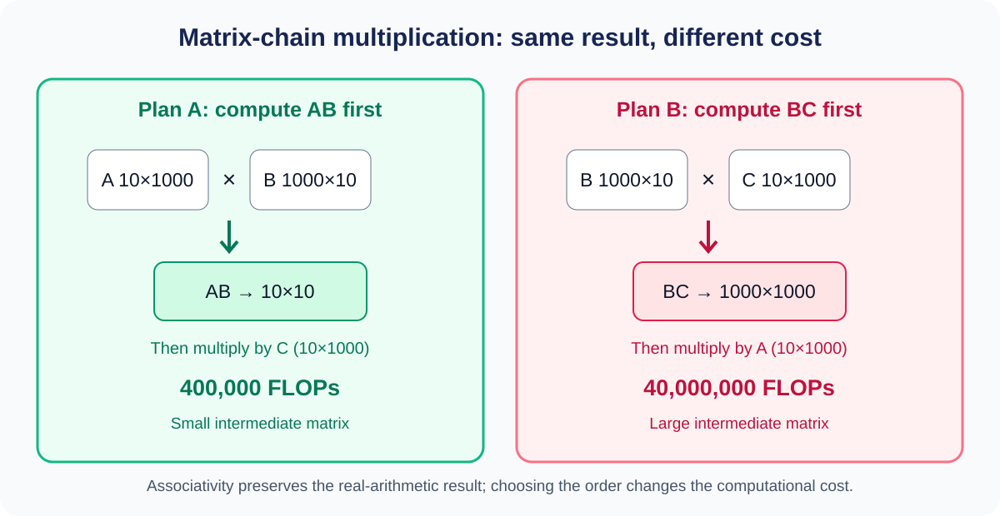

# 代数化简

**所属分类：** [01 算法与数学优化](README.md)  
**英文名称：** Algebraic Simplification  
**专题编号：** 01

## 01. 一句话定义与核心目的

**一句话定义：** 代数化简是利用数学恒等式、运算性质和表达式结构，改写计算表达式，使其在保持数学结果或满足规定数值误差的前提下，减少冗余运算或降低执行成本。

**核心目的：**

- **减少计算量：** 消除重复运算，选择成本更低的计算顺序，减少 FLOPs 或指令数量。
- **减少中间开销：** 避免不必要的中间表达式、临时矩阵或数据读写。
- **暴露可优化结构：** 将表达式转换为编译器、数值库或硬件更容易识别和优化的形式。
- **保持正确性：** 明确变换成立的数学条件；在浮点计算中，还要考虑舍入误差、溢出和数值稳定性。

代数化简不等于“表达式看起来更短”。真正的目标是让计算成本更低；表达式变短、运算次数减少和实际运行更快也不是完全等价的判断。

## 02. 数学原理与核心技术

### 2.1 可视化理解

*图：左右比较两种矩阵链乘法顺序。先算 AB 得到 10×10 中间矩阵，理论计算量为 0.4 MFLOPs；先算 BC 得到 1000×1000 中间矩阵，理论计算量为 40 MFLOPs。该图对应本文给出的矩阵维度与 FLOPs 估算。*

### 2.2 数学原理与核心技术

#### 2.2.1 常见数学依据

- **恒等变换：** 在定义域和前提条件成立时，用等价表达式替换原表达式。
- **结合律与计算顺序重组：** 对满足相应代数性质的运算，改变运算分组或执行顺序。
- **分配律与公共项提取：** 识别重复子表达式，将重复计算改写为一次计算加复用。
- **矩阵恒等式：** 利用矩阵乘法、转置、逆、迹等运算的性质，重组矩阵计算。
- **常量折叠与特殊值化简：** 在编译期计算已知常量，或利用 0、1、幂等元素等性质简化表达式。

#### 2.2.2 例子：矩阵链乘法的计算顺序

设：

$$
A\in\mathbb R^{10\times1000},\quad
B\in\mathbb R^{1000\times10},\quad
C\in\mathbb R^{10\times1000}
$$

目标是计算：

$$
Y=ABC
$$

矩阵乘法满足结合律：

$$
(AB)C=A(BC)
$$

但两种计算顺序的成本不同。按一次乘法和一次加法各计 1 FLOP，矩阵乘法 $(m\times n)(n\times p)$ 的计算量约为 $2mnp$。

**方案 A：先计算 AB**

$$
F_A=2(10)(1000)(10)+2(10)(10)(1000)
=400{,}000
$$

中间矩阵 $AB$ 的形状是 $10\times10$。

**方案 B：先计算 BC**

$$
F_B=2(1000)(10)(1000)+2(10)(1000)(1000)
=40{,}000{,}000
$$

中间矩阵 $BC$ 的形状是 $1000\times1000$。

因此：

$$
\frac{F_B}{F_A}=100
$$

在这个例子中，先计算 AB 的理论乘加运算量只有先计算 BC 的百分之一。两种顺序的实数数学结果相同，但计算量和中间矩阵规模明显不同。

**这个例子说明：** 代数优化不只是把公式写短；利用数学等价关系选择更合适的计算顺序，本身就可能显著降低计算成本。

#### 2.2.3 需要注意的边界

- 矩阵乘法的结合律允许改变括号，但不允许任意交换矩阵顺序；一般而言，$AB\ne BA$。
- 浮点运算不严格满足实数运算的结合律。改变计算顺序可能改变舍入误差。
- 运算次数减少不保证实际运行时间一定降低；数据布局、内存访问、并行度和硬件指令也会影响性能。
- 编译器的化简通常受整数溢出、浮点语义、异常行为和目标平台规则约束，不能只依据实数代数直觉进行替换。

## 03. 代表案例

| 项目 | 与本专题的关系 | 值得关注的内容 | 项目与资料 |
|---|---|---|---|
| LLVM InstCombine | **直接案例：** 编译器指令级代数化简与规范化 | 合并冗余指令、常量化简、代数模式匹配 | [GitHub](https://github.com/llvm/llvm-project) · [LLVM Pass 文档](https://llvm.org/docs/Passes.html) |
| XLA AlgebraicSimplifier | **直接案例：** 深度学习 HLO 计算中的代数化简 | 对 HLO 运算进行模式匹配和等价变换 | [GitHub](https://github.com/openxla/xla) · [源码入口](https://github.com/openxla/xla/blob/main/xla/hlo/transforms/simplifiers/algebraic_simplifier.h) |
| SymPy | **直接案例：** 符号表达式化简 | 恒等式、因式分解、约分和针对特定表达式的化简 | [GitHub](https://github.com/sympy/sympy) · [官方文档](https://docs.sympy.org/latest/modules/simplify/simplify.html) |
| Eigen | **关联案例：** 矩阵表达式求值优化 | Expression Templates、Lazy Evaluation、减少不必要的临时对象 | [官方项目](https://libeigen.gitlab.io/) · [GitHub 镜像](https://github.com/eigenteam/eigen-git-mirror) |
| ReWY | **关联案例：** 基于伴随关系的梯度计算重组 | 通过局部矩阵方程和共享伴随量减少特定反向计算中的矩阵乘法 | [GitHub](https://github.com/flashserve/ReWY) · [论文](https://arxiv.org/abs/2611.01940) |
| FFTW | **关联案例：** 利用 DFT 数学结构实现快速算法 | FFT 的因子分解、算法选择和高性能实现；更直接归属“快速算法 / FFT”专题 | [GitHub](https://github.com/FFTW/fftw3) · [官方网站](https://www.fftw.org/) |

#### 案例分类说明

这些项目并不是同一种技术的不同实现：

- **LLVM、XLA、SymPy** 最直接体现表达式或计算图中的代数化简。
- **Eigen** 重点体现矩阵表达式的延迟求值和临时对象优化，属于相关的表达式求值优化。
- **ReWY** 的核心是 Delta-Rule Attention 反向传播的数学重组与伴随计算，适合与“伴随方法”专题交叉阅读。
- **FFTW** 是快速傅里叶变换的工程实现，主要归入后续的 FFT 专题；在这里作为利用数学结构降低计算复杂度的关联案例。

---

**后续扩展：** 本专题当前先保留定义、目的、数学原理、核心技术和代表案例。工程实现、性能比较、实验方法及更深入的源码分析，等逐项学习并掌握验证方法后再补充。
