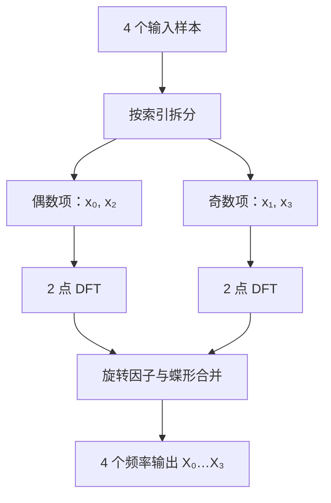

# 快速傅里叶变换（FFT）

**所属分类：** [01 算法与数学优化](README.md)  
**英文名称：** Fast Fourier Transform  
**专题编号：** 02

## 01. 一句话定义与核心目的

**一句话定义：** FFT 是一类利用离散傅里叶变换（DFT）的周期性、对称性和可分解结构，快速计算频域表示的算法。

**核心目的：** 将直接 DFT 的二次复杂度降低到典型的 $O(N\log N)$，使大规模频谱分析、卷积、信号处理和科学计算变得可行。FFT 是一类算法，而不是单一公式；具体复杂度和性能取决于长度分解、数据布局和实现。

## 02. 数学原理与核心技术

### 直观示意：Radix-2 Butterfly

下面用一个简化的 4 点 FFT 示意分治结构：输入被拆成偶数索引与奇数索引两组，分别做较短的 DFT，再通过旋转因子合并。图中是结构示意，不是完整的数值计算图。

读图重点：FFT 并没有改变 DFT 要计算的频域结果，而是把一次大规模求和改写为子变换与蝶形合并。

长度为 $N$ 的 DFT 定义为：

$$
X_k=\sum_{n=0}^{N-1}x_n e^{-i2\pi kn/N},\quad k=0,\ldots,N-1.
$$

直接计算每个频率分量需要约 $N^2$ 级别的运算。FFT 利用单位根的周期性与对称性，把长变换拆成较短的子变换。

以 Cooley–Tukey 分治为例，当 $N$ 可分解为若干因子时，将输入按索引拆成子序列，分别计算子 DFT，再通过旋转因子（twiddle factors）合并结果。对于适合递归分解的长度，运算规模降至 $O(N\log N)$。

核心技术：
- **Cooley–Tukey：** 按因子分解长度，递归组合子变换。
- **Radix-2 / Mixed-Radix：** 使用基 2 或混合基数分解。
- **Butterfly：** 在小规模子变换之间执行加减和旋转因子乘法。
- **Bit-Reversal / 数据重排：** 安排输入输出顺序以满足分阶段计算。
- **实数 FFT 与多维 FFT：** 利用共轭对称性或逐维变换减少成本。

FFT 的数学结果对应 DFT，但不同浮点执行顺序会带来舍入差异；任意长度也可能采用补零、混合基数或其他算法，不能简单假定所有长度都有完全相同的性能。

## 03. 代表案例

| 项目 | 采用的技术与价值 | 项目链接 |
|---|---|---|
| FFTW | 高性能 CPU FFT 库，包含计划（plan）机制、算法选择和面向硬件的实现 | [GitHub](https://github.com/FFTW/fftw3) · [官网](https://www.fftw.org/) |
| pocketfft | 轻量级多维 FFT 实现，被多个科学计算生态采用 | [GitHub](https://github.com/mreineck/pocketfft) |
| cuFFT | NVIDIA CUDA FFT 库，提供 GPU 上的一维、二维和多维变换 | [官方文档](https://docs.nvidia.com/cuda/cufft/) |
| oneMKL DFT | Intel oneAPI Math Kernel Library 中的离散傅里叶变换接口 | [官方文档](https://www.intel.com/content/www/us/en/docs/onemkl/developer-reference-c/2024-0/dft-functions.html) |

FFT 适合研究快速算法的数学结构与高性能实现；FFTW 适合研究 CPU 上的算法选择与计划机制，cuFFT 适合了解 GPU FFT 库的接口与设备执行。
