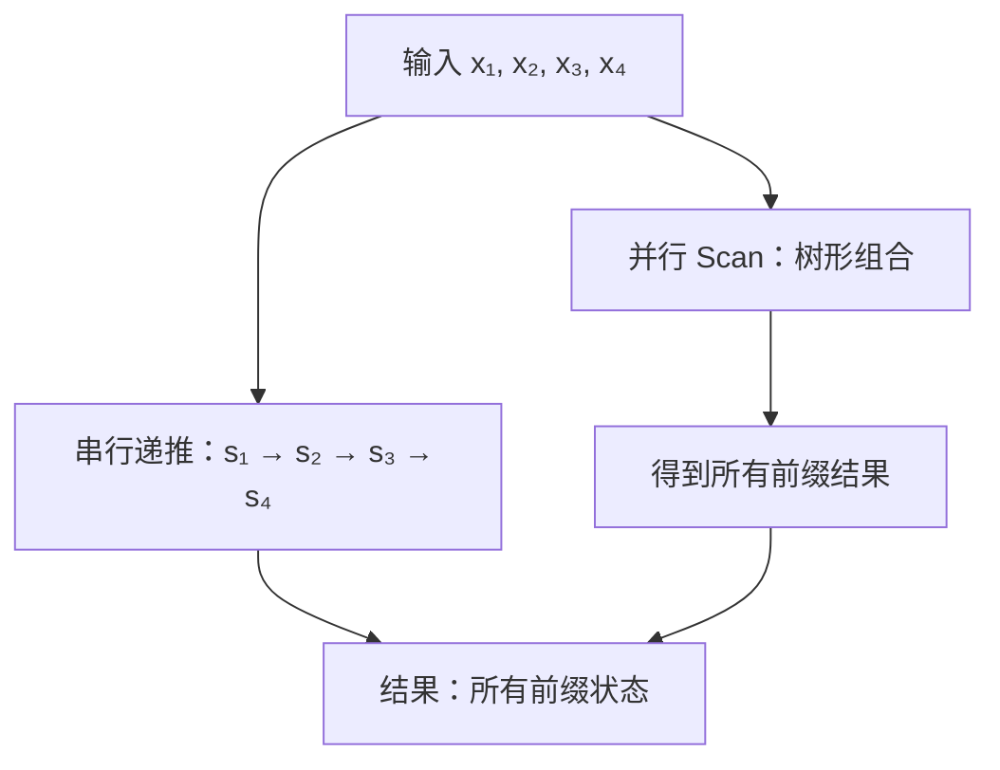

# 递归重构

**所属分类：** [01 算法与数学优化](README.md)  
**英文名称：** Recurrence Reformulation  
**专题编号：** 05

## 01. 一句话定义与核心目的

**一句话定义：** 递归重构是利用递推关系的数学结构，改变状态更新、计算分组或执行顺序，使原算法更容易并行化、分块计算或减少重复工作。

**核心目的：** 在保持递推语义的前提下，打破不必要的串行依赖，暴露可并行结构，或将逐步更新改写为 Scan、Prefix Sum、Chunkwise 等更适合现代硬件的形式。

## 02. 数学原理与核心技术

### 直观示意：串行递推与并行前缀扫描

并行 Scan 依赖可结合的运算结构。它改变的是计算组织和依赖深度，不是任意递归都能无条件转换为 Scan。

一般递推可以写成：

$
s_{t+1}=F(s_t,x_t).
$

如果更新具有可结合的二元运算结构：

$
s_t=x_1\oplus x_2\oplus\cdots\oplus x_t,
$

且 (oplus) 满足结合律，就可以使用并行前缀扫描（Parallel Scan）计算所有前缀结果。结合律允许改变括号分组，但不代表可以任意改变元素顺序。

核心技术：
- **Prefix Sum / Scan：** 并行计算所有前缀累积值。
- **Associative Operator：** 寻找满足结合律的状态组合运算。
- **Parallel Prefix Algorithm：** 通过树形阶段减少串行依赖深度。
- **Chunkwise Computation：** 将长序列分块，块内计算与块间状态传递相结合。
- **State-Space Parallelization：** 利用线性状态更新的结构，将递归过程转化为可组合的变换。
- **递推闭式或快速求解：** 对特定线性递推利用矩阵幂、分治等方法。

不是所有递归都能直接并行 Scan。若更新依赖前一状态且无法表示为可结合的变换组合，就需要寻找更一般的函数组合、分块或近似策略。浮点加法的非严格结合性也会影响数值结果。

## 03. 代表案例

| 项目 | 采用的技术与价值 | 项目链接 |
|---|---|---|
| NVIDIA CCCL / CUB | 提供高性能并行 Scan、Reduction 等 GPU 基础原语 | [GitHub](https://github.com/NVIDIA/cccl) |
| Thrust | 提供面向 GPU 的高级并行算法，包括 scan 与 transform | [GitHub](https://github.com/NVIDIA/cccl) |
| JAX lax.scan | 将循环状态更新表达为可变换的函数式计算原语 | [官方文档](https://docs.jax.dev/en/latest/_autosummary/jax.lax.scan.html) |
| Flash Linear Attention (FLA) | 多种线性注意力和状态空间序列算法的 chunkwise、recurrent 与 parallel 实现 | [GitHub](https://github.com/fla-org/flash-linear-attention) |

FLA 是研究递归状态更新如何在串行、分块和并行形式之间转换的直接学习入口。
