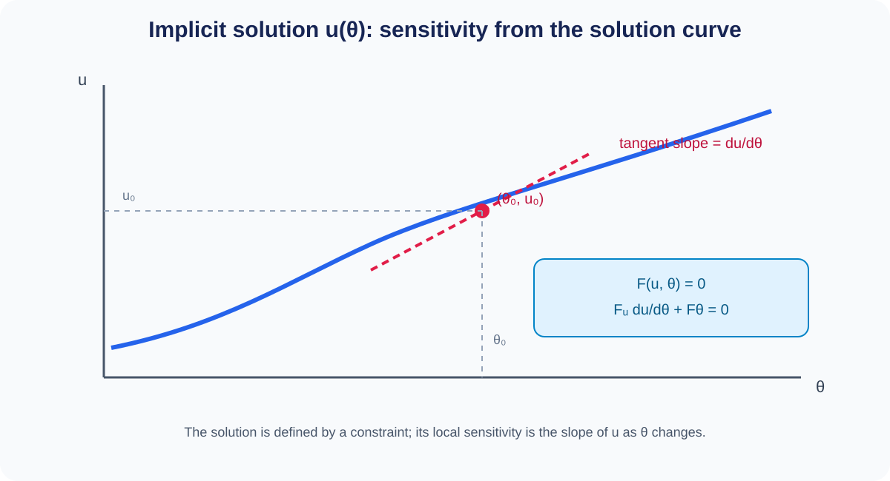

# 隐式微分

**所属分类：** [01 算法与数学优化](README.md)  
**英文名称：** Implicit Differentiation  
**专题编号：** 07

## 01. 一句话定义与核心目的

**一句话定义：** 隐式微分是对定义某个解的方程或约束关系直接求导，从而计算解对参数的导数，而不必展开求解过程中的每一步迭代。

**核心目的：** 当变量由优化问题、线性方程、平衡条件或迭代求解器隐式定义时，避免对所有求解迭代步骤完整展开自动微分，降低反向传播的存储或计算负担。

## 02. 数学原理与核心技术

### 2.1 可视化理解

*相关成熟资料：UNSW 隐函数定理课程讲义，详见[原始链接](https://web.maths.unsw.edu.au/~potapov/2111_course_notes/Implicit-function-theorem_002c-sketch-of-proof.html)。*

*图源：UNSW MATH2111 课程讲义。蓝色曲线表示约束 $g(x,y)=0$ 所定义的局部解关系；该图用于理解隐函数定理的局部解几何，不直接表示导数切线。参见[原始讲义](https://web.maths.unsw.edu.au/~potapov/2111_course_notes/Implicit-function-theorem_002c-sketch-of-proof.html)。*

*图：曲线表示隐式方程定义的解 u(θ) 随参数 θ 的变化；标记点处的切线斜率是局部敏感度 du/dθ。右下方给出隐函数微分关系。曲线为概念示意，不对应特定方程的数值解。*

### 2.2 数学原理与核心技术

设变量 (u) 由方程定义：

$$
F(u,\theta)=0.
$$

假设在所考虑的解附近，(F) 对 (u) 可微且 Jacobian (F_u) 可逆。对参数 (	heta) 求微分：

$$
F_u\frac{du}{d\theta}+F_\theta=0.
$$

因此：

$$
\boxed{\frac{du}{d\theta}=-F_u^{-1}F_\theta}
$$

这就是隐函数定理给出的基本关系。实际计算通常不显式形成逆矩阵，而是求解线性系统：

$$
F_u\frac{du}{d\theta}=-F_\theta.
$$

若最终目标是标量损失 (L(u(\theta),\theta))，可进一步结合伴随方法，避免显式构造完整 Jacobian。

核心技术：
- **Implicit Function Theorem：** 在局部可逆条件下建立解对参数的导数关系。
- **Linear Solve / Jacobian-Vector Product：** 通过线性求解或 Jacobian 向量积计算导数。
- **Implicit Layers：** 将优化解、平衡状态或固定点作为网络层输出。
- **Differentiable Optimization：** 对优化问题的最优解关于输入或参数求导。
- **Fixed-point Differentiation：** 对固定点方程直接求导，而不是展开全部迭代步骤。

适用条件必须检查：解是否局部唯一、Jacobian 是否可逆或可稳定求解、数值求解是否收敛。隐式梯度描述的是方程解的局部敏感度，不会自动修复不准确的前向解。

## 03. 代表案例

| 项目 | 采用的技术与价值 | 项目链接 |
|---|---|---|
| JAXopt | 可微优化器与隐式微分工具，支持对优化解求导 | [GitHub](https://github.com/google/jaxopt) |
| TorchOpt | 面向 PyTorch 的可微优化库，提供显式与隐式梯度相关工具 | [GitHub](https://github.com/metaopt/torchopt) |
| Theseus | 面向可微非线性优化的 PyTorch 库，关注优化问题与自动微分 | [GitHub](https://github.com/facebookresearch/theseus) |
| Deep Equilibrium Models | 将网络输出定义为隐式固定点，并使用隐式微分计算梯度 | [论文](https://arxiv.org/abs/1909.01377) |

建议把隐式微分与伴随方法联系起来学习：隐式微分说明如何对方程定义的解求导；伴随方法进一步组织梯度计算，特别适合输出少、参数多的场景。
