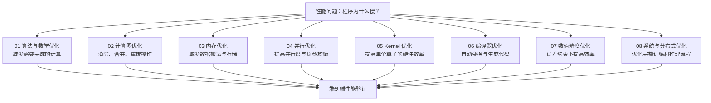

# 八类高性能计算与 AI 算子优化方法

> 这份文档是个人技术知识库的总览。目标不是罗列术语，而是建立一套分析性能问题的方法：先判断瓶颈在哪里，再选择对应层次的优化手段。
>
> **核心主线：** 数学算法 → 计算图 → 内存 → 并行 → Kernel → 编译器 → 数值精度 → 系统。

## 高性能计算优化地图（总览）

这张图先回答一个最重要的问题：**性能瓶颈可能来自哪里？应该在哪一层寻找优化？** 八类不是互斥的算法标签，而是从数学到系统的八个观察层次。

### 八类优化分别在问什么？

| 层次 | 核心问题 | 典型手段 | 代表案例 |
|---|---|---|---|
| 01 算法与数学 | 能否少算一些？ | 代数化简、快速算法、伴随方法、低秩、稀疏 | FFT、ReWY |
| 02 计算图 | 是否有重复或无用操作？ | Fusion、CSE、Dead Code、Recomputation | XLA、TorchInductor |
| 03 内存 | 是否搬运了太多数据？ | Tiling、Data Reuse、Coalescing、Layout | FlashAttention、PagedAttention |
| 04 并行 | 是否有计算单元空闲或负载不均？ | Data/Tensor/Pipeline/Expert Parallelism | Megatron-LM |
| 05 Kernel | 单个算子是否充分利用硬件？ | Warp、CTA、Tensor Core、Pipeline、Occupancy | CUTLASS、Triton、cuDNN |
| 06 编译器 | 能否自动找到更好的执行方案？ | IR、Lowering、Auto-Tuning、Codegen | MLIR、TVM、XLA |
| 07 数值精度 | 能否在误差可控下使用更高效的数值格式？ | Mixed Precision、Quantization、Error Compensation | Transformer Engine |
| 08 系统与分布式 | 完整工作流是否被调度、通信或缓存拖慢？ | CUDA Graph、NCCL、KV Cache、Continuous Batching | DeepSpeed、vLLM |

### 著名优化案例：值得重点研究的项目

下面这些项目在高性能计算和 AI Infra 中具有代表性。它们的价值不只是“速度快”，更在于展示了不同层次的优化思想。

#### 1. FFT：利用数学结构减少计算量

- **原始问题：** 直接计算 N 点离散傅里叶变换需要约 $O(N^2)$ 运算。
- **核心思想：** 利用周期性、对称性和分治结构，将大问题拆成可复用的小问题。
- **结果：** 经典 FFT 算法将复杂度降至 $O(N\log N)$。
- **主要分类：** 01 算法与数学优化。
- **研究启发：** 先检查问题是否有对称性、稀疏性、可分离性或递归结构，再决定如何实现。

#### 2. ReWY：通过伴随变量重组反向传播

- **原始问题：** Delta-Rule Attention 的局部 WY 反向传播包含冗余矩阵乘法和中间梯度计算。
- **核心思想：** 对局部线性矩阵关系做隐式微分，利用伴随变量共享梯度计算。
- **结果：** 论文报告局部 WY 矩阵乘法从 7 次减少到 3 次；实际加速还取决于 Kernel 和硬件。
- **主要分类：** 01 算法与数学优化；关联 02 计算图优化、05 Kernel 优化。
- **研究启发：** 不要只优化既有计算图，也要检查计算图本身是否能通过数学推导重写。

#### 3. FlashAttention：减少 Attention 的显存 IO

- **原始问题：** 标准 Attention 的中间注意力矩阵规模为 $N\times N$，完整物化会产生大量 HBM 读写。
- **核心思想：** 分块计算 Q/K/V，并使用在线 Softmax 累积结果，避免完整物化注意力矩阵。
- **结果：** 减少 HBM 数据搬运，同时保持标准 Attention 的精确数学结果。
- **主要分类：** 03 内存优化；关联 01 算法组织、05 Kernel 优化。
- **研究启发：** 计算量相同的算法，数据访问方式不同，性能也可能差异很大。

#### 4. CUTLASS：把矩阵乘法映射到 GPU 硬件

- **原始问题：** 通用矩阵乘法实现未必能充分利用特定 GPU 的 Tensor Core、共享内存和 Warp。
- **核心思想：** 通过分层 Tile、线程布局、流水线和模板化组件组织 GEMM。
- **结果：** 提供面向 NVIDIA GPU 的高性能矩阵计算构件。
- **主要分类：** 05 Kernel 优化。
- **研究启发：** 数学公式确定后，Tile 尺寸、数据布局、Warp 分工和流水策略仍然决定实际性能。

#### 5. Triton：用 DSL 编写并编译 GPU Kernel

- **原始问题：** 直接使用 CUDA 编写高性能 Kernel，需要显式处理较多线程和硬件细节。
- **核心思想：** 使用 Python 风格的 GPU DSL 表达块级并行计算，由编译器完成布局、调度和代码生成。
- **结果：** 降低自定义 GPU Kernel 的开发门槛，同时保留较强的性能调优能力。
- **主要分类：** 05 Kernel 优化；关联 06 编译器优化。
- **研究启发：** 学习 Kernel 不应只看 Python 代码，还要追踪编译后的布局、访存和指令行为。

#### 6. XLA / TorchInductor：自动优化计算图

- **原始问题：** Python 框架中的大量细粒度张量操作会产生中间张量和多次 Kernel Launch。
- **核心思想：** 捕获计算图，进行图变换、融合、布局选择和代码生成。
- **结果：** 在适用场景下减少中间开销，并生成更适合设备的执行代码。
- **主要分类：** 02 计算图优化、06 编译器优化。
- **研究启发：** 需要区分数学算法优化与编译器对已有计算图的自动优化。

#### 7. Megatron-LM：扩展到多 GPU 的模型并行

- **原始问题：** 单 GPU 的显存和计算能力不足以支持更大模型或更高训练吞吐。
- **核心思想：** 使用 Tensor Parallelism、Pipeline Parallelism 等方式切分模型计算。
- **结果：** 将训练工作分配到多个 GPU 协同完成。
- **主要分类：** 04 并行优化；关联 08 系统与分布式优化。
- **研究启发：** 并行切分会引入通信，必须联合分析计算、通信和流水线空闲。

#### 8. DeepSpeed ZeRO：切分训练状态以节省显存

- **原始问题：** 模型参数、梯度和优化器状态占用大量显存。
- **核心思想：** 在数据并行设备之间分片保存训练状态，按需通信和聚合。
- **结果：** 降低单个设备需要常驻的训练状态显存。
- **主要分类：** 08 系统与分布式优化；关联 03 内存优化、04 并行优化。
- **研究启发：** 系统级显存优化不一定减少总数据量，而是改变数据的存放和分配方式。

#### 9. vLLM / PagedAttention：管理推理阶段的 KV Cache

- **原始问题：** 自回归生成需要持续保存历史 Key/Value，传统连续内存分配容易产生碎片并限制批处理。
- **核心思想：** 将 KV Cache 分成固定大小的逻辑块，采用分页式管理，并支持请求动态调度。
- **结果：** 改善 KV Cache 的内存利用和在线推理批处理能力。
- **主要分类：** 08 系统与分布式优化；关联 03 内存优化。
- **研究启发：** 推理性能不仅取决于 Attention Kernel，还取决于请求调度和缓存管理。

### 案例对照：不同项目究竟改变了什么？

| 项目 | 首先改变的对象 | 不是简单地做什么 |
|---|---|---|
| FFT | 数学算法与分解方式 | 不是只调线程数 |
| ReWY | 梯度推导与反向计算关系 | 不是只调小 Tile |
| FlashAttention | 数据访问与分块计算组织 | 不是把精确 Attention 变成线性复杂度 |
| CUTLASS | Kernel 的线程、Tile 和硬件映射 | 不是提出新的 Attention 数学定义 |
| Triton | Kernel 表达与编译路径 | 不是一个现成的 Attention 算法 |
| XLA / TorchInductor | 计算图和编译生成过程 | 不是自动保证每个模型都更快 |
| Megatron-LM | 多设备计算切分和并行策略 | 不是单 GPU Kernel 优化 |
| DeepSpeed ZeRO | 分布式训练状态的存储与通信 | 不是简单压缩模型权重 |
| vLLM | KV Cache 分配和请求调度 | 不是只优化矩阵乘法 |

> **重要结论：** 高性能优化没有一个适用于所有场景的“万能技巧”。必须先定位瓶颈，再选择优化层次；最后通过正确性、数值误差和端到端基准测试验证收益。

## 八大专题深入学习入口

每个目录下包含分类索引和独立专题文档。当前先建立结构；具体内容将在后续逐篇讨论后完善。

| 分类 | 专题目录 |
|---|---|
| 01 算法与数学优化 | [进入专题](01_Algorithmic_Optimization/README.md) |
| 02 计算图优化 | [进入专题](02_Computation_Graph_Optimization/README.md) |
| 03 内存优化 | [进入专题](03_Memory_Optimization/README.md) |
| 04 并行优化 | [进入专题](04_Parallelism_Optimization/README.md) |
| 05 Kernel 优化 | [进入专题](05_Kernel_Optimization/README.md) |
| 06 编译器优化 | [进入专题](06_Compiler_Optimization/README.md) |
| 07 数值精度优化 | [进入专题](07_Numerical_Optimization/README.md) |
| 08 系统与分布式优化 | [进入专题](08_System_Optimization/README.md) |

## 如何使用这份分类

下面八类是观察和分析优化问题的八个视角，并不是彼此互斥的算法分类。同一个项目经常跨越多个层次。例如 FlashAttention 同时涉及算法重组、IO 优化和 GPU Kernel 设计；ReWY 的主要贡献在数学与梯度计算图层面，也包含面向硬件的 Kernel 实现。

分析一个项目时，建议依次问：

1. 它减少了需要完成的数学工作吗？
2. 它重组或消除了计算图中的操作吗？
3. 它减少了数据搬运、存储或分配吗？
4. 它提高了并行度或负载均衡吗？
5. 它改善了单个 Kernel 的硬件执行效率吗？
6. 它利用编译器自动完成了哪些优化？
7. 它如何处理精度、误差和数值稳定性？
8. 它对完整训练或推理系统有什么影响？

---

## 01. Algorithmic & Mathematical Optimization
### 算法与数学优化

**核心问题：能否从数学表达式或算法结构上，减少真正需要完成的计算？**

这一层通常最接近研究创新。它不只是把同样的运算执行得更快，而是寻找更低复杂度的算法、利用问题结构，或重新推导计算关系。

常见方法：

- **代数化简（Algebraic Simplification）：** 利用恒等式、矩阵结构或变量关系消去冗余项。
- **快速算法（Fast Algorithms）：** 利用对称性、分治或特殊结构降低渐近复杂度。
- **低秩近似（Low-rank Approximation）：** 用低秩结构近似高维矩阵或算子。
- **稀疏计算（Sparse Computation）：** 只计算非零或必要的元素。
- **递归重构（Recurrence Reformulation）：** 改变递归关系或计算顺序。
- **伴随方法（Adjoint Method）：** 通过伴随方程高效计算目标函数对大量变量的梯度。
- **隐式微分（Implicit Differentiation）：** 直接对定义解的方程求导，而不必展开完整求解过程。

经典案例：

| 案例 | 优化思想 | 主要收益 |
|---|---|---|
| FFT | 利用离散傅里叶变换的对称性与分治结构 | 从直接 DFT 的 $O(N^2)$ 降到 $O(N\log N)$ |
| ReWY | 对 Delta-Rule Attention 的局部 WY 关系重新求导，构造共享伴随量 | 减少局部反向计算中的矩阵乘法 |
| 低秩分解 | 用较小的因子矩阵表示近似矩阵 | 降低存储和矩阵运算成本 |
| 稀疏矩阵算法 | 利用矩阵稀疏结构 | 避免对大量零元素做无效运算 |

### ReWY 在这一类中的位置

ReWY 的主要数学思路是：将局部计算看作线性矩阵方程，再对方程进行微分，并引入伴随变量统一梯度表达。它属于**基于伴随方法/隐式微分思想的反向计算重组**。

需要准确区分：ReWY 不是提出了通用的新自动微分规则；它将已有的伴随与隐式微分思想用于 Delta-Rule Attention 的特定计算结构，并进一步做代数和 Kernel 优化。

进一步阅读：
- [ReWY 仓库](https://github.com/flashserve/ReWY)
- [FFT 介绍 — Wikipedia](https://en.wikipedia.org/wiki/Fast_Fourier_transform)

---

## 02. Computation Graph Optimization
### 计算图优化

**核心问题：计算图中是否存在重复、无用或可以合并的操作？**

深度学习框架会把张量操作组织成计算图。优化器可以分析图中的依赖关系，删除无用节点、复用重复结果、融合操作或调整执行顺序。

常见方法：

- **算子融合（Operator Fusion）：** 将多个操作合并，减少 Kernel Launch 和中间张量读写。
- **公共子表达式消除（Common Subexpression Elimination, CSE）：** 对相同表达式复用计算结果。
- **死代码消除（Dead Code Elimination）：** 删除不会影响最终输出的计算。
- **重计算（Recomputation / Activation Checkpointing）：** 不保存部分中间结果，在反向传播时重新计算，以时间换显存。
- **计算重排（Graph / Operation Reordering）：** 在不破坏依赖关系的前提下改变执行顺序。
- **循环融合（Loop Fusion）：** 将访问相同数据的循环合并，减少循环和内存开销。

经典案例：

| 案例 | 优化思想 | 主要收益 |
|---|---|---|
| XLA | 图级分析、融合、布局和代码生成 | 减少中间操作与执行开销 |
| PyTorch TorchInductor | 对捕获的计算图做融合、调度并生成后端代码 | 自动生成优化后的 CPU/GPU 执行 |
| Activation Checkpointing | 选择性保存或重算激活值 | 降低训练显存占用 |
| ReWY | 重新组织特定反向计算关系，消除不必要的中间梯度计算 | 减少局部反向计算量 |

### 与 Kernel Fusion 的区别

计算图融合是较高层的图变换；Kernel Fusion 是底层实现层面把多个操作放进同一个设备 Kernel。两者相关，但不是完全相同的概念。

进一步阅读：
- [XLA](https://openxla.org/xla)
- [PyTorch torch.compile](https://pytorch.org/docs/stable/torch.compiler.html)

---

## 03. Memory Optimization
### 内存与数据搬运优化

**核心问题：程序是否花费了过多时间搬运数据，而不是执行算术运算？**

在现代 GPU 上，计算单元速度很高，但显存带宽和访问延迟仍可能成为瓶颈。许多高性能算法的关键不是减少 FLOPs，而是减少昂贵的数据读写，并提高数据复用率。

常见方法：

- **分块（Tiling / Blocking）：** 将大问题拆成适合缓存、寄存器或共享内存的小块。
- **数据复用（Data Reuse）：** 让一次加载的数据参与多次计算。
- **合并访存（Memory Coalescing）：** 让 Warp 内线程访问尽可能连续、对齐的地址。
- **内存布局优化（Memory Layout）：** 调整张量维度、步长和数据排列，使访问更适合硬件。
- **共享内存暂存（Shared Memory Staging）：** 将重复使用的数据搬入片上共享内存。
- **原地计算（In-place Operation）：** 在语义允许时减少额外张量分配。
- **减少中间结果写回：** 尽可能避免将可短暂保留的中间数据写入 HBM。

经典案例：

| 案例 | 优化思想 | 主要收益 |
|---|---|---|
| FlashAttention | 分块计算 Q/K/V，使用在线 Softmax，避免物化完整注意力矩阵 | 大幅减少 HBM 读写；保持标准 Attention 的精确数学结果 |
| GEMM Tiling | 分块加载矩阵并重复利用数据 | 提高数据复用率 |
| PagedAttention | 以分页块管理 KV Cache | 降低 KV Cache 管理中的内存碎片和分配限制 |

### FlashAttention 为什么重要？

标准 Attention 会涉及 $N\times N$ 的注意力分数矩阵。若将其完整写入和读取 HBM，数据搬运成本可能很高。FlashAttention 使用分块和在线 Softmax，在不改变标准 Attention 数学结果的前提下，减少 HBM IO。

它不是简单地把 $O(N^2)$ 的精确 Attention 算术复杂度变成线性复杂度；它的关键贡献是 IO-aware 的计算组织。

进一步阅读：
- [FlashAttention](https://github.com/Dao-AILab/flash-attention)
- [FlashAttention-2](https://arxiv.org/abs/2307.08691)

---

## 04. Parallelism Optimization
### 并行计算优化

**核心问题：如何让多个计算单元同时工作，并尽量避免等待和负载不均？**

并行优化既发生在单个 GPU 内部，也发生在多 GPU、多节点之间。

常见方法：

- **数据并行（Data Parallelism）：** 不同设备处理不同样本或数据分片。
- **张量并行（Tensor Parallelism）：** 将矩阵或张量计算拆分到多个设备。
- **流水线并行（Pipeline Parallelism）：** 将模型不同层放在不同设备，分阶段执行。
- **序列并行（Sequence Parallelism）：** 沿序列维度拆分计算或激活。
- **专家并行（Expert Parallelism）：** 将 MoE 专家分布到不同设备。
- **负载均衡（Load Balancing）：** 尽量避免部分设备过载、其他设备空闲。
- **通信与计算重叠（Communication-Compute Overlap）：** 在依赖允许时，让通信与计算并行进行。

经典案例：

| 案例 | 优化思想 | 主要收益 |
|---|---|---|
| Megatron-LM | Tensor Parallelism、Pipeline Parallelism 等 | 支持大规模 Transformer 训练 |
| DeepSpeed | 数据、模型和流水线并行等训练策略 | 扩展训练规模 |
| MoE Expert Parallelism | 将专家分配到不同设备 | 扩展模型容量与计算资源 |

进一步阅读：
- [Megatron-LM](https://github.com/NVIDIA/Megatron-LM)
- [DeepSpeed](https://github.com/deepspeedai/DeepSpeed)

---

## 05. Kernel Optimization
### GPU 算子内核优化

**核心问题：在数学计算已经确定的情况下，如何让 GPU 更高效地执行这些操作？**

Kernel 是实际在设备上执行的函数。相同的矩阵乘法或归约，可以因为线程映射、Tile 尺寸、数据布局、指令调度不同而产生很大的性能差异。

常见方法：

- **Tiling：** 将计算划分为 CTA/Block 负责的子块。
- **Warp-level Optimization：** 利用 Warp 内协作、Shuffle 和归约指令。
- **Tensor Core Utilization：** 让矩阵乘法映射到专用矩阵计算单元。
- **Pipeline：** 重叠数据加载与计算。
- **Warp Specialization：** 让不同 Warp 承担不同角色，例如加载和计算。
- **Kernel Fusion：** 在一个 Kernel 内完成多个相关操作。
- **Occupancy Optimization：** 平衡寄存器、共享内存和并行 Block 数量。
- **Launch Overhead Reduction：** 减少 Kernel 启动次数及其 CPU 开销。

经典案例：

| 案例 | 优化思想 | 主要收益 |
|---|---|---|
| CUTLASS | 模板化 GEMM 与 Tensor Core Kernel 设计 | 提供可组合、高性能矩阵计算实现 |
| Triton | 用高级 DSL 表达 GPU Kernel，由编译器完成底层映射 | 降低编写和调优 Kernel 的门槛 |
| cuDNN | 针对卷积、归一化等深度学习算子提供多种实现与算法选择 | 利用硬件特性提升算子性能 |
| ReWY | 将数学上重组的反向计算落到 GPU/NPU Kernel | 将算法层收益转化为设备执行收益 |

进一步阅读：
- [NVIDIA CUTLASS](https://github.com/NVIDIA/cutlass)
- [Triton](https://github.com/triton-lang/triton)
- [NVIDIA cuDNN](https://developer.nvidia.com/cudnn)

---

## 06. Compiler Optimization
### 编译器优化

**核心问题：能否让编译器分析程序，并自动生成更适合目标硬件的执行代码？**

编译器通常会经过多个中间表示（Intermediate Representation, IR）和优化阶段，将高层计算表达转换为目标设备的指令。

常见方法：

- **常量传播（Constant Propagation）：** 在编译期计算已知常量。
- **循环展开（Loop Unrolling）：** 减少循环控制开销并暴露并行机会。
- **算子融合（Fusion）：** 自动合并可融合的计算。
- **布局变换（Layout Transformation）：** 调整数据组织方式。
- **自动调优（Auto-Tuning）：** 测试不同 Tile、Warp 数量和调度参数。
- **代码生成（Code Generation）：** 针对目标硬件生成执行代码。
- **多层 IR（Multi-level IR）：** 在不同抽象层次表达和优化计算。

经典案例：

| 案例 | 主要作用 |
|---|---|
| MLIR | 提供多层中间表示基础设施，支持不同抽象层之间的逐步降低 |
| Apache TVM | 面向机器学习工作负载的编译与自动调度框架 |
| XLA | 优化机器学习计算图并生成设备执行代码 |
| TorchInductor | PyTorch 编译执行后端，可生成 Triton 等代码 |

进一步阅读：
- [MLIR](https://mlir.llvm.org/)
- [Apache TVM](https://github.com/apache/tvm)
- [OpenXLA](https://openxla.org/)

---

## 07. Numerical Precision Optimization
### 数值精度优化

**核心问题：在满足误差和稳定性要求的前提下，能否使用更低成本的数值表示和计算方式？**

浮点计算并非精确实数运算。数据类型、累积顺序和舍入误差都会影响最终结果。低精度通常能提高吞吐量并减少显存占用，但必须验证数值误差和训练稳定性。

常见方法：

- **混合精度（Mixed Precision）：** 低精度存储或乘法，关键累积使用较高精度。
- **量化（Quantization）：** 将权重、激活或 KV Cache 表示为低比特数据。
- **误差补偿（Error Compensation）：** 对低精度运算产生的误差进行修正。
- **迭代改进（Iterative Refinement）：** 用低成本近似求解，再通过残差修正结果。
- **数值稳定性设计：** 避免溢出、下溢、灾难性消减和不稳定累积。
- **精度感知调度：** 根据不同计算阶段选择合适的数据类型。

经典案例：

| 案例 | 优化思想 | 主要收益 |
|---|---|---|
| BF16/FP16 混合精度训练 | 低精度张量运算与适当的高精度累积配合 | 提高训练吞吐、降低显存占用 |
| NVIDIA Transformer Engine | 为 Transformer 训练提供 FP8 等低精度计算支持及精度管理机制 | 提升支持硬件上的训练效率 |
| INT8/INT4 推理量化 | 以低比特表示权重或激活 | 降低模型存储与推理成本 |

### 需要特别注意

不能把“精度降低后速度更快”直接称为算法优化。必须同时报告数值误差、任务质量或训练收敛情况，并明确累积精度与计时范围。

进一步阅读：
- [NVIDIA Transformer Engine](https://github.com/NVIDIA/TransformerEngine)

---

## 08. System & Distributed Optimization
### 系统与分布式优化

**核心问题：单个算子已经很快，为什么完整训练或推理系统仍然慢？**

完整系统还受到数据加载、CPU 调度、Kernel Launch、通信、显存管理和请求调度等因素影响。

常见方法：

- **CUDA Graph：** 捕获并重放一组 GPU 操作，降低重复提交开销。
- **集合通信（Collective Communication）：** 使用 AllReduce、AllGather、ReduceScatter 等操作交换分布式数据。
- **通信计算重叠：** 减少设备等待通信的时间。
- **KV Cache 管理：** 控制自回归推理中历史 Key/Value 的存储和访问。
- **Continuous Batching：** 动态加入和移除推理请求，提高批处理效率。
- **分页内存管理：** 将大块缓存拆分管理，改善分配与复用。
- **流水线调度：** 减少多阶段执行中的空闲时间。

经典案例：

| 案例 | 优化思想 | 主要收益 |
|---|---|---|
| NCCL | 高性能 GPU 集合通信 | 提高多 GPU 通信效率 |
| CUDA Graph | 捕获和重放 GPU 工作流 | 降低重复 Kernel Launch 的提交开销 |
| DeepSpeed ZeRO | 分片保存优化器状态、梯度和参数 | 降低单设备训练显存需求 |
| vLLM / PagedAttention | 分页管理 KV Cache，并配合连续批处理 | 提高 LLM 推理的显存利用率和服务吞吐 |

进一步阅读：
- [NCCL](https://github.com/NVIDIA/nccl)
- [DeepSpeed](https://github.com/deepspeedai/DeepSpeed)
- [vLLM](https://github.com/vllm-project/vllm)

---

## 九、经典项目的交叉分类

一个项目通常横跨多个优化层次。下表给出主要切入点，而不是排他分类。

| 项目 | 主要优化层次 | 关键思想 |
|---|---|---|
| FFT | 算法与数学 | 分治与对称性 |
| ReWY | 算法与数学、计算图、Kernel | 伴随变量、梯度重组、Kernel 实现 |
| FlashAttention | 算法与数学、内存、Kernel | 在线 Softmax、IO-aware、分块 |
| XLA | 计算图、编译器 | 图优化与代码生成 |
| TorchInductor | 计算图、编译器、Kernel | 图捕获、融合、代码生成 |
| CUTLASS | Kernel | GEMM、Tile、Tensor Core |
| Triton | Kernel、编译器 | GPU DSL 与编译优化 |
| Megatron-LM | 并行、系统 | 张量并行、流水线并行 |
| DeepSpeed ZeRO | 系统、并行、内存 | 分布式状态切分 |
| vLLM | 系统、内存、调度 | PagedAttention、Continuous Batching |

## 十、分析一个新项目的通用模板

以后研究 FLA、HiLS、ReWY、FlashAttention 或其他项目，都可以用以下模板：

### 1. 原始问题
- 原来的算法是什么？
- 原始实现的性能瓶颈是什么？
- 瓶颈来自 FLOPs、显存 IO、并行度还是系统调度？

### 2. 优化思想
- 属于哪几个优化层次？
- 它改变了数学表达式、计算图还是硬件调度？
- 关键创新是什么？

### 3. 数学与算法
- 原始公式是什么？
- 新公式是什么？
- 两者为什么等价？
- 是否引入近似或精度损失？

### 4. 工程实现
- 使用什么框架和编程语言？
- 对应哪些 Kernel？
- 如何进行数据布局、分块和调度？
- 是否支持多种硬件？

### 5. 实验验证
- 正确性如何验证？
- 与什么基线比较？
- 硬件、输入规模、精度和计时边界是什么？
- 算子级收益能否传递到完整模型？

### 6. 我们的理解与研究问题
- 这个方法的适用边界是什么？
- 哪些计算结构可以推广？
- 是否存在尚未解决的瓶颈？
- 可以提出什么假设，设计什么实验？

---

## 十一、参考资料与说明

本文是学习路线和技术分类的入门总览。具体项目的算法定义、兼容范围和实验数字，应以其论文、官方文档和源码为准。

建议优先阅读：

1. [ReWY GitHub](https://github.com/flashserve/ReWY)
2. [FlashAttention GitHub](https://github.com/Dao-AILab/flash-attention)
3. [Triton GitHub](https://github.com/triton-lang/triton)
4. [CUTLASS GitHub](https://github.com/NVIDIA/cutlass)
5. [OpenXLA](https://openxla.org/xla)
6. [MLIR](https://mlir.llvm.org/)
7. [Megatron-LM](https://github.com/NVIDIA/Megatron-LM)
8. [DeepSpeed](https://github.com/deepspeedai/DeepSpeed)
9. [vLLM](https://github.com/vllm-project/vllm)

**维护原则：** 随着学习和实验推进，持续修订分类、补充案例、记录个人理解。不要把项目宣传中的性能数字直接当作可横向比较的结论。

## 二级专题写作与可视化规范

所有二级专题固定采用三个一级章节：**一句话定义与核心目的、数学原理与核心技术、代表案例**。数学公式统一使用 GitHub 支持的 `$...$` 和 `$$...$$`；配图必须与知识点匹配，优先使用波形/频谱、矩阵热图、奇异值谱、存储结构、GPU 架构或执行时间线等真实可视化。Mermaid 仅用于流程和依赖关系，不作为所有专题的通用配图。工程实现和性能比较暂时留待后续补充。详见 [专题写作与可视化规范](DOCUMENTATION_STANDARD.md)。
