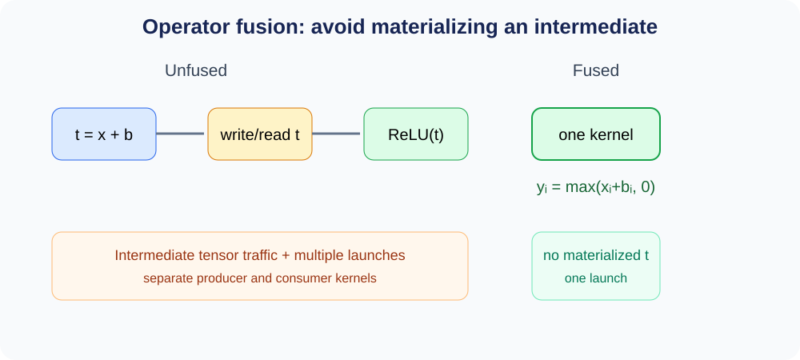

# 算子融合

**所属分类：** [02 计算图优化](README.md)  
**英文名称：** Operator Fusion  
**专题编号：** 02

## 01. 一句话定义与核心目的

**一句话定义：** 算子融合是把计算图中多个相邻且满足依赖与语义条件的操作组合成一个更大的执行单元，常见结果是生成一个融合 Kernel。

**核心目的：** 减少 Kernel Launch 次数、中间张量写回与重新读取，以及多个独立算子带来的调度开销。融合通常不改变数学计算本身，而是改变这些计算在设备上的执行组织。

## 02. 数学原理与核心技术

### 2.1 可视化理解

*相关成熟资料：TorchInductor reduction kernel 融合案例，详见[原始链接](https://karthick.ai/blog/2025/Learn-By-Doing-Torchinductor-Reduction/)。*

*图源：TorchInductor reduction kernel 技术文章。展示多个 reduction / pointwise 操作融合前后的 IR 结构。参见[原始文章](https://karthick.ai/blog/2025/Learn-By-Doing-Torchinductor-Reduction/)。*

*图：未融合路径将中间张量 t 写出后再读取；融合路径在一个 Kernel 中完成逐元素加法和 ReLU，减少中间张量流量与启动开销。*

### 2.2 数学原理与核心技术

考虑：

$$
y=\operatorname{ReLU}(x+b)
$$

未融合时可能先计算并写出 $t=x+b$，再读取 $t$ 计算 $y=\max(t,0)$。融合后，一个 Kernel 可以直接逐元素执行：

$$
y_i=\max(x_i+b_i,0).
$$

中间张量 $t$ 不必写入全局显存再读回。数学运算仍然是加法和 ReLU，变化的是数据流与执行边界。

**核心技术：**
- **Elementwise Fusion：** 融合加法、乘法、激活等逐元素操作。
- **Producer–Consumer Fusion：** 将生产中间张量的操作与消费该张量的操作合并。
- **Reduction Fusion：** 在满足归约语义与资源约束时，把归约和后续计算结合。
- **GEMM Epilogue Fusion：** 将偏置、缩放或激活等后处理并入矩阵计算输出阶段。
- **Compiler Fusion：** 编译器根据图依赖、形状、布局和成本模型自动决定融合区域。

融合并非越多越好。过度融合可能增加寄存器压力、降低 Occupancy、限制并行度或产生过大的 Kernel。因此需要考虑张量形状、硬件资源和整体执行时间。

## 03. 代表案例

| 项目 | 与本专题的关系 | 值得关注的内容 | 项目与资料 |
|---|---|---|---|
| TorchInductor | **直接案例：** PyTorch 编译后端进行图级融合并生成设备代码 | FX 图、融合分区、Triton 代码生成 | [GitHub](https://github.com/pytorch/pytorch) · [torch.compile 文档](https://docs.pytorch.org/docs/stable/torch.compiler.html) |
| OpenXLA XLA | **直接案例：** HLO 图优化和面向设备的融合 | HLO Fusion、后端融合策略 | [GitHub](https://github.com/openxla/xla) · [HLO Passes](https://openxla.org/xla/hlo_passes) |
| NVIDIA TensorRT | **直接案例：** 推理图优化与层/算子融合 | Layer Fusion、引擎构建和执行计划 | [GitHub](https://github.com/NVIDIA/TensorRT) · [开发者文档](https://docs.nvidia.com/deeplearning/tensorrt/) |
| Triton | **关联案例：** 允许开发者在一个 Kernel 中表达多个连续计算 | 自定义 fused Kernel、块级数据流 | [GitHub](https://github.com/triton-lang/triton) · [教程](https://triton-lang.org/main/getting-started/tutorials/) |

TorchInductor 与 XLA 适合研究编译器如何自动融合；Triton 适合研究手工设计融合 Kernel 时的数据复用与资源权衡。
