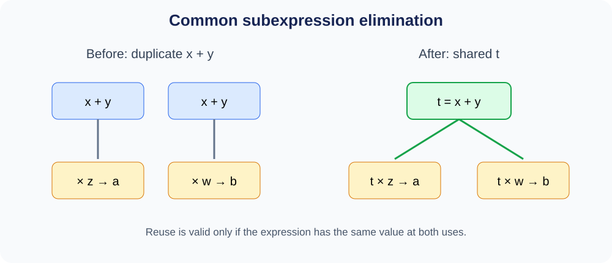

# 公共子表达式消除（CSE）

**所属分类：** [02 计算图优化](README.md)  
**英文名称：** Common Subexpression Elimination  
**专题编号：** 03

## 01. 一句话定义与核心目的

**一句话定义：** 公共子表达式消除（CSE）是在计算图或程序中识别重复且可复用的表达式，让它只计算一次，并让多个使用位置共享同一个结果。

**核心目的：** 避免重复计算，减少指令数量和中间结果生成；在适当情况下也能减少内存流量。CSE 的前提是重复表达式在相关执行位置具有相同语义，而且操作没有会影响程序行为的副作用。

## 02. 数学原理与核心技术

### 2.1 可视化理解

*图：两处重复使用 x+y。CSE 将公共表达式计算一次并共享结果；前提是输入值未被改变且运算没有影响语义的副作用。*

### 2.2 数学原理与核心技术

考虑：

$$
a=(x+y)z,\qquad b=(x+y)w.
$$

定义公共子表达式：

$$
t=x+y,
$$

则：

$$
a=tz,\qquad b=tw.
$$

这样 $x+y$ 只计算一次。

**核心技术：**
- **Value Numbering：** 为等价表达式识别统一的值编号。
- **Local CSE：** 在一个基本块或局部区域内消除重复表达式。
- **Global CSE：** 跨基本块或更大范围分析表达式可用性。
- **Dominance：** 确保共享结果的定义支配其使用位置。
- **Memory / Alias Analysis：** 判断读写内存是否可能改变表达式依赖的数据。

CSE 不只是“看见相同文本就合并”。两次读取之间若相关内存可能被修改，或运算依赖随机数、时钟和外部状态，就不能简单复用。共享长生命周期中间值也可能增加寄存器压力或内存占用。

## 03. 代表案例

| 项目 | 与本专题的关系 | 值得关注的内容 | 项目与资料 |
|---|---|---|---|
| LLVM | **直接案例：** 编译器通过 GVN 等 Pass 识别等价值并消除冗余计算 | GVN、MemorySSA、指令等价性 | [GitHub](https://github.com/llvm/llvm-project) · [LLVM Passes](https://llvm.org/docs/Passes.html) |
| MLIR | **直接案例：** 提供公共子表达式消除等通用 IR 变换基础设施 | CSE Pass、Dialect 与可折叠操作 | [GitHub](https://github.com/llvm/llvm-project) · [MLIR 文档](https://mlir.llvm.org/) |
| OpenXLA XLA | **关联案例：** HLO 优化流程包含公共表达式与图级简化相关变换 | HLO 图、优化 Pass 和数据依赖 | [GitHub](https://github.com/openxla/xla) · [HLO Passes](https://openxla.org/xla/hlo_passes) |

LLVM 和 MLIR 适合从编译器角度理解 CSE 的正确性条件；XLA 适合观察类似思想如何作用于机器学习计算图。
