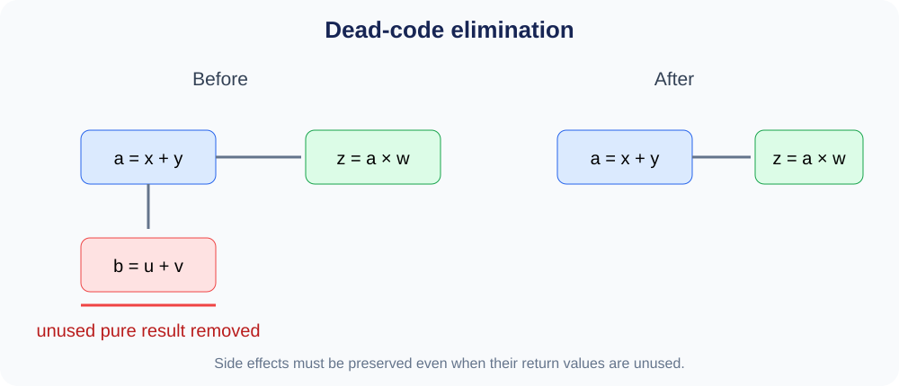

# 死代码消除

**所属分类：** [02 计算图优化](README.md)  
**英文名称：** Dead Code Elimination（DCE）  
**专题编号：** 04

## 01. 一句话定义与核心目的

**一句话定义：** 死代码消除是删除那些计算结果不会影响程序输出、状态或其他可观察行为的操作和节点。

**核心目的：** 避免执行对最终结果没有贡献的计算，减少指令、Kernel、内存和调度开销。判断“无用”必须考虑副作用：写内存、I/O、同步、随机数状态或异常行为等操作，即使其返回值未被使用，也不一定能删除。

## 02. 数学原理与核心技术

### 2.1 可视化理解

*图：b=u+v 的结果没有被最终输出使用，且没有副作用，因此可删除；a 与 z 的依赖路径仍需保留。*

### 2.2 数学原理与核心技术

考虑：

$$
a=x+y,\qquad b=u+v,\qquad z=aw.
$$

若程序最终只输出 $z$，且 $b$ 没有副作用，也没有被其他可观察操作使用，那么 $b=u+v$ 对最终输出没有贡献，可以删除。

DCE 的关键是从可观察输出反向追踪依赖，保留所有影响输出或副作用的节点。

**核心技术：**
- **Liveness Analysis：** 分析变量或计算结果在后续是否仍然会被使用。
- **Use-Def Chain：** 追踪一个值在哪里定义、在哪里使用。
- **Reachability / Backward Slicing：** 从输出和副作用节点反向遍历，确定必须保留的计算。
- **Dead Store Elimination：** 删除写入后在被读取前又被覆盖、因而不可观察的存储操作。
- **Aggressive DCE：** 在更广范围分析依赖，删除不再影响程序行为的指令或子图。

常量折叠可能使某条分支变得不可达，DCE 随后删除该分支中的无用节点。CSE 合并重复计算，DCE 删除不再需要的结果，两者经常协同工作。

## 03. 代表案例

| 项目 | 与本专题的关系 | 值得关注的内容 | 项目与资料 |
|---|---|---|---|
| LLVM | **直接案例：** 提供 Dead Code Elimination、ADCE 等优化 Pass | DCE、ADCE、Dead Store Elimination | [GitHub](https://github.com/llvm/llvm-project) · [LLVM Passes](https://llvm.org/docs/Passes.html) |
| OpenXLA XLA | **直接案例：** HLO DCE 删除结果未被使用的操作 | HLO 图中的输出依赖和未使用节点 | [GitHub](https://github.com/openxla/xla) · [HLO Passes](https://openxla.org/xla/hlo_passes) |
| MLIR | **直接案例：** 在 IR 层通过通用与 Dialect 特定的变换清理无用操作 | Operation use-def、canonicalization、DCE 相关 Pass | [GitHub](https://github.com/llvm/llvm-project) · [MLIR 文档](https://mlir.llvm.org/) |

研究 DCE 时，最重要的是理解“可观察行为”的边界，而不只是从图上删除没有连到最终输出的节点。
