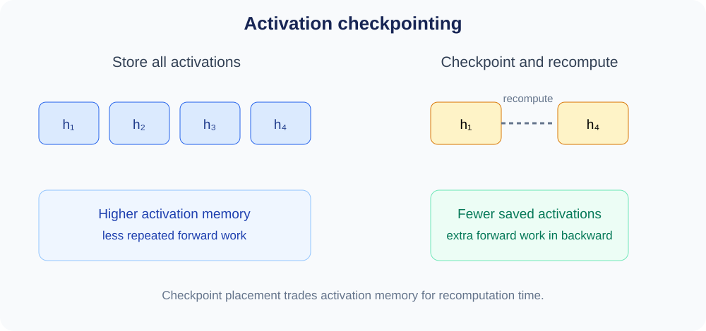

# 重计算

**所属分类：** [02 计算图优化](README.md)  
**英文名称：** Recomputation / Rematerialization  
**专题编号：** 05

## 01. 一句话定义与核心目的

**一句话定义：** 重计算是在某些中间结果不再保存、需要时再重新执行生成它的计算，以减少中间数据的存储和生命周期。

**核心目的：** 用额外计算换取更低的峰值内存占用，尤其用于深度学习训练中减少需要为反向传播长期保存的激活值。它也称为 Rematerialization；Activation Checkpointing 是训练中常见的实现策略之一。

## 02. 数学原理与核心技术

### 2.1 可视化理解

*相关成熟资料：PyTorch 官方 Activation Checkpointing 技术文章，详见[原始链接](https://pytorch.org/blog/activation-checkpointing-techniques/)。*

*图源：PyTorch 官方博客《Current and New Activation Checkpointing Techniques in PyTorch》。展示 activation checkpoint 区域如何减少保存的中间张量，并在反向阶段重新计算。参见[官方原文](https://pytorch.org/blog/activation-checkpointing-techniques/)。*

### 2.2 数学原理与核心技术

设网络由若干层组成：

$$
h_{l+1}=f_l(h_l;\theta_l).
$$

普通反向传播通常需要保存部分前向激活 $h_l$，以便计算梯度。若保存所有激活，内存需求可能随网络深度、批量和序列长度增长。

Checkpointing 可以只保存部分检查点。反向传播到某个区间时，从最近的检查点重新执行前向计算，重建区间内需要的激活，再计算梯度。

**核心技术：**
- **Activation Checkpointing：** 只保存选定层或区间的激活，反向时重新运行对应前向片段。
- **Selective Checkpointing：** 根据操作成本、内存大小或策略选择哪些中间值保存、哪些重算。
- **Rematerialization：** 编译器或运行时分析值的生命周期，决定重新计算比保存更合适的节点。
- **Checkpoint Scheduling：** 决定检查点位置与重算区间，在峰值内存和额外计算之间折中。
- **Recompute vs. Store：** 对每个中间结果比较存储成本、重算成本和依赖关系。

重计算要求重新执行的计算在语义上可安全复现。随机数、Dropout、状态更新和外部副作用需要正确处理；重算也会增加计算时间，甚至可能因额外 Kernel Launch 或通信而降低吞吐。

## 03. 代表案例

| 项目 | 与本专题的关系 | 值得关注的内容 | 项目与资料 |
|---|---|---|---|
| PyTorch Activation Checkpointing | **直接案例：** 前向不保留指定区域的全部中间激活，反向时重跑该区域 | `torch.utils.checkpoint`、非重入实现、选择性 checkpoint | [GitHub 源码](https://github.com/pytorch/pytorch/blob/main/torch/utils/checkpoint.py) · [官方文档](https://docs.pytorch.org/docs/stable/checkpoint.html) |
| OpenXLA HLO Rematerialization | **直接案例：** 编译器在 HLO 图中选择性重算表达式以降低内存压力 | HloRematerialization、值生命周期与内存规划 | [GitHub](https://github.com/openxla/xla) · [HLO Passes](https://openxla.org/xla/hlo_passes) |
| DeepSpeed | **关联案例：** 训练内存优化工具中提供 activation checkpointing 等机制 | 大模型训练中的激活内存与重算策略 | [GitHub](https://github.com/deepspeedai/DeepSpeed) · [文档](https://deepspeed.readthedocs.io/) |

PyTorch 文档说明 checkpointing 以额外计算换取较低激活内存，并提示随机状态处理与重算一致性等注意事项。
