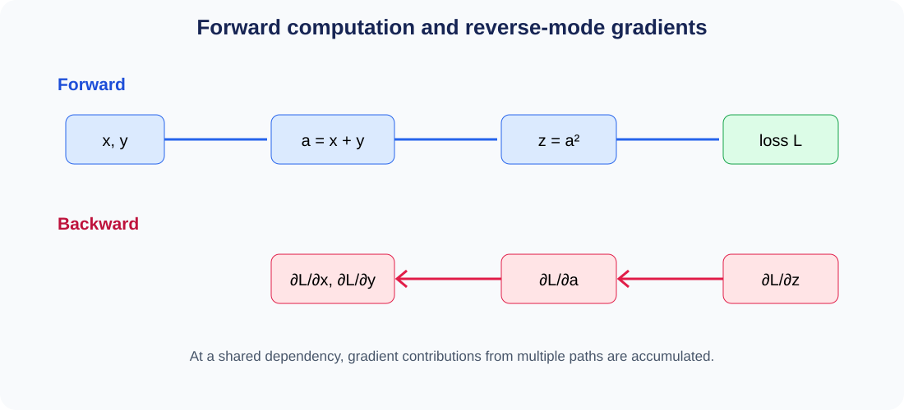

# 自动微分图优化

**所属分类：** [02 计算图优化](README.md)  
**英文名称：** Autograd Graph Optimization  
**专题编号：** 06

## 01. 一句话定义与核心目的

**一句话定义：** 自动微分图优化是针对自动微分系统生成的前向与反向计算图，优化梯度计算的依赖、存储和执行方式。

**核心目的：** 在保持梯度语义和数值要求的前提下，减少反向传播中的冗余操作与中间数据，控制激活内存，并改善梯度计算的执行效率。它涉及自动微分规则、反向图构建、梯度累积、图融合、重计算和高阶梯度等问题。

## 02. 数学原理与核心技术

### 2.1 可视化理解

*图：前向图计算 a=x+y、z=a² 和损失；反向图沿依赖反向传播梯度，并在分支汇合处累加贡献。*

### 2.2 数学原理与核心技术

设复合函数：

$$
y=f(g(x)).
$$

链式法则给出：

$$
\frac{dy}{dx}=\frac{df}{dg}\frac{dg}{dx}.
$$

自动微分系统会记录前向计算的依赖关系，并在反向阶段沿图传播梯度。对于多输入汇合的节点，来自不同路径的梯度需要累加；一个值被多处使用时，反向传播需要汇总各条路径的贡献。

**核心技术：**
- **反向图构建与简化：** 删除无梯度需求的路径，简化不影响目标梯度的节点。
- **Gradient Accumulation：** 正确合并来自多个后继节点的梯度贡献。
- **Saved Tensor 管理：** 只保存反向计算必需的中间结果；结合重计算降低内存。
- **Backward Fusion：** 将相邻梯度操作融合，减少中间张量与 Kernel Launch。
- **自定义梯度规则：** 对特定算子提供更高效的 VJP（Vector-Jacobian Product）或 JVP（Jacobian-Vector Product）。
- **高阶自动微分：** 管理二阶或更高阶导数的梯度图构建与保留，避免不必要的图扩展。

反向模式自动微分在计算图上执行链式法则，与离散伴随传播具有紧密的数学联系，但自动微分图优化范围更广，还包含图捕获、内存管理、融合和调度。

隐式微分是对方程定义的解求导的一种方法；它可以通过自定义反向规则接入自动微分系统，但不等同于普通的反向图遍历。

## 03. 代表案例

| 项目 | 与本专题的关系 | 值得关注的内容 | 项目与资料 |
|---|---|---|---|
| PyTorch Autograd | **直接案例：** 动态记录前向操作并构建反向梯度图 | grad_fn、Node、saved tensors、梯度累积 | [GitHub](https://github.com/pytorch/pytorch) · [Autograd mechanics](https://docs.pytorch.org/docs/stable/notes/autograd.html) |
| JAX | **直接案例：** 函数变换式自动微分，支持 grad、vjp、jvp 与 jit 组合 | VJP/JVP、函数变换、编译与自动微分组合 | [GitHub](https://github.com/jax-ml/jax) · [Autodiff cookbook](https://docs.jax.dev/en/latest/notebooks/autodiff_cookbook.html) |
| TensorFlow GradientTape | **直接案例：** 通过操作记录构建梯度计算关系 | GradientTape、persistent tape、custom gradients | [GitHub](https://github.com/tensorflow/tensorflow) · [自动微分指南](https://www.tensorflow.org/guide/autodiff) |
| ReWY | **关联案例：** 对特定 Delta-Rule Attention 反向计算做数学重组，减少局部矩阵乘法 | 共享伴随变量与特定反向计算结构 | [GitHub](https://github.com/flashserve/ReWY) · [论文](https://arxiv.org/abs/2611.01940) |

建议先用 PyTorch Autograd 或 JAX 观察一个简单函数的反向图，再进一步研究 saved tensors、重计算和自定义 VJP 如何改变梯度计算的时间与内存成本。
