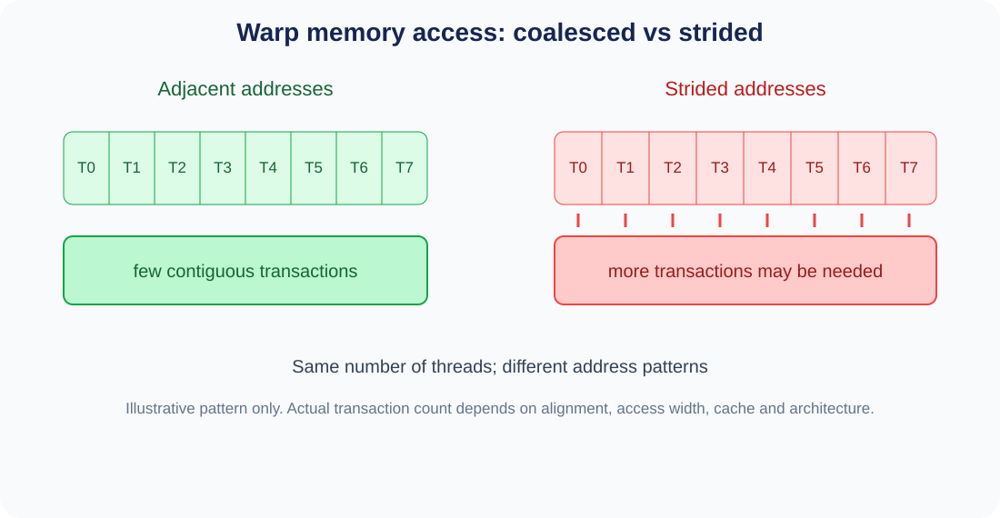

# 内存访问

**所属分类：** [03 内存优化](README.md)  
**英文名称：** Memory Access  
**专题编号：** 02

## 01. 一句话定义与核心目的

**一句话定义：** 内存访问优化是通过安排线程访问地址的顺序、粒度和局部性，使 GPU 尽可能高效地完成数据加载与写回。

**核心目的：** 减少非合并访问、重复加载、无效传输和访问冲突，提高有效内存带宽。GPU 的性能不仅取决于需要多少数据，也取决于线程如何访问这些数据。

## 02. 数学原理与核心技术

### 2.1 可视化理解

*图：左侧线程访问相邻地址，容易合并为较少的内存事务；右侧线程跨步访问，可能触发更多事务并降低每次传输的有效数据比例。具体事务粒度取决于 GPU 架构和访问类型。*

### 2.2 数学原理与核心技术

GPU 通常以 Warp 为单位执行相同指令。若 Warp 中多个线程访问相邻且对齐的地址，硬件可以将这些请求合并为较少的内存事务，这称为 **Memory Coalescing（内存合并访问）**。

设一个 Warp 有 $W$ 个线程，每个线程读取 $b$ Bytes，理想情况下连续访问的数据总量为：

$$
D=Wb.
$$

若实际内存事务传输总量为 $D_{\mathrm{txn}}$，可以用有效利用比例描述访问效率：

$$
\eta_{\mathrm{access}}=
\frac{D}{D_{\mathrm{txn}}}.
$$

该比例是帮助理解的简化指标；真实事务数量还取决于地址对齐、缓存命中、访问宽度和具体架构。

**核心技术：**
- **Coalesced Access：** 让同一 Warp 的线程访问连续或相邻地址。
- **Stride Optimization：** 避免过大的跨步访问；必要时调整数据布局或线程映射。
- **Alignment：** 保持合适的地址对齐，减少跨事务访问。
- **Array of Structures / Structure of Arrays：** 根据线程访问模式选择 AoS 或 SoA 数据布局。
- **Bank Conflict Avoidance：** 对 Shared Memory，安排访问模式以减少多个线程请求同一存储 Bank 的冲突。
- **Gather / Scatter Awareness：** 对不规则索引访问，分析缓存命中、访存事务和索引开销。

一个常见例子是行优先存储的二维矩阵。若相邻线程处理同一行的相邻列，通常更容易形成合并访问；若相邻线程沿列方向跨越较大行距访问，访问可能更分散。

## 03. 代表案例

| 项目 | 与本专题的关系 | 值得关注的内容 | 项目与资料 |
|---|---|---|---|
| CUDA Samples | **直接案例：** 提供矩阵转置、内存访问模式等 CUDA 示例 | coalesced access、transpose、shared-memory padding | [GitHub](https://github.com/NVIDIA/cuda-samples) |
| Triton Tutorials | **直接案例：** 展示块级指针、layout 与内存访问模式 | vector addition、矩阵乘法、layout | [GitHub](https://github.com/triton-lang/triton) · [教程](https://triton-lang.org/main/getting-started/tutorials/) |
| CUTLASS | **直接案例：** 通过线程布局与 Tile 映射组织全局内存访问 | threadblock swizzle、global-to-shared copy、layout | [GitHub](https://github.com/NVIDIA/cutlass) |
| Nsight Compute | **分析工具：** 用于检查内存吞吐、事务和访问效率 | Memory Workload Analysis、Memory Throughput | [官方文档](https://docs.nvidia.com/nsight-compute/) |

本专题关注“线程怎样访问地址”；数据复用关注“读入的数据如何被多次使用”。两者相关，但问题不同。
