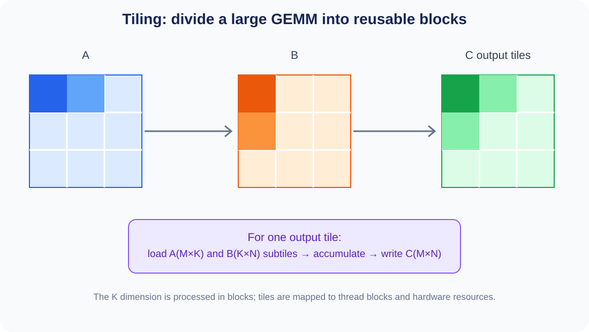

# 分块计算（Tiling / Blocking）

**所属分类：** [03 内存优化](README.md)  
**英文名称：** Tiling / Blocking  
**专题编号：** 04

## 01. 一句话定义与核心目的

**一句话定义：** Tiling（分块）是把大规模数据或计算域切分成较小的 Tile，使每个 Tile 能在寄存器、共享内存或缓存等较快存储中完成一组计算。

**核心目的：** 提高数据局部性和复用率，减少重复访问较慢存储层的次数，并让计算任务更适合 GPU 的线程块、Warp 和矩阵硬件组织。Tiling 是算法组织与硬件映射之间的重要桥梁。

## 02. 数学原理与核心技术

### 2.1 可视化理解

*图：大矩阵被拆成输出 Tile；沿 K 维分块加载 A、B 子块，在片上累积后写回 C。Tile 大小需受寄存器和共享内存资源约束。*

### 2.2 数学原理与核心技术

### 2.1 可视化理解

*图：大矩阵乘法被拆成多个输出 Tile；每个输出 Tile 通过沿 K 维循环加载 A、B 的子块，在片上累积后写回 C。图中颜色表示不同数据块，不代表特定 GPU 的固定 Tile 尺寸。*

### 2.2 数学原理与核心技术

对于：

$$
C=AB,
$$

将矩阵按块划分。设输出 Tile 尺寸为 $B_M\times B_N$，沿归约维度每次处理 $B_K$。一个输出 Tile 可写为：

$$
C_{tile}
=
\sum_{k\text{-tiles}}
A_{tile}^{(k)}B_{tile}^{(k)}.
$$

每次从较慢存储层加载大小约为 $B_M\times B_K$ 的 A 子块和 $B_K\times B_N$ 的 B 子块，在片上执行乘加并累积到 $B_M\times B_N$ 的输出块。

**核心技术：**
- **Loop Tiling：** 将循环迭代空间切成块，改善缓存局部性。
- **Register Tiling：** 在线程寄存器中累积输出或保存操作数。
- **Shared-Memory Tiling：** 让线程块协作加载并复用输入 Tile。
- **Hierarchical Tiling：** 在 Threadblock、Warp、线程和指令层设置不同 Tile。
- **Tail Handling：** 处理矩阵维度不能被 Tile 尺寸整除的边界元素。
- **Double Buffering / Pipelining：** 在计算当前 Tile 时预取下一 Tile，尝试重叠数据搬运与计算。

Tiling 尺寸存在权衡：Tile 太小会降低数据复用并增加循环或调度开销；Tile 太大可能超过寄存器或共享内存容量，降低 Occupancy。实际最佳参数依赖矩阵形状、数据类型、硬件和 Kernel 实现。

## 03. 代表案例

| 项目 | 与本专题的关系 | 值得关注的内容 | 项目与资料 |
|---|---|---|---|
| CUTLASS | **直接案例：** 以多级 Tile 构建高性能 GEMM | Threadblock、Warp、Instruction Shape 与流水线 | [GitHub](https://github.com/NVIDIA/cutlass) |
| Triton | **直接案例：** 通过 program/block 组织矩阵和张量分块计算 | Matmul tutorial、BLOCK_SIZE_M/N/K | [GitHub](https://github.com/triton-lang/triton) · [矩阵乘法教程](https://triton-lang.org/main/getting-started/tutorials/03-matrix-multiplication.html) |
| TVM | **直接案例：** 使用 loop tiling、reorder 等调度变换优化张量程序 | TensorIR、schedule primitives、auto-tuning | [GitHub](https://github.com/apache/tvm) · [文档](https://tvm.apache.org/docs/) |
| FlashAttention | **关联案例：** 将 Attention 计算按序列块组织，控制片上工作集并减少 HBM IO | Blockwise attention、online softmax | [GitHub](https://github.com/Dao-AILab/flash-attention) · [论文](https://arxiv.org/abs/2205.14135) |

Tiling 是本分类中连接存储层级、数据复用和 Kernel 优化的核心专题。后续学习 CUTLASS 与 Triton 时，应重点观察 Tile 尺寸如何映射到线程组织和片上资源。
