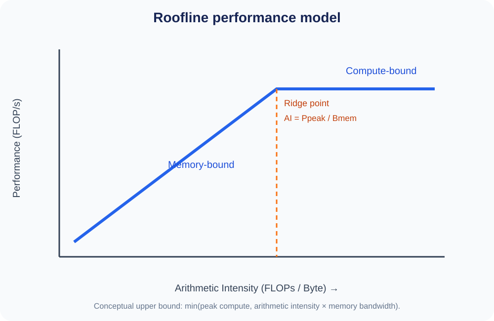

# Roofline Model

**所属分类：** [03 内存优化](README.md)  
**英文名称：** Roofline Performance Model  
**专题编号：** 05

## 01. 一句话定义与核心目的

**一句话定义：** Roofline Model（屋顶线模型）是用算术强度、内存带宽和峰值计算能力估计程序性能上限的分析模型。

**核心目的：** 判断一个 Kernel 更可能受内存带宽限制（Memory-bound），还是受计算吞吐限制（Compute-bound），帮助研究者选择优化方向，而不是盲目调参。

## 02. 数学原理与核心技术

### 2.1 可视化理解

*图：横轴为算术强度 FLOPs/Byte，纵轴为可达到的计算性能。斜线区域受内存带宽约束，水平区域受峰值计算能力约束；两者交点为 Ridge Point。图为概念曲线，非某一 GPU 的实测数据。*

### 2.2 数学原理与核心技术

Roofline 的基本上界为：

$$
P\leq \min(P_{peak},AI\times B_{mem}).
$$

其中：
- $P$：程序实际可达到的计算性能，通常以 FLOP/s 表示。
- $P_{peak}$：目标精度和硬件条件下的峰值计算吞吐。
- $AI$：算术强度，单位为 FLOPs/Byte。
- $B_{mem}$：所分析存储层级的带宽，常用 HBM 带宽。

两条性能上界分别是：
- **Memory roof：** $P=AI\times B_{mem}$，性能随算术强度线性增长。
- **Compute roof：** $P=P_{peak}$，性能达到计算吞吐上限。

两者交点称为 Ridge Point：

$$
AI_{ridge}=\frac{P_{peak}}{B_{mem}}.
$$

当算术强度低于 Ridge Point 时，模型预测更可能是内存带宽受限；高于 Ridge Point 时，更可能受到计算吞吐限制。

**核心技术与使用方式：**
- 明确统计边界：计算 FLOPs 和数据传输量必须针对同一个 Kernel、同一存储层级和同一工作负载。
- 区分理论峰值与实测带宽：硬件规格提供上界，实际可达到值受访问模式、缓存、并发和指令影响。
- 画出 Kernel 的实测点：将实际性能与 AI 放到 Roofline 图上，观察离理论上界的距离。
- 分层分析：L1、L2、HBM 的流量和带宽不同，扩展 Roofline 可分别分析不同存储层级。

Roofline 是上界分析模型，不会自动指出具体代码中的问题，也不意味着落在 Memory-bound 区域就一定只需减少 HBM 流量。实际程序还可能受到延迟、指令吞吐、同步、占用率和并行度限制。

## 03. 代表案例

| 项目 | 与本专题的关系 | 值得关注的内容 | 项目与资料 |
|---|---|---|---|
| Berkeley Roofline 工作 | **原始研究：** 提出并系统阐述 Roofline 性能模型 | Arithmetic Intensity、带宽屋顶、计算屋顶 | [论文 DOI](https://doi.org/10.1145/1498765.1498785) |
| Intel Advisor | **直接工具：** 提供 Roofline 分析，定位 CPU/GPU 代码的计算与带宽瓶颈 | Roofline chart、loop/kernel analysis | [官方文档](https://www.intel.com/content/www/us/en/docs/advisor/user-guide/current/roofline-analysis.html) |
| NVIDIA Nsight Compute | **关联工具：** 提供 Kernel 性能、内存吞吐和计算吞吐指标，可用于构建瓶颈分析 | Speed of Light、Memory Workload Analysis | [官方文档](https://docs.nvidia.com/nsight-compute/) |
| Empirical Roofline Toolkit | **直接工具：** 测量平台带宽和计算能力，生成经验 Roofline | 硬件峰值与实测上界 | [GitHub](https://github.com/berkeleylab/cs-roofline-toolkit) |

后续做 Triton Kernel 实验时，可以把 Roofline 作为性能诊断框架：先估算 AI，再测量实际吞吐，最后判断下一步更值得优化数据搬运还是计算执行。
