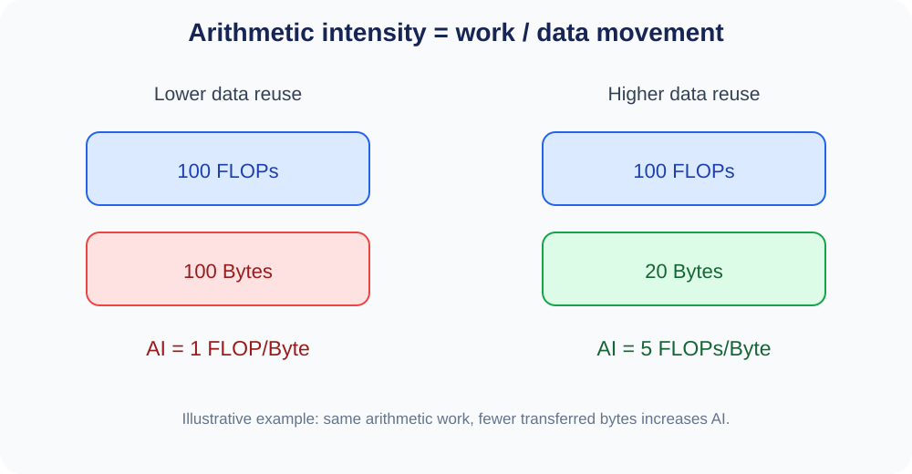

# Arithmetic Intensity（算术强度）

**所属分类：** [03 内存优化](README.md)  
**英文名称：** Arithmetic Intensity  
**专题编号：** 06

## 01. 一句话定义与核心目的

**一句话定义：** 算术强度（AI）是单位数据传输量所对应的浮点运算次数，通常以 FLOPs/Byte 表示。

**核心目的：** 衡量一个计算任务相对于数据搬运执行了多少计算，帮助判断优化重点是减少内存流量、提高数据复用，还是提升计算吞吐。算术强度也是 Roofline Model 的核心横轴。

## 02. 数学原理与核心技术

### 2.1 可视化理解

*图：相同计算量下，若通过数据复用减少从所选存储层级传输的 Bytes，算术强度就会提高。图中数值仅为概念示例。*

### 2.2 数学原理与核心技术

定义：

$$
AI=\frac{F}{Q},
$$

其中 $F$ 是浮点运算次数（FLOPs），$Q$ 是指定存储层级的数据传输量（Bytes）。

例如某 Kernel 执行 $2\times10^{12}$ FLOPs，并从 HBM 传输 $2\times10^{11}$ Bytes，则：

$$
AI=\frac{2\times10^{12}}{2\times10^{11}}
=10\ \text{FLOPs/Byte}.
$$

**核心技术与概念：**
- **FLOPs Counting：** 统计乘法、加法、FMA 等操作时，明确采用的计数约定。
- **Memory Traffic：** 统计读写 Bytes；要说明统计的是 HBM、L2 还是其他层级。
- **Data Reuse：** 同一数据在片上多次参与计算，减少从目标存储层级重复读取。
- **Arithmetic Intensity vs. Operational Intensity：** 文献中有时区分算法层面的数据访问量与实际硬件层级流量；阅读或比较结果时必须确认定义。
- **结合 Roofline：** 将 AI 与目标硬件的 Ridge Point 对照，判断带宽上限和计算上限哪个更严格。

AI 不是“越大越好”的独立目标。提高 AI 可能需要更多寄存器或共享内存，反而降低 Occupancy；而且若 Kernel 已经受计算吞吐限制，继续提高 AI 未必带来速度收益。

## 03. 代表案例

| 项目 | 与本专题的关系 | 值得关注的内容 | 项目与资料 |
|---|---|---|---|
| Berkeley Roofline Model | **直接理论案例：** 将算术强度作为计算性能与内存带宽之间的核心指标 | AI 定义、Ridge Point | [原始论文 DOI](https://doi.org/10.1145/1498765.1498785) |
| NVIDIA Nsight Compute | **直接分析工具：** 可检查 Kernel 的计算吞吐、内存流量和带宽利用 | FLOP 指标、Memory Workload、Roofline chart | [官方文档](https://docs.nvidia.com/nsight-compute/) |
| Empirical Roofline Toolkit | **直接工具：** 测量硬件计算与带宽特征，帮助解释 AI 对应的性能上界 | 实测带宽、计算峰值 | [GitHub](https://github.com/berkeleylab/cs-roofline-toolkit) |
| FlashAttention | **关联案例：** 通过 IO-aware 分块减少 HBM 访问，使 Attention 的数据传输与计算比例发生变化 | IO complexity、online softmax、tiling | [GitHub](https://github.com/Dao-AILab/flash-attention) · [论文](https://arxiv.org/abs/2205.14135) |

比较不同论文或工具报告的 AI 时，必须核对 FLOPs 计数规则、读写流量统计范围以及是否计入缓存命中数据。
