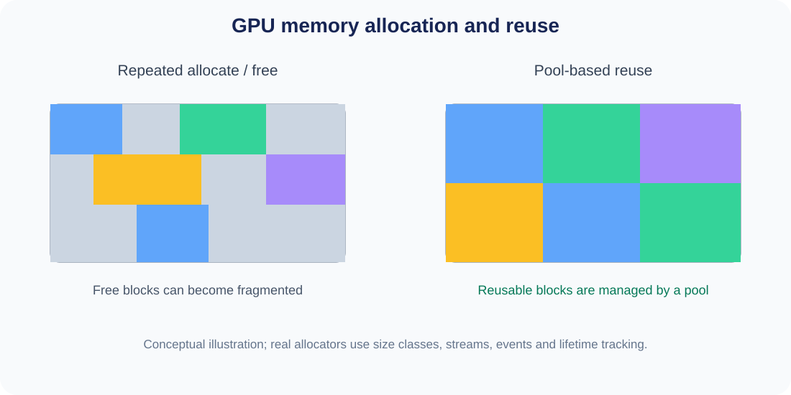

# 显存管理

**所属分类：** [03 内存优化](README.md)  
**英文名称：** GPU Memory Management  
**专题编号：** 07

## 01. 一句话定义与核心目的

**一句话定义：** 显存管理是对 GPU 内存的分配、释放、复用、缓存和生命周期进行组织，以满足计算任务的容量需求并控制分配开销与碎片。

**核心目的：** 减少频繁分配和释放带来的开销，降低内存碎片和峰值占用，提高显存复用率，并使训练或推理任务能够在有限显存中稳定运行。它既包括单个进程内的内存分配器，也包括模型运行时的缓存管理策略。

## 02. 数学原理与核心技术

### 2.1 可视化理解

*图：左侧展示分散空闲块的碎片化示意，右侧展示内存池管理和复用。实际分配器还会考虑尺寸类别、Stream 与生命周期。*

### 2.2 数学原理与核心技术

### 2.1 可视化理解

### 2.2 数学原理与核心技术

显存管理的一个基本问题是：**当前需要的内存总量可能小于空闲显存总量，但由于空闲空间分散，仍可能无法满足一次连续分配。** 这就是外部碎片的一种表现。

常见指标包括：
- **Allocated Memory：** 当前被张量或对象实际占用的内存。
- **Reserved Memory：** 分配器向设备申请并保留、可供后续复用的内存。
- **Peak Memory：** 一段执行期间出现的最大内存占用。
- **Fragmentation：** 空闲内存分散或块大小不匹配造成的利用效率下降。

**核心技术：**
- **Caching Allocator：** 释放张量时不一定立即把内存还给驱动，而是缓存内存块以便后续复用。
- **Memory Pool：** 预先申请一批内存，再从池中切分和复用，降低频繁系统级分配开销。
- **Arena / Slab Allocation：** 按区域或固定大小类别组织内存块。
- **Lifetime Analysis：** 根据张量生命周期判断哪些内存区间可以安全复用。
- **Memory Planning：** 在已知或可捕获的计算图中规划中间张量的存储位置。
- **Paged KV Cache：** 将推理 KV Cache 切分为固定大小的块，按请求动态分配，减少连续大块分配和内部浪费。

需要区分显存分配器的 reserved 与 allocated：Reserved 不等于模型当前张量实际占用；框架缓存保留显存也不必然意味着内存泄漏。异步执行、跨 Stream 使用和张量生命周期会影响内存何时能够安全复用。

## 03. 代表案例

| 项目 | 与本专题的关系 | 值得关注的内容 | 项目与资料 |
|---|---|---|---|
| PyTorch CUDA Caching Allocator | **直接案例：** 管理 CUDA 张量内存块并缓存复用 | allocated / reserved、memory snapshot、碎片统计 | [GitHub](https://github.com/pytorch/pytorch) · [CUDA memory notes](https://docs.pytorch.org/docs/stable/notes/cuda.html) |
| RAPIDS RMM | **直接案例：** GPU 内存管理库，提供 memory resource 与 pool allocator | PoolMemoryResource、异步资源和分配策略 | [GitHub](https://github.com/rapidsai/rmm) · [文档](https://docs.rapids.ai/api/rmm/stable/) |
| vLLM | **直接案例：** 通过 PagedAttention 管理推理过程中的 KV Cache 块 | Block manager、KV block allocation、请求调度 | [GitHub](https://github.com/vllm-project/vllm) · [论文](https://arxiv.org/abs/2309.06180) |
| CUDA Memory Pools | **直接资料：** CUDA 异步分配与内存池机制 | cudaMallocAsync、cudaFreeAsync、memory pool | [CUDA Programming Guide](https://docs.nvidia.com/cuda/cuda-c-programming-guide/) |

建议先理解 PyTorch 的 allocated / reserved，再研究 vLLM 的 KV Cache block 管理。两者分别代表通用张量分配器和模型推理专用缓存管理。
