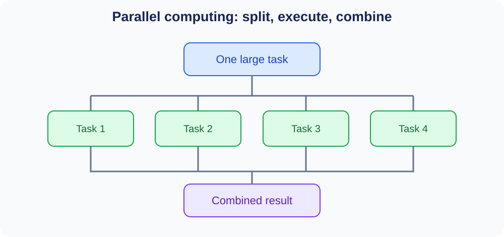

# 并行基础

**所属分类：** [04 并行优化](README.md)  
**英文名称：** Parallel Computing Fundamentals  
**专题编号：** 01

## 01. 一句话定义与核心目的

**一句话定义：** 并行计算是把一个计算任务拆分为多个可同时执行的子任务，并通过协调数据依赖与结果合并来完成整体计算。

**核心目的：** 在多个 CPU 核心、GPU 执行单元或计算设备上同时开展工作，缩短完成时间或提高单位时间处理量。收益取决于任务可拆分程度、子任务依赖、通信同步成本和负载均衡。

## 02. 数学原理与核心技术

### 2.1 可视化理解

*图：整体任务被拆成多个子任务并行执行，最后汇总结果。并行任务必须满足数据依赖条件，拆分过细也会增加调度开销。*

### 2.2 数学原理与核心技术

### 2.1 可视化理解

### 2.2 数学原理与核心技术

并行计算常用加速比衡量并行执行相对串行执行的速度提升：

$$
S(p)=\frac{T_1}{T_p},
$$

其中 $T_1$ 是串行执行时间，$T_p$ 是使用 $p$ 个处理单元时的执行时间。

Amdahl 定律考虑程序中不可并行的比例。设串行比例为 $s$，理想情况下：

$$
S(p)=\frac{1}{s+\frac{1-s}{p}}.
$$

当处理单元数量趋于无穷时，加速比仍受串行部分限制：

$$
S(\infty)=\frac{1}{s}.
$$

**核心技术与概念：**
- **Task Parallelism：** 不同任务同时执行。
- **Data Parallelism：** 对不同数据分片执行相同操作。
- **Concurrency 与 Parallelism：** 并发描述多个任务在时间上交错推进；并行强调多个任务在同一时刻执行。
- **Synchronization：** 通过屏障、锁、原子操作或事件保证必要的执行顺序。
- **Communication：** 不同执行单元交换数据或部分结果。
- **Load Balancing：** 让各执行单元获得相近的有效工作量，减少等待。

任务拆分过细会增加调度和通信开销；依赖链、同步和串行阶段也会限制加速比。Amdahl 定律是固定问题规模下的模型；问题规模随处理单元数增长时，还可结合 Gustafson 定律分析。

## 03. 代表案例

| 项目 | 与本专题的关系 | 值得关注的内容 | 项目与资料 |
|---|---|---|---|
| OpenMP | **直接案例：** 共享内存多线程并行编程模型 | parallel、for、reduction、synchronization | [GitHub](https://github.com/OpenMP/sources) · [官方规范](https://www.openmp.org/specifications/) |
| MPI | **直接案例：** 分布式进程之间的消息传递模型 | point-to-point、collective communication、communicator | [MPI Forum 文档](https://www.mpi-forum.org/docs/) |
| oneTBB | **直接案例：** 任务并行、调度和并发容器 | task arena、parallel algorithms、work stealing | [GitHub](https://github.com/oneapi-src/oneTBB) |
| CUDA | **关联案例：** 在 GPU 上组织大量线程并行执行数据计算 | thread hierarchy、grid、block、warp | [CUDA Programming Guide](https://docs.nvidia.com/cuda/cuda-c-programming-guide/) |
