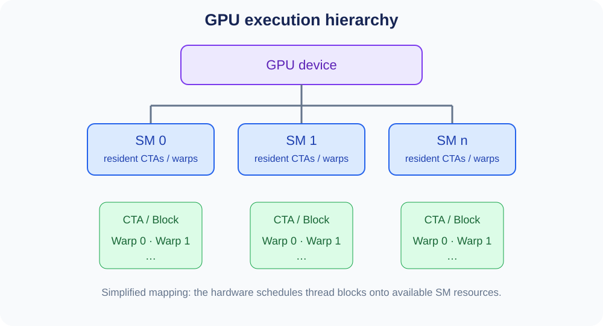

# GPU 并行

**所属分类：** [04 并行优化](README.md)  
**英文名称：** GPU Parallelism  
**专题编号：** 02

## 01. 一句话定义与核心目的

**一句话定义：** GPU 并行是把大量数据元素或计算任务映射到 GPU 的线程、Warp、线程块和 SM 上执行，利用大规模并发隐藏访存延迟并提高吞吐量。

**核心目的：** 让 GPU 上的大量计算资源持续获得可执行工作。GPU 通常通过大量线程和高吞吐执行处理具有足够并行度的数据任务。

## 02. 数学原理与核心技术

### 2.1 可视化理解

*图：程序中的线程组织为 Block/CTA，再由硬件调度到 SM；一个 Warp 中的线程以 SIMT 方式协同执行。具体资源与调度规则依 GPU 架构而异。*

### 2.2 数学原理与核心技术

以向量加法为例：

$$
C_i=A_i+B_i.
$$

若有 $N$ 个元素，可以让不同线程处理不同索引 $i$。一种常见映射为：

$$
i=\text{blockIdx}\times\text{blockDim}+\text{threadIdx}.
$$

每个线程计算一个或多个元素；所有线程共同覆盖数据范围。

**核心技术与概念：**
- **Thread：** 执行 Kernel 程序的逻辑线程。
- **Warp：** NVIDIA GPU 上通常由 32 个线程组成的调度与执行组。
- **Block / CTA：** 程序员定义的线程协作单元，Block 内线程可通过 Shared Memory 和同步机制协作。
- **Grid：** 一次 Kernel Launch 中所有 Block 的集合。
- **SM：** GPU 上执行并调度线程块的主要处理单元。
- **SIMT：** Single Instruction, Multiple Threads；同一 Warp 的线程执行相同指令流，但可通过谓词或分支处理不同数据。
- **Latency Hiding：** 一个 Warp 等待数据时，调度器可选择其他就绪 Warp 执行，以隐藏部分延迟。

GPU 并行效率取决于可并行工作量、访存模式、寄存器和共享内存资源、分支分歧以及 Warp 是否有足够的就绪指令。Warp 调度和 Occupancy 的细节在 [Kernel 优化](../05_Kernel_Optimization/README.md) 中深入讨论。

## 03. 代表案例

| 项目 | 与本专题的关系 | 值得关注的内容 | 项目与资料 |
|---|---|---|---|
| CUDA Samples | **直接案例：** 展示 GPU 线程组织、并行算法和内存协作 | vector add、reduction、matrix multiplication | [GitHub](https://github.com/NVIDIA/cuda-samples) |
| Triton | **直接案例：** 以 program/block 抽象组织 GPU 并行任务 | program_id、num_warps、block layout | [GitHub](https://github.com/triton-lang/triton) · [文档](https://triton-lang.org/main/) |
| CUTLASS | **直接案例：** 将矩阵运算映射到 Threadblock、Warp 和 Tensor Core | threadblock shape、warp shape、instruction shape | [GitHub](https://github.com/NVIDIA/cutlass) |
| CUDA Programming Guide | **权威资料：** 解释 CUDA 执行模型和 GPU 线程层级 | grid、block、warp、SM | [官方文档](https://docs.nvidia.com/cuda/cuda-c-programming-guide/) |
