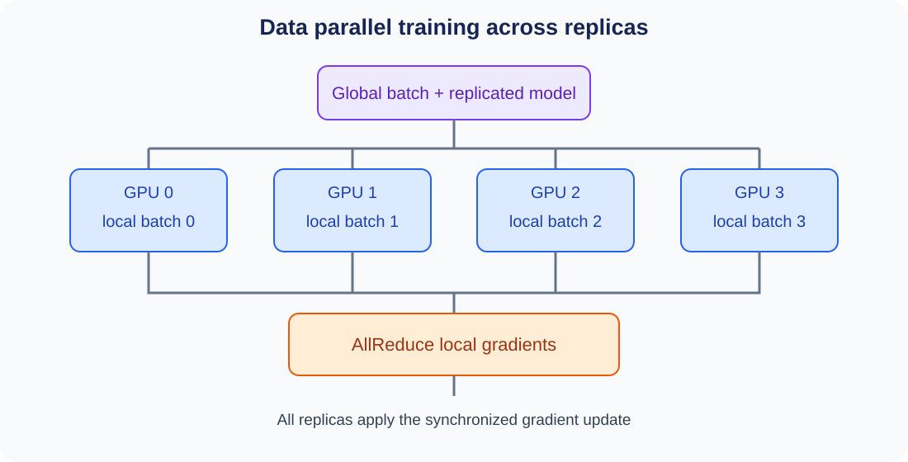

# 数据并行

**所属分类：** [04 并行优化](README.md)  
**英文名称：** Data Parallelism  
**专题编号：** 03

## 01. 一句话定义与核心目的

**一句话定义：** 数据并行是将一个批次或数据集切分到多个计算设备上，各设备执行相同模型或操作，再按算法要求汇总局部结果。

**核心目的：** 通过增加处理数据的设备数量，提高训练吞吐量或数据处理能力。深度学习中常见做法是每张 GPU 保存一份模型副本，处理不同 mini-batch 分片，并同步梯度以保持训练过程一致。

## 02. 数学原理与核心技术

### 2.1 可视化理解

*图：全局 Batch 切分到不同 GPU，各自计算局部梯度，再通过 AllReduce 得到同步梯度。*

### 2.2 数学原理与核心技术

### 2.1 可视化理解

### 2.2 数学原理与核心技术

设全局 Batch 包含 $B$ 个样本，分配到 $p$ 个设备。第 $r$ 个设备处理本地数据集 $D_r$，计算局部梯度：

$$
g_r=\frac{1}{|D_r|}\sum_{x\in D_r}\nabla_\theta\ell(\theta;x).
$$

当各设备本地 Batch 大小相同时，全局平均梯度为：

$$
g=\frac{1}{p}\sum_{r=1}^{p}g_r.
$$

若各设备样本数不同，则应按样本数量加权，而不能简单平均各设备的局部均值。

**核心技术：**
- **Data Sharding：** 将样本、序列或数据分片分配给不同设备。
- **Model Replication：** 每个设备保留一份模型参数副本。
- **Gradient Synchronization：** 同步各设备计算出的梯度。
- **AllReduce：** 对所有设备的局部张量执行归约并将结果分发回各设备。
- **Global Batch 与 Local Batch：** 全局 Batch 通常等于各设备本地 Batch 之和，需考虑梯度累积和最后一个不完整 Batch。
- **Synchronous / Asynchronous Training：** 同步方式等待参与设备完成更新；异步方式可能引入梯度陈旧等问题。

数据并行通常复制模型参数、梯度和优化器状态，因此模型状态本身的显存占用不会因设备数增加而自动减少。模型过大时需要结合 ZeRO 或模型并行策略。

## 03. 代表案例

| 项目 | 与本专题的关系 | 值得关注的内容 | 项目与资料 |
|---|---|---|---|
| PyTorch DistributedDataParallel | **直接案例：** 多进程/多 GPU 同步梯度，支持 Bucket 与通信重叠 | DDP、gradient buckets、communication hooks | [GitHub](https://github.com/pytorch/pytorch) · [DDP 文档](https://docs.pytorch.org/docs/stable/generated/torch.nn.parallel.DistributedDataParallel.html) |
| Horovod | **直接案例：** 跨设备和跨框架的分布式训练抽象 | Distributed optimizer、AllReduce | [GitHub](https://github.com/horovod/horovod) |
| NVIDIA NCCL | **基础组件：** GPU 集合通信原语，常用于梯度同步 | AllReduce、AllGather、ReduceScatter | [GitHub](https://github.com/NVIDIA/nccl) |
| TensorFlow Distributed Training | **直接案例：** MirroredStrategy 等数据并行训练策略 | strategy、replica、global batch | [官方指南](https://www.tensorflow.org/guide/distributed_training) |
