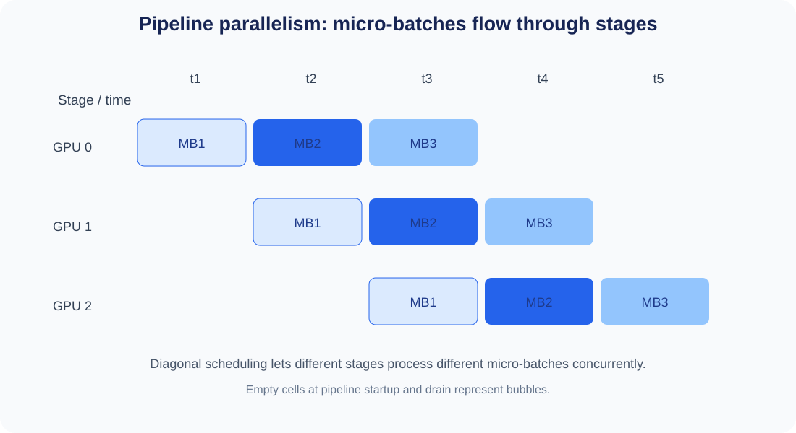

# 流水线并行

**所属分类：** [04 并行优化](README.md)  
**英文名称：** Pipeline Parallelism  
**专题编号：** 05

## 01. 一句话定义与核心目的

**一句话定义：** 流水线并行是把模型的不同层或连续层组分配到不同设备，按微批次流水执行，使不同设备在同一时间处理不同批次的数据。

**核心目的：** 将深层模型按阶段切分到多设备，降低单设备需要容纳的模型层数，并通过流水调度提高多设备利用率。主要挑战是流水线气泡、阶段负载不均和阶段间激活通信。

## 02. 数学原理与核心技术

### 2.1 可视化理解

*图：微批次沿模型阶段流水执行，不同设备同时处理不同微批次；填充和排空阶段产生流水线气泡。*

### 2.2 数学原理与核心技术

### 2.1 可视化理解

### 2.2 数学原理与核心技术

将模型划分为 $p$ 个阶段，每个阶段分配到一个设备。将一个 Batch 切成 $m$ 个 Micro-batches，依次通过各阶段。

若各阶段耗时相同为 $t$，仅考虑前向流水线且忽略通信与调度开销，完成 $m$ 个微批次的时间约为：

$$
T_{\mathrm{pipe}}\approx(m+p-1)t.
$$

总工作量为 $mp t$，设备总时间槽容量为 $p(m+p-1)t$，因此该简化模型的平均设备利用率为：

$$
U\approx\frac{m}{m+p-1}.
$$

这个模型显示：微批次数 $m$ 越大，流水线气泡相对占比越低；真实训练还涉及反向阶段、激活存储、通信和调度策略。

**核心技术：**
- **Pipeline Partitioning：** 将模型层划分为多个阶段，尽量平衡各阶段计算量和内存需求。
- **Micro-batching：** 把大 Batch 切成多个微批次，让不同阶段重叠执行。
- **GPipe：** 常见的 Flush 式流水线调度，完成一轮前向微批次后再进行反向阶段。
- **1F1B：** 每个阶段交替执行一个 Forward 和一个 Backward 微批次，减少激活存储。
- **Interleaved Pipeline：** 每个设备承担多个模型分段，以改变气泡和负载分布。
- **Pipeline Bubble：** 流水线填充和排空造成的空闲时间。

阶段划分不均会使最慢阶段成为瓶颈；微批次过多也会增加调度和通信开销。流水线并行与张量并行可组合使用，但切分维度不同。

## 03. 代表案例

| 项目 | 与本专题的关系 | 值得关注的内容 | 项目与资料 |
|---|---|---|---|
| GPipe | **经典直接案例：** 将网络分段并通过微批次流水执行 | pipeline partition、micro-batch、gradient accumulation | [论文](https://arxiv.org/abs/1811.06965) |
| PipeDream | **经典直接案例：** 研究流水线调度与训练吞吐 | 1F1B、权重版本和调度策略 | [论文](https://arxiv.org/abs/1806.03377) |
| Megatron-LM | **直接案例：** 支持 Transformer 模型流水线并行 | pipeline schedules、interleaving、virtual pipeline stages | [GitHub](https://github.com/NVIDIA/Megatron-LM) |
| DeepSpeed Pipeline | **直接案例：** 模型分段、微批次调度与流水线训练 | PipelineModule、schedule、partition | [GitHub](https://github.com/deepspeedai/DeepSpeed) · [教程](https://www.deepspeed.ai/tutorials/pipeline/) |
