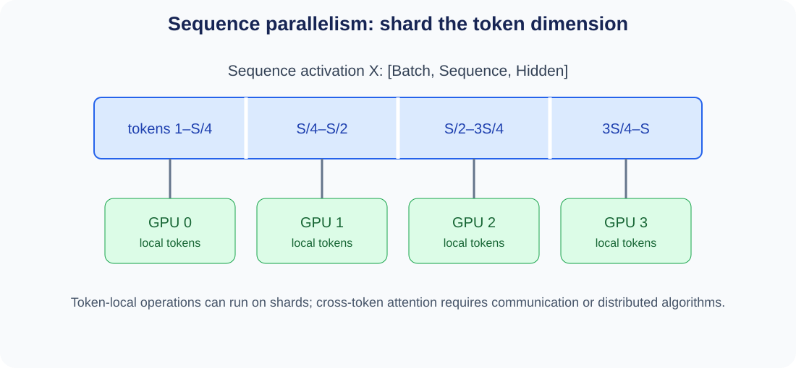

# 序列并行

**所属分类：** [04 并行优化](README.md)  
**英文名称：** Sequence Parallelism  
**专题编号：** 06

## 01. 一句话定义与核心目的

**一句话定义：** 序列并行是沿 Transformer 的序列长度维度切分 Token 或序列相关激活，让多个设备共同处理同一批序列的不同片段。

**核心目的：** 降低单设备持有的序列激活内存或长序列计算负担，并在特定 Transformer 结构中减少张量并行带来的激活复制。不同论文和框架对 Sequence Parallelism 的定义并不完全相同，需要区分 Megatron 的序列并行与长上下文 Context Parallelism。

## 02. 数学原理与核心技术

### 2.1 可视化理解

*图：沿序列长度维切分 Token 激活到不同设备。Token-local 操作可在本地执行，跨 Token Attention 需要通信或分布式算法。*

### 2.2 数学原理与核心技术

### 2.1 可视化理解

### 2.2 数学原理与核心技术

设 Transformer 激活为：

$$
X\in\mathbb R^{B\times S\times H},
$$

其中 $B$ 为 Batch，$S$ 为序列长度，$H$ 为隐藏维度。将序列维度切分到 $p$ 个设备，每个设备持有：

$$
X_r\in\mathbb R^{B\times(S/p)\times H},
$$

这里假设 $S$ 能被 $p$ 整除；否则需要处理不均匀分片或 Padding。

**核心技术：**
- **Sequence-Dimension Sharding：** 沿 Token/Sequence 维切分激活。
- **AllGather / ReduceScatter：** 在需要完整序列或分布式归约时交换张量。
- **Megatron Sequence Parallelism：** 与 Tensor Parallelism 配合，将部分 LayerNorm、Dropout 等操作的激活分片保留在序列维度，减少复制和内存占用。
- **Context Parallelism：** 将长上下文序列分配到多个设备，Attention 计算需处理跨分片 Key/Value 或注意力依赖。
- **Ring Attention / Context Exchange：** 通过环形传递或分块交换远端上下文，避免一次性聚集全部 K/V。

序列并行不意味着所有操作都可以独立按 Token 分片。LayerNorm、Attention、位置编码和跨 Token 操作的通信需求不同；需要结合具体算法确定数据布局与通信。

## 03. 代表案例

| 项目 | 与本专题的关系 | 值得关注的内容 | 项目与资料 |
|---|---|---|---|
| Megatron-LM | **直接案例：** 在 Tensor Parallelism 下切分部分激活，降低重复存储 | Sequence Parallel、AllGather/ReduceScatter | [GitHub](https://github.com/NVIDIA/Megatron-LM) · [论文](https://arxiv.org/abs/2205.05198) |
| DeepSpeed-Ulysses | **直接案例：** 通过序列维与 Attention Head 维的 All-to-All 转换扩展长序列训练 | sequence parallelism、All-to-All attention | [GitHub](https://github.com/deepspeedai/DeepSpeed) · [论文](https://arxiv.org/abs/2309.14509) |
| Ring Attention | **直接案例：** 通过分块与环形通信处理跨设备长上下文 Attention | blockwise attention、ring communication | [论文](https://arxiv.org/abs/2310.01889) |
| Megatron Context Parallelism | **直接案例：** 在多个设备间分配长序列上下文 | context parallel groups、KV exchange | [Megatron-LM](https://github.com/NVIDIA/Megatron-LM) |

学习时应先区分“减少 Transformer 激活复制的 Sequence Parallelism”和“扩展长上下文 Attention 的 Context Parallelism”；两者都沿序列维切分，但计算目标和通信模式不同。
