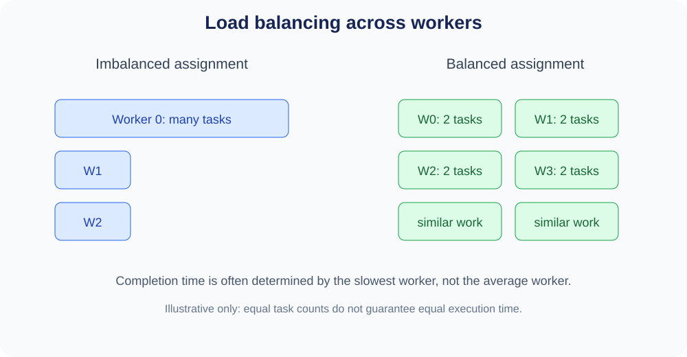

# 负载均衡

**所属分类：** [04 并行优化](README.md)  
**英文名称：** Load Balancing  
**专题编号：** 07

## 01. 一句话定义与核心目的

**一句话定义：** 负载均衡是把任务或数据分配给多个执行单元，使各单元承担的有效工作量尽可能协调，避免部分单元完成后长期等待其他单元。

**核心目的：** 减少并行执行中的尾部等待，提高设备利用率和整体吞吐。负载均衡既要考虑任务数量，也要考虑每个任务的实际计算成本、通信成本和数据位置。

## 02. 数学原理与核心技术

### 2.1 可视化理解

*图：左侧任务分配不均，部分工作单元提前空闲；右侧任务量更均衡，各单元完成时间更接近。实际任务成本可能不同，不能只按任务个数均分。*

### 2.2 数学原理与核心技术

设有 $p$ 个执行单元，第 $i$ 个单元承担工作量 $W_i$，单位处理能力为 $r_i$。忽略通信时，总完成时间至少受最慢单元限制：

$$
T\geq\max_i\frac{W_i}{r_i}.
$$

若各单元处理能力相同，理想均衡分配使各 $W_i$ 尽量接近。若任务成本不同，则应按预计执行时间或资源消耗分配，而不只是按任务数量均分。

**核心技术：**
- **Static Scheduling：** 执行前确定任务分配，开销低，适合工作量可预测的任务。
- **Dynamic Scheduling：** 运行时分配任务，适合工作量不均或不可预测的场景，但有调度开销。
- **Work Stealing：** 空闲工作线程从繁忙线程的队列中窃取任务。
- **Cost-aware Partitioning：** 根据任务估计成本、数据大小或计算复杂度分配工作。
- **Load-aware Routing：** 在服务系统中根据设备队列、显存和负载选择执行节点。
- **Straggler Mitigation：** 识别慢任务，减少其对同步阶段或整体请求完成时间的拖累。

负载均衡需要与数据局部性、通信量和任务粒度一起考虑。平均分配任务数量，可能造成数据搬运更多或关键路径变长，因此“工作量均衡”不一定等于“总时间最短”。

## 03. 代表案例

| 项目 | 与本专题的关系 | 值得关注的内容 | 项目与资料 |
|---|---|---|---|
| oneTBB | **直接案例：** 通过任务调度与 work stealing 分配 CPU 并行任务 | task arena、scheduler、parallel algorithms | [GitHub](https://github.com/oneapi-src/oneTBB) |
| Ray | **直接案例：** 分布式任务与 Actor 调度，支持集群资源管理 | task scheduling、placement groups、resource-aware scheduling | [GitHub](https://github.com/ray-project/ray) · [文档](https://docs.ray.io/) |
| Kubernetes | **关联案例：** 根据资源请求与调度策略将工作负载分配到节点 | scheduler、resource requests、node affinity | [GitHub](https://github.com/kubernetes/kubernetes) · [文档](https://kubernetes.io/docs/concepts/scheduling-eviction/kube-scheduler/) |
| Megatron-LM MoE | **关联案例：** 专家并行中需要处理不同 Expert Token 数量不均造成的负载差异 | expert parallelism、token dispatch、capacity factor | [GitHub](https://github.com/NVIDIA/Megatron-LM) |
