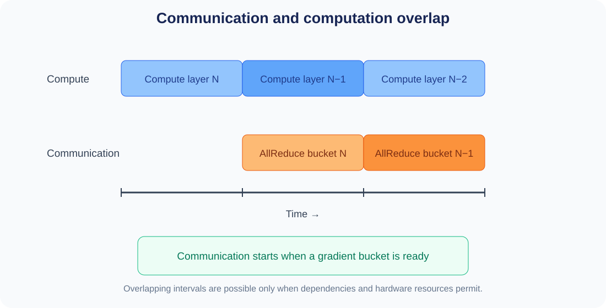

# 通信与计算重叠

**所属分类：** [04 并行优化](README.md)  
**英文名称：** Communication–Compute Overlap  
**专题编号：** 08

## 01. 一句话定义与核心目的

**一句话定义：** 通信与计算重叠是利用异步执行、独立工作流和依赖调度，让设备间数据传输与可并行的计算在时间上同时进行。

**核心目的：** 隐藏一部分通信等待时间，减少多 GPU 或分布式训练中的空闲时间，提高端到端吞吐。能否重叠取决于数据依赖、通信进度、硬件互联和计算/通信是否争用相同资源。

## 02. 数学原理与核心技术

### 2.1 可视化理解

*图：梯度 Bucket 就绪后即可启动通信，并与后续层的反向计算交叠；是否真正重叠取决于依赖和硬件资源。*

### 2.2 数学原理与核心技术

### 2.1 可视化理解

*图：当一部分梯度已经就绪时，可以启动对应 AllReduce，同时继续计算其他层的梯度。橙色通信区间与蓝色计算区间重叠；实际可隐藏的时间受依赖和资源竞争影响。*

### 2.2 数学原理与核心技术

若计算时间为 $T_{comp}$，通信时间为 $T_{comm}$，完全串行时：

$$
T_{serial}=T_{comp}+T_{comm}.
$$

若二者能够完全重叠，理想下界为：

$$
T_{overlap}\geq\max(T_{comp},T_{comm}).
$$

可定义简化的通信隐藏比例：

$$
\eta_{overlap}
=
\frac{T_{comp}+T_{comm}-T_{observed}}
{\min(T_{comp},T_{comm})},
$$

其中 $T_{observed}$ 是重叠调度下的实际总时间。测量时必须固定工作负载和计时边界，并确保串行基线与重叠执行比较的是相同工作。

**核心技术：**
- **Asynchronous Communication：** 非阻塞提交通信操作，让 CPU 或 GPU 能继续安排其他工作。
- **CUDA Streams：** 将工作放入不同 Stream，借助事件和依赖控制执行顺序。
- **NCCL Collectives：** 使用 AllReduce、AllGather、ReduceScatter 等集合通信。
- **Gradient Bucketing：** 将梯度分桶；某个 Bucket 的梯度就绪后即可启动通信，不必等待全部梯度完成。
- **Double Buffering：** 一块缓冲区用于计算时，另一块用于数据传输。
- **Pipeline Communication：** 将通信分块并与后续计算阶段交错执行。

异步提交不等于一定发生物理重叠。若通信依赖尚未完成的计算结果，或通信与计算争用同一带宽、SM、PCIe/NVLink 链路，就可能无法隐藏全部通信时间。还必须正确处理 Stream 依赖和缓冲区生命周期。

## 03. 代表案例

| 项目 | 与本专题的关系 | 值得关注的内容 | 项目与资料 |
|---|---|---|---|
| PyTorch DistributedDataParallel | **直接案例：** 使用梯度 Bucket 在反向计算期间启动梯度同步 | bucket readiness、Reducer、communication hooks | [GitHub](https://github.com/pytorch/pytorch) · [DDP 文档](https://docs.pytorch.org/docs/stable/generated/torch.nn.parallel.DistributedDataParallel.html) |
| NCCL | **基础组件：** 提供 GPU 集合通信及异步执行能力 | AllReduce、AllGather、ReduceScatter、CUDA Stream | [GitHub](https://github.com/NVIDIA/nccl) · [文档](https://docs.nvidia.com/deeplearning/nccl/user-guide/docs/) |
| Megatron-LM | **直接案例：** 在分布式 Transformer 训练中安排张量/流水线通信与计算 | TP communication、pipeline schedule、overlap | [GitHub](https://github.com/NVIDIA/Megatron-LM) |
| DeepSpeed | **直接案例：** 在分布式训练中组织通信、参数分片和计算调度 | ZeRO communication、overlap communication | [GitHub](https://github.com/deepspeedai/DeepSpeed) · [文档](https://www.deepspeed.ai/) |
