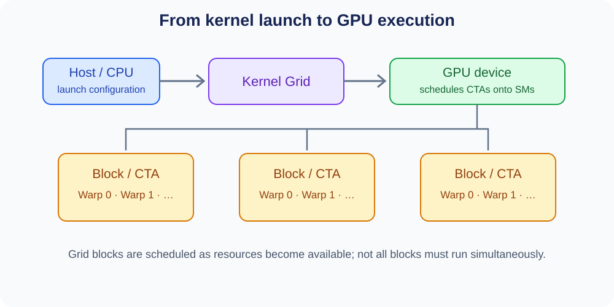

# Kernel 执行模型

**所属分类：** [05 Kernel 优化](README.md)  
**英文名称：** GPU Kernel Execution Model  
**专题编号：** 01

## 01. 一句话定义与核心目的

**一句话定义：** GPU Kernel 执行模型描述一个 Kernel 从主机端启动后，如何由设备端线程组织成 Grid、Block 和 Warp，并由 GPU 硬件调度执行。

**核心目的：** 建立从程序代码到硬件执行的对应关系，理解 Kernel Launch、线程索引、资源分配和执行调度，为判断并行度、访存效率和性能瓶颈提供基础。

## 02. 数学原理与核心技术

### 2.1 可视化理解

*图：Host 启动 Kernel 后形成 Grid；Grid 中的 Block/CTA 在 SM 资源允许时分批驻留，Block 内线程被划分为 Warp 执行。Grid 中所有 Block 不必同时运行。*

### 2.2 数学原理与核心技术

### 2.1 可视化理解

*图：Host 发起 Kernel Launch，Grid 包含多个 Block，Block 被调度到 SM，Block 内线程组成 Warp 执行指令。具体调度和驻留数量由硬件资源决定。*

### 2.2 数学原理与核心技术

以一维向量加法为例：

$$
C_i=A_i+B_i.
$$

CUDA 中常见的全局线程索引为：

$$
i=\text{blockIdx.x}\cdot\text{blockDim.x}+\text{threadIdx.x}.
$$

若每个线程处理一个元素，线程总数通常需要覆盖 $N$ 个元素，并通过边界判断处理最后一个不完整 Block。

**核心技术与概念：**
- **Kernel Launch：** Host 端配置执行网格并启动设备端函数。
- **Grid：** 一次 Kernel Launch 中所有 Block 的集合。
- **Block / CTA：** 可协作的线程集合，Block 内线程可使用 Shared Memory 和同步机制。
- **Warp：** 硬件调度执行的线程组；NVIDIA GPU 通常为 32 个线程。
- **SM：** 执行 Block/CTA 并调度 Warp 的硬件处理单元。
- **Thread Indexing：** 将线程索引映射到数据元素或任务。
- **Bounds Checking：** 处理任务数量不能被 Block 大小整除的边界。

Kernel 执行模型是逻辑组织与硬件调度的抽象，不意味着一个 Block 永久绑定某个 SM，也不意味着 Grid 中所有 Block 同时驻留。Block 会在资源允许时分批调度执行。

## 03. 代表案例

| 项目 | 与本专题的关系 | 值得关注的内容 | 项目与资料 |
|---|---|---|---|
| CUDA Samples | **直接案例：** 展示 Kernel Launch、索引和线程组织 | vectorAdd、reduction、matrixMul | [GitHub](https://github.com/NVIDIA/cuda-samples) |
| CUDA Programming Guide | **权威资料：** 定义 CUDA 执行模型与线程层级 | thread hierarchy、execution configuration | [官方文档](https://docs.nvidia.com/cuda/cuda-c-programming-guide/) |
| Triton | **直接案例：** 用 program instance 与 block 抽象组织 GPU 工作 | program_id、num_warps、launch grid | [GitHub](https://github.com/triton-lang/triton) · [文档](https://triton-lang.org/main/) |
| HIP | **关联案例：** 提供 AMD GPU 的异构 Kernel 编程模型 | grid、work-group、wavefront | [GitHub](https://github.com/ROCm/HIP) |
