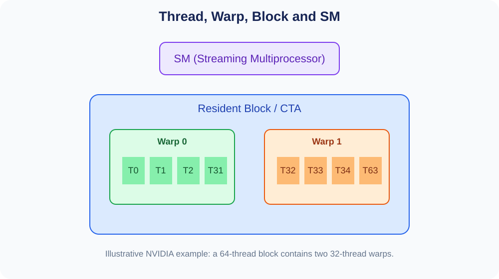

# Thread / Warp / Block / SM

**所属分类：** [05 Kernel 优化](README.md)  
**英文名称：** Thread, Warp, Block and Streaming Multiprocessor  
**专题编号：** 02

## 01. 一句话定义与核心目的

**一句话定义：** Thread、Warp、Block 和 SM 是 GPU 编程与硬件执行中不同层级的组织概念，分别对应逻辑执行线程、硬件调度组、协作线程块和主要计算单元。

**核心目的：** 理解软件定义的线程层级如何映射到硬件资源，明确哪些线程可以协作、哪些线程一起调度，以及寄存器和共享内存等资源如何限制并发执行。

## 02. 数学原理与核心技术

### 2.1 可视化理解

*图：一个 Block 包含多个 Warp，每个 Warp 包含多个 Thread；SM 可同时驻留多个 Block，数量受寄存器、共享内存和架构上限约束。图中以 64-thread Block 为例。*

### 2.2 数学原理与核心技术

### 2.1 可视化理解

### 2.2 数学原理与核心技术

在 NVIDIA CUDA 模型中：
- **Thread：** 执行 Kernel 的逻辑线程，有自己的线程索引和寄存器状态。
- **Warp：** 通常由 32 个线程组成，是指令调度和 SIMT 执行的重要单位。
- **Block / CTA：** 由程序员定义，Block 内线程可通过 Shared Memory 和同步原语协作。
- **SM（Streaming Multiprocessor）：** 包含执行管线、寄存器文件、共享内存/缓存和 Warp 调度资源的硬件单元。

若 Block 有 $T_b$ 个线程，Warp 大小为 $W$，则该 Block 至少需要：

$$
N_{warp}=\left\lceil\frac{T_b}{W}\right\rceil
$$

个 Warp。这里 $W=32$ 是 NVIDIA CUDA 常见配置，其他 GPU 架构可能使用不同的 Wavefront 宽度。

一个 SM 可驻留的 Block 数量受多项资源共同约束，可概念化表示为：

$$
B_{resident}\leq
\min(B_{thread},B_{register},B_{shared},B_{architectural}).
$$

其中各上限分别由线程数、寄存器、共享内存和架构规定的最大驻留 Block 数决定。

**关键区别：** Thread 和 Block 是程序员组织工作的抽象；Warp 是硬件调度粒度；SM 是实际执行资源。Block 被调度到 SM 后，其线程会被划分为 Warp 执行。

## 03. 代表案例

| 项目 | 与本专题的关系 | 值得关注的内容 | 项目与资料 |
|---|---|---|---|
| CUDA Programming Guide | **权威资料：** 解释 Thread、Warp、Block、SM 的执行关系 | thread hierarchy、SM resources | [官方文档](https://docs.nvidia.com/cuda/cuda-c-programming-guide/) |
| CUDA Occupancy Calculator | **关联工具：** 根据线程数和资源使用估算 SM 驻留 Block/Warp | register、shared memory、active blocks | [CUDA Toolkit](https://developer.nvidia.com/cuda-toolkit) |
| Triton | **直接案例：** 将程序实例映射到 GPU 工作单元 | num_warps、threads per warp、layout | [GitHub](https://github.com/triton-lang/triton) |
| ROCm HIP | **关联案例：** 展示 AMD 平台的 work-group 与 wavefront 概念 | work-group、wavefront、compute unit | [GitHub](https://github.com/ROCm/HIP) |
