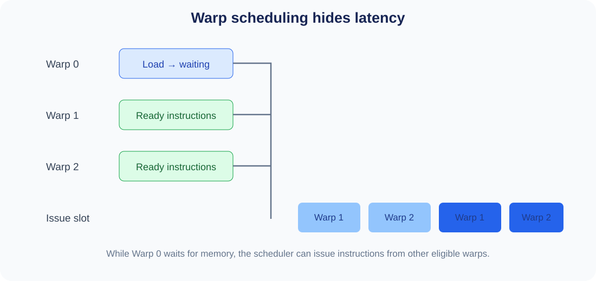

# Warp 调度

**所属分类：** [05 Kernel 优化](README.md)  
**英文名称：** Warp Scheduling  
**专题编号：** 03

## 01. 一句话定义与核心目的

**一句话定义：** Warp 调度是 SM 在多个驻留 Warp 中选择当前可执行 Warp 发射指令的硬件机制。

**核心目的：** 当某个 Warp 因访存依赖、同步或其他原因暂时无法继续执行时，调度器选择其他就绪 Warp 发射指令，以隐藏延迟并保持执行管线繁忙。

## 02. 数学原理与核心技术

### 2.1 可视化理解

*图：Warp 0 因 Load 依赖等待时，调度器可以选择其他就绪 Warp 发射指令，从而隐藏部分访存延迟。*

### 2.2 数学原理与核心技术

### 2.1 可视化理解

### 2.2 数学原理与核心技术

GPU 指令执行存在依赖。例如：

$$
r_1=\mathrm{load}(A[i]),\qquad r_2=r_1+1.
$$

加法必须等待 Load 返回数据。等待期间，SM 可以调度其他就绪 Warp 执行独立指令。

可用简化的延迟隐藏直觉理解：若某类指令的执行间隔为 $I$ 个周期，而一次长延迟等待为 $L$ 个周期，则需要足够多的独立 Warp 工作来覆盖等待；具体数量取决于指令吞吐、调度器数量、依赖结构和内存延迟，不能用单一固定公式概括所有 GPU。

**核心技术与概念：**
- **Ready Warp：** 操作数和执行条件均已满足、可以发射下一条指令的 Warp。
- **Stall：** Warp 因数据依赖、访存、同步或资源冲突而无法发射指令。
- **Latency Hiding：** 通过切换到其他就绪 Warp 覆盖部分等待时间。
- **Instruction-Level Parallelism：** 同一线程或 Warp 内可同时推进的独立指令。
- **Eligible Warps：** 某周期满足发射条件的 Warp 数量，是分析调度是否缺少就绪工作的有用指标。

驻留 Warp 多不代表就绪 Warp 一定多。若所有 Warp 都等待同一内存依赖，单纯提高 Occupancy 也无法消除瓶颈。

## 03. 代表案例

| 项目 | 与本专题的关系 | 值得关注的内容 | 项目与资料 |
|---|---|---|---|
| NVIDIA Nsight Compute | **直接分析工具：** 分析 Warp 状态、发射效率和 Stall 原因 | Warp State Statistics、Scheduler Statistics | [官方文档](https://docs.nvidia.com/nsight-compute/) |
| CUDA Programming Guide | **权威资料：** 说明 SIMT 执行与 Warp 行为 | SIMT architecture、warp divergence | [官方文档](https://docs.nvidia.com/cuda/cuda-c-programming-guide/) |
| Triton | **关联案例：** 通过 num_warps 与 Kernel 组织影响 Warp 数量和工作分配 | num_warps、layout、occupancy trade-off | [GitHub](https://github.com/triton-lang/triton) |
