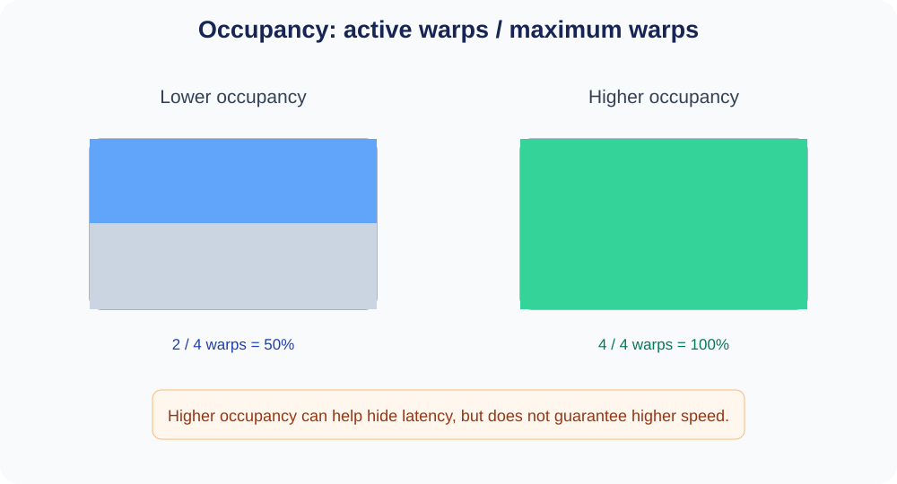

# Occupancy（占用率）

**所属分类：** [05 Kernel 优化](README.md)  
**英文名称：** GPU Occupancy  
**专题编号：** 04

## 01. 一句话定义与核心目的

**一句话定义：** Occupancy 是一个 SM 上实际驻留的 Warp 数量与该 SM 支持的最大驻留 Warp 数量之比。

**核心目的：** 衡量线程资源驻留程度，帮助判断是否有足够多的 Warp 可供调度器选择，以隐藏指令和访存延迟。Occupancy 是资源与调度指标，不是 Kernel 性能的直接评分。

## 02. 数学原理与核心技术

### 2.1 可视化理解

*图：图中用 4 个槽位表示最大可驻留 Warp 数；实际驻留 2 个时 Occupancy 为 50%，驻留 4 个时为 100%。高 Occupancy 不必然更快。*

### 2.2 数学原理与核心技术

### 2.1 可视化理解

*图：Active Warps 占最大支持 Warp 数的比例即 Occupancy。寄存器或 Shared Memory 使用过多，会减少一个 SM 能同时驻留的 Block/Warps。*

### 2.2 数学原理与核心技术

Occupancy 定义为：

$$
Occupancy=
\frac{N_{active\ warps}}
{N_{max\ warps}}.
$$

一个 SM 上的驻留 Block 数受多个资源约束。简化地说：

$$
B_{resident}=
\min\left(
B_{thread},
B_{register},
B_{shared},
B_{block}
\right).
$$

其中：
- $B_{thread}$：线程数量上限允许的 Block 数。
- $B_{register}$：寄存器容量允许的 Block 数。
- $B_{shared}$：共享内存容量允许的 Block 数。
- $B_{block}$：架构规定的最大驻留 Block 数。

**核心技术与概念：**
- **Active Warps：** 当前驻留在 SM 上的 Warp。
- **Theoretical Occupancy：** 根据 Kernel 配置和资源使用估算的理论占用率。
- **Achieved Occupancy：** Kernel 执行期间实际达到的平均或采样占用率。
- **Register Pressure：** 每线程寄存器需求过高可能减少驻留 Warp。
- **Shared-Memory Footprint：** 每 Block 的共享内存使用会限制驻留 Block 数。

更高 Occupancy 不必然更快。一个 Kernel 可能在较低 Occupancy 下仍达到很高吞吐，特别是其指令级并行度高、访存行为良好或已受计算管线限制时。优化目标应是实际执行效率，而不是单独最大化 Occupancy。

## 03. 代表案例

| 项目 | 与本专题的关系 | 值得关注的内容 | 项目与资料 |
|---|---|---|---|
| NVIDIA Nsight Compute | **直接分析工具：** 报告理论与实测 Occupancy、资源限制 | Launch Statistics、Occupancy、Speed of Light | [官方文档](https://docs.nvidia.com/nsight-compute/) |
| CUDA Occupancy Calculator | **直接工具：** 根据线程和资源参数估算驻留 Block | registers per thread、shared memory per block | [CUDA Toolkit](https://developer.nvidia.com/cuda-toolkit) |
| CUDA Programming Guide | **权威资料：** 说明 SM 资源与驻留限制 | hardware resource limits、occupancy | [官方文档](https://docs.nvidia.com/cuda/cuda-c-programming-guide/) |
| Triton | **关联案例：** num_warps、寄存器与 Tile 设计共同影响占用率 | launch configuration、resource trade-offs | [GitHub](https://github.com/triton-lang/triton) |
