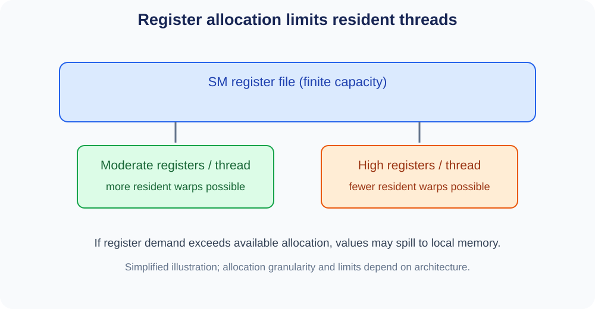

# 寄存器

**所属分类：** [05 Kernel 优化](README.md)  
**英文名称：** GPU Registers  
**专题编号：** 05

## 01. 一句话定义与核心目的

**一句话定义：** GPU 寄存器是线程执行时使用的高速片上存储资源，用于保存操作数、地址、临时变量和中间计算结果。

**核心目的：** 让线程快速访问正在使用的数据，减少对共享内存和设备显存的访问。但每个 SM 的寄存器容量有限，单线程寄存器使用过多会限制同时驻留的 Warp 数量，甚至引发寄存器溢出（Spilling）。

## 02. 数学原理与核心技术

### 2.1 可视化理解

*图：SM 寄存器文件容量有限。每线程寄存器需求增加时，可驻留线程数可能下降；资源不足还可能导致 Spill。*

### 2.2 数学原理与核心技术

### 2.1 可视化理解

*图：SM 的寄存器文件容量由驻留线程共同使用。每线程寄存器需求越高，同一 SM 能容纳的线程数量通常越少；超出可分配资源时可能发生 Spill。*

### 2.2 数学原理与核心技术

设每线程使用 $R_t$ 个寄存器，一个 Block 有 $T_b$ 个线程，则该 Block 的寄存器需求近似为：

$$
R_{block}=R_t\,T_b.
$$

若 SM 可用于线程块的寄存器总量为 $R_{SM}$，仅从寄存器限制估算：

$$
B_{register}
\leq
\left\lfloor\frac{R_{SM}}{R_tT_b}\right\rfloor.
$$

实际还受到寄存器分配粒度、架构限制、其他资源和编译器分配策略影响。

**核心技术与概念：**
- **Register Allocation：** 编译器将变量分配到寄存器。
- **Register Pressure：** 同一时刻需要存活的变量过多，增加寄存器需求。
- **Register Tiling：** 在线程寄存器中保存 Tile 的局部数据或累加器。
- **Spilling：** 寄存器不足时，部分值被放到较慢的本地内存路径，通常会增加访存开销。
- **Launch Bounds / Register Limits：** 某些编程工具允许给出线程块或寄存器使用约束，影响编译器分配与驻留。

寄存器使用并非越少越好。过度限制寄存器可能导致 Spill、重复加载或更多指令；需要在每线程数据复用、并行驻留和实际访存之间权衡。

## 03. 代表案例

| 项目 | 与本专题的关系 | 值得关注的内容 | 项目与资料 |
|---|---|---|---|
| CUDA Programming Guide | **权威资料：** 解释寄存器分配、资源限制与本地内存 | register variables、local memory、launch bounds | [官方文档](https://docs.nvidia.com/cuda/cuda-c-programming-guide/) |
| NVIDIA Nsight Compute | **直接分析工具：** 查看每线程寄存器数量和 Spill 相关指标 | Launch Statistics、local load/store、register usage | [官方文档](https://docs.nvidia.com/nsight-compute/) |
| Triton | **直接案例：** Tile 大小、layout 和 num_warps 会影响编译后的寄存器需求 | compiler metadata、register pressure、matmul tutorial | [GitHub](https://github.com/triton-lang/triton) |
| CUTLASS | **直接案例：** 通过线程级 Tile 和累加器组织寄存器使用 | accumulator fragments、warp-level GEMM | [GitHub](https://github.com/NVIDIA/cutlass) |
