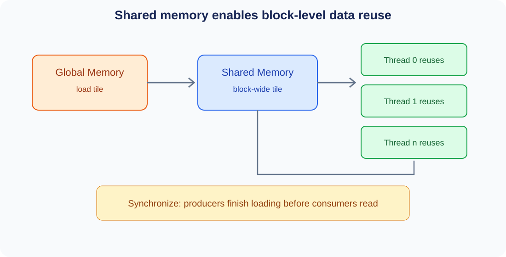

# Shared Memory（共享内存）

**所属分类：** [05 Kernel 优化](README.md)  
**英文名称：** GPU Shared Memory  
**专题编号：** 06

## 01. 一句话定义与核心目的

**一句话定义：** Shared Memory 是 GPU 上可由同一线程块内线程显式协作访问的片上存储空间，常用于暂存和共享数据。

**核心目的：** 让一个 Block 中的多个线程复用已经从较慢存储层加载的数据，并支持线程间数据交换，从而减少重复全局内存访问或实现需要协作的算法。其容量有限，访问模式还需考虑 Bank Conflict。

## 02. 数学原理与核心技术

### 2.1 可视化理解

*图：Block 内线程协作将数据从 Global Memory 加载到 Shared Memory，再供多个线程复用；屏障保证生产者写入完成后消费者再读取。*

### 2.2 数学原理与核心技术

### 2.1 可视化理解

*图：Block 中多个线程协作把数据从 Global Memory 搬到 Shared Memory，再从共享区域读取并复用。同步确保消费者在线程写入完成后读取。*

### 2.2 数学原理与核心技术

以矩阵乘法为例：

$$
C_{ij}=\sum_k A_{ik}B_{kj}.
$$

一个 Block 负责输出矩阵中的一个 Tile。线程协作加载 A、B 的子块到 Shared Memory，然后多次执行乘加，最后将输出写回 Global Memory。

**核心技术：**
- **Cooperative Loading：** 多个线程分工加载一个 Tile。
- **Synchronization：** 使用 Block 级屏障确保数据加载完成后再消费。
- **Bank：** Shared Memory 被划分为多个 Bank；若同一访问阶段多个线程访问同一 Bank 的不同地址，可能发生 Bank Conflict。
- **Padding：** 对数组维度增加填充，改变访问映射，缓解特定转置访问中的 Bank Conflict。
- **Double Buffering：** 使用两个缓冲区交替执行加载和计算，尝试重叠数据传输与计算。
- **Asynchronous Copy：** 在支持的架构和编程接口中，异步搬运数据到共享存储并配合屏障管理依赖。

Shared Memory 使用量会限制每个 SM 可同时驻留的 Block 数量。同步和数据搬运本身也有成本，因此只有当复用收益足以抵消这些成本时，显式使用 Shared Memory 才有价值。

## 03. 代表案例

| 项目 | 与本专题的关系 | 值得关注的内容 | 项目与资料 |
|---|---|---|---|
| CUDA Samples | **直接案例：** 展示 Shared Memory、矩阵乘法和转置 | matrixMul、transpose、shared-memory bank conflict | [GitHub](https://github.com/NVIDIA/cuda-samples) |
| CUTLASS | **直接案例：** 以 Shared Memory 作为 GEMM 多级流水中的数据暂存层 | shared-memory tile、copy atom、pipeline | [GitHub](https://github.com/NVIDIA/cutlass) |
| Triton | **关联案例：** 编译器根据 Tile 和 layout 将数据映射到片上资源 | layout、shared-memory lowering、barrier | [GitHub](https://github.com/triton-lang/triton) |
| CUDA Programming Guide | **权威资料：** 说明 Shared Memory 生命周期、同步与 Bank 行为 | shared memory、synchronization、bank conflicts | [官方文档](https://docs.nvidia.com/cuda/cuda-c-programming-guide/) |
