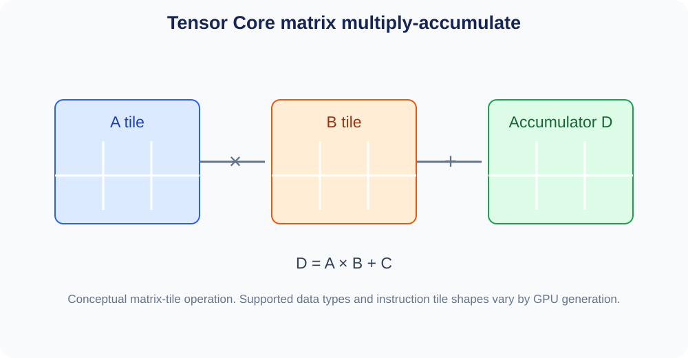

# Tensor Core

**所属分类：** [05 Kernel 优化](README.md)  
**英文名称：** NVIDIA Tensor Core  
**专题编号：** 07

## 01. 一句话定义与核心目的

**一句话定义：** Tensor Core 是 NVIDIA GPU 中面向矩阵乘加等特定张量运算的专用硬件计算单元。

**核心目的：** 对矩阵乘法和相关累加操作提供高吞吐执行能力，支撑深度学习训练与推理中的 GEMM、卷积和 Attention 计算。要获得收益，数据类型、矩阵形状、布局和指令路径需要满足硬件要求。

## 02. 数学原理与核心技术

### 2.1 可视化理解

*图：Tensor Core 执行矩阵乘加，将输入矩阵块相乘并累加到输出累加器。图示强调矩阵级运算，不表示固定的硬件 Tile 尺寸。*

### 2.2 数学原理与核心技术

典型矩阵乘加可以写为：

$$
D=AB+C,
$$

其中 $A$、$B$ 是输入矩阵，$C$ 是累加器或已有输出，$D$ 是结果。Tensor Core 将一组矩阵乘加映射到专用矩阵硬件上执行。

**核心技术与概念：**
- **MMA（Matrix Multiply-Accumulate）：** 矩阵乘加指令或抽象操作。
- **Data Types：** 支持的数据类型随 GPU 架构变化，例如 FP16、BF16、TF32、FP8 等。
- **Accumulator Precision：** 输入精度与累加精度可能不同，需理解指令和框架的精度策略。
- **Warp-level Matrix Operations：** 线程协作提供矩阵片段，映射到 Tensor Core 指令。
- **Tiling：** 将大矩阵划分成适合 Tensor Core 指令和数据搬运的 Tile。
- **Layout：** 决定矩阵元素如何分布到线程、寄存器和共享内存。

Tensor Core 不等同于“所有矩阵乘法都会自动使用”。尺寸太小、数据类型不支持、布局不匹配或计算图没有走到相应指令路径时，可能无法发挥其吞吐优势。

## 03. 代表案例

| 项目 | 与本专题的关系 | 值得关注的内容 | 项目与资料 |
|---|---|---|---|
| CUTLASS | **直接案例：** 构建 Tensor Core GEMM、卷积和相关算子 | MMA atoms、collective、warp-specialized kernels | [GitHub](https://github.com/NVIDIA/cutlass) |
| cuBLAS | **直接案例：** NVIDIA 高性能 BLAS 库，支持利用 Tensor Core 的矩阵运算路径 | GEMM、math modes、precision controls | [官方文档](https://docs.nvidia.com/cuda/cublas/) |
| Triton | **直接案例：** 通过矩阵乘法编程模型生成适配 Tensor Core 的代码 | tl.dot、matrix multiplication tutorial | [GitHub](https://github.com/triton-lang/triton) |
| NVIDIA PTX ISA | **权威资料：** 描述 Tensor Core 相关矩阵指令 | mma、wgmma 等指令族（依架构而定） | [PTX 文档](https://docs.nvidia.com/cuda/parallel-thread-execution/) |
