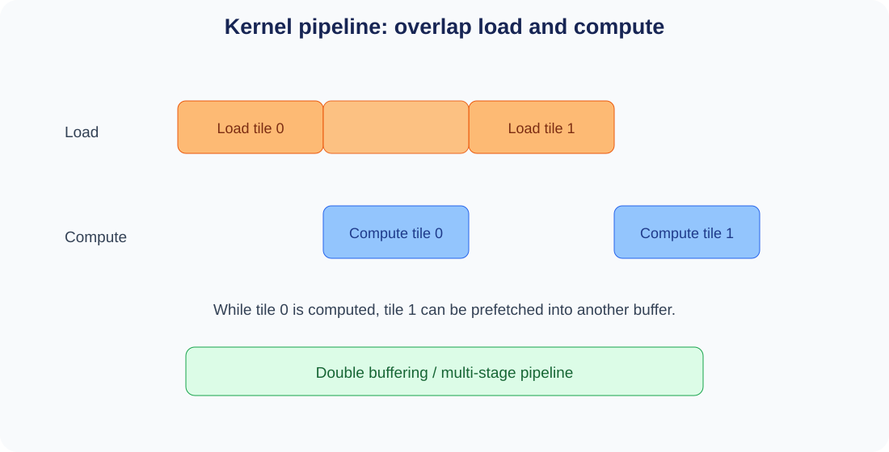

# 流水线

**所属分类：** [05 Kernel 优化](README.md)  
**英文名称：** GPU Kernel Pipelining  
**专题编号：** 08

## 01. 一句话定义与核心目的

**一句话定义：** Kernel 流水线是把数据加载、计算和结果写回等阶段组织成可重叠的执行过程，使不同 Tile 或任务在不同硬件阶段并行推进。

**核心目的：** 隐藏数据搬运和指令执行之间的等待，提高计算单元与内存传输单元的利用率。典型方法包括预取、双缓冲、异步拷贝和多阶段 Pipeline。

## 02. 数学原理与核心技术

### 2.1 可视化理解

*图：单缓冲执行时加载和计算阶段串行；多缓冲流水线中，计算当前 Tile 的同时可预取下一 Tile。真实重叠程度取决于硬件、依赖和资源。*

### 2.2 数学原理与核心技术

假设每个 Tile 的加载时间为 $T_L$，计算时间为 $T_C$。若完全串行处理 $n$ 个 Tile：

$$
T_{serial}=n(T_L+T_C).
$$

理想双阶段流水线在稳定阶段可以接近每个 Tile 用时：

$$
T_{tile}\approx\max(T_L,T_C),
$$

总时间近似为：

$$
T_{pipeline}\approx T_L+T_C+(n-1)\max(T_L,T_C).
$$

这是忽略启动、排空、同步、资源竞争和带宽争用的简化模型。

**核心技术：**
- **Prefetching：** 在当前计算完成前提前请求下一块数据。
- **Double Buffering：** 两个缓冲区交替承担加载与计算。
- **Multi-stage Pipeline：** 使用多个缓冲阶段增加在途工作量。
- **Async Copy：** 使用硬件支持的异步数据搬运接口。
- **Producer–Consumer Synchronization：** 使用屏障或阶段计数确保数据就绪后再消费。
- **Warp Specialization：** 在适用架构和实现中，让不同 Warp 组承担加载与计算等不同角色。

流水线阶段越多不一定越快。额外缓冲区占用共享内存，异步同步机制也有成本；若计算或数据传输本身无法并行，流水线收益会受到限制。

## 03. 代表案例

| 项目 | 与本专题的关系 | 值得关注的内容 | 项目与资料 |
|---|---|---|---|
| CUTLASS | **直接案例：** GEMM 中采用多阶段数据搬运与计算流水线 | pipeline stages、producer/consumer、warp specialization | [GitHub](https://github.com/NVIDIA/cutlass) |
| CUDA Programming Guide | **权威资料：** 介绍异步拷贝、屏障和执行依赖 | asynchronous operations、barrier、TMA（支持架构） | [官方文档](https://docs.nvidia.com/cuda/cuda-c-programming-guide/) |
| Triton | **直接案例：** 通过 num_stages 等编译配置和编程结构进行软件流水 | software pipelining、matmul tutorial | [GitHub](https://github.com/triton-lang/triton) |
| FlashAttention | **关联案例：** 将 Q/K/V 加载、Attention 计算与在线累积组织为分块流水 | IO-aware tiling、prefetch、online softmax | [GitHub](https://github.com/Dao-AILab/flash-attention) |
