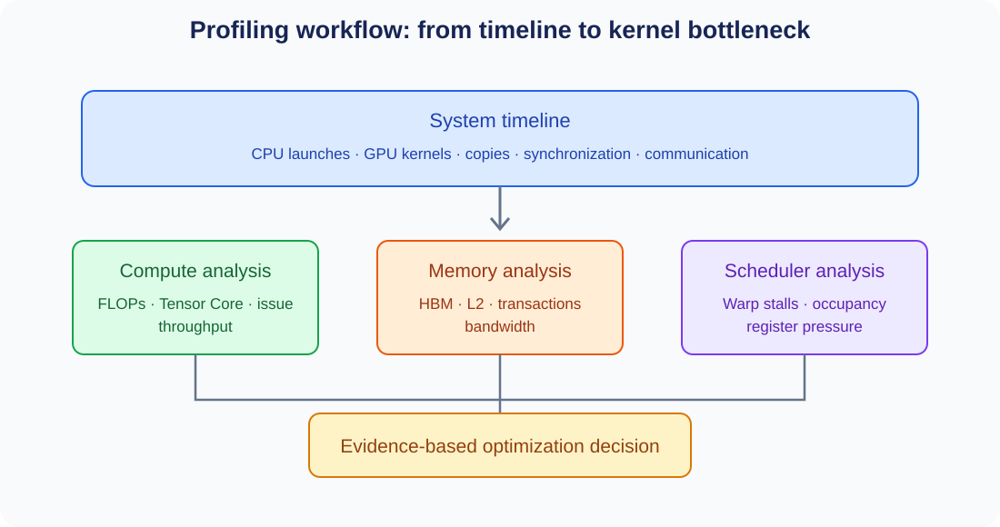

# Profiler 与性能分析

**所属分类：** [05 Kernel 优化](README.md)  
**英文名称：** GPU Profiling and Performance Analysis  
**专题编号：** 09

## 01. 一句话定义与核心目的

**一句话定义：** Profiler 是采集程序运行时间、硬件计数器和执行行为的性能分析工具，用于定位 Kernel 的实际瓶颈。

**核心目的：** 将“感觉程序慢”转化为可验证的性能证据，识别瓶颈来自计算吞吐、内存带宽、访存延迟、Warp Stall、低 Occupancy、同步还是 Kernel Launch 开销，并指导下一轮优化。

## 02. 数学原理与核心技术

### 2.1 可视化理解

*图：性能分析从端到端时间线定位目标 Kernel，再查看 Kernel 内部的计算、内存、Warp 和资源指标。先定位问题，再选择适当的细粒度分析工具。*

### 2.2 数学原理与核心技术

最基本的性能指标是执行时间：

$$
T_{kernel}=t_{end}-t_{start}.
$$

对于重复执行的 Kernel，应在明确同步边界和预热条件后测量，并报告多次运行的统计量，而不是只取一次结果。

常用吞吐指标包括：

$$
Throughput=\frac{Work}{Time}.
$$

例如矩阵运算可以报告 FLOP/s，数据处理可以报告 Bytes/s 或 elements/s。

**核心分析维度：**
- **Timeline Profiling：** 查看 CPU、GPU、Kernel Launch、Memcpy 和同步事件的时间关系。
- **Kernel Profiling：** 对单个 Kernel 采集硬件计数器与执行指标。
- **Memory Analysis：** 检查内存吞吐、缓存命中、访存事务和访问效率。
- **Compute Analysis：** 检查计算管线、指令吞吐和 Tensor Core 利用情况。
- **Warp Stall Analysis：** 查看 Warp 因数据依赖、访存、同步等原因停顿的比例。
- **Occupancy / Resource Analysis：** 检查寄存器、共享内存和驻留 Warp。
- **Roofline Analysis：** 将算术强度和实测性能放到计算/带宽上界模型中分析。

**工具分工：**
- **Nsight Systems：** 先看端到端时间线、CPU-GPU 协同、通信和 Kernel Launch。
- **Nsight Compute：** 再深入分析单个 CUDA Kernel 的硬件指标。
- **PyTorch Profiler：** 从模型和算子层观察 CPU、CUDA 活动及算子调用。
- **rocprof / Omniperf：** AMD ROCm 平台的性能分析工具。

Profiler 数据必须结合具体 GPU 型号、驱动、编译选项、输入规模和测量方法解释。单个指标（例如 Occupancy 或 Tensor Core 利用率）不能独立证明 Kernel 已经优化到位。

## 03. 代表案例

| 项目 | 与本专题的关系 | 值得关注的内容 | 项目与资料 |
|---|---|---|---|
| NVIDIA Nsight Systems | **直接工具：** 系统级时间线分析 | CPU/GPU timeline、CUDA API、通信与同步 | [官方文档](https://docs.nvidia.com/nsight-systems/) |
| NVIDIA Nsight Compute | **直接工具：** 单 Kernel 细粒度性能分析 | Speed of Light、Memory Workload、Warp State、Occupancy | [官方文档](https://docs.nvidia.com/nsight-compute/) |
| PyTorch Profiler | **直接工具：** 模型算子与设备活动分析 | operator trace、CUDA activities、memory profile | [GitHub](https://github.com/pytorch/pytorch) · [官方文档](https://docs.pytorch.org/docs/stable/profiler.html) |
| ROCm Omniperf | **关联工具：** AMD GPU Kernel 性能分析 | kernel metrics、compute/memory bottlenecks | [GitHub](https://github.com/ROCm/omniperf) |
