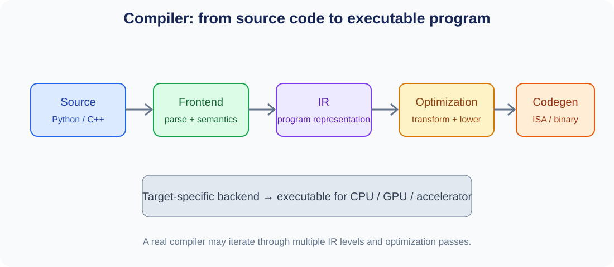

# Compiler 基础

**所属分类：** [06 编译器优化](README.md)  
**英文名称：** Compiler Fundamentals  
**专题编号：** 01

## 01. 一句话定义与核心目的

**一句话定义：** 编译器是将高级语言或计算表达式转换为目标平台可执行代码的系统，转换过程中会分析程序语义并执行一系列优化。

**核心目的：** 在保持程序语义的前提下，把人类易于表达的计算转换成硬件高效执行的指令，同时处理数据类型、内存布局、并行映射和目标架构差异。

## 02. 数学原理与核心技术

### 2.1 可视化理解

*图：源程序经过前端分析形成中间表示，再经优化与目标代码生成，最终由目标平台执行。真实编译器可能有多个 IR 和多轮优化，流程并非严格单向。*

### 2.2 数学原理与核心技术

编译器优化的基本约束是语义保持。设源程序为 $P$，变换后的程序为 $P'$，对于允许的输入集合 $X$，理想情况下要求：

$$
\forall x\in X,\quad
\operatorname{Obs}(P,x)=\operatorname{Obs}(P',x),
$$

其中 $\operatorname{Obs}$ 表示程序可观察行为，例如输出、状态变化和规定的异常行为。浮点运算优化还可能受到舍入误差与严格数值语义约束。

**核心技术与阶段：**
- **Frontend：** 词法、语法和语义分析，将源代码转化为编译器内部结构。
- **IR（Intermediate Representation）：** 用统一的中间表示描述运算、控制流和数据依赖。
- **Optimization Passes：** 执行常量折叠、CSE、循环变换、融合、向量化等优化。
- **Lowering：** 将高层抽象逐步转换为更接近目标硬件的低层表示。
- **Code Generation：** 生成目标指令、汇编或设备代码。
- **Runtime：** 在运行时加载、调度或执行生成的代码；它与编译阶段相关但不是同一阶段。

编译器并不是简单地把 Python 翻译成机器码。对于 PyTorch、JAX 等框架，编译过程还可能涉及计算图捕获、形状推导、自动微分变换和设备代码生成。

## 03. 代表案例

| 项目 | 与本专题的关系 | 值得关注的内容 | 项目与资料 |
|---|---|---|---|
| LLVM | **直接案例：** 通用编译器基础设施，提供 IR、优化 Pass 和后端代码生成 | Clang 前端、LLVM IR、Pass Manager、Backend | [GitHub](https://github.com/llvm/llvm-project) · [文档](https://llvm.org/docs/) |
| MLIR | **直接案例：** 多层级 IR 编译基础设施，适合领域专用编译器 | Dialect、Operation、Pass、Conversion | [官方文档](https://mlir.llvm.org/) |
| GCC | **直接案例：** 完整的编译器工具链与优化实现 | GIMPLE、RTL、优化 Pass | [GitHub](https://github.com/gcc-mirror/gcc) |
| TVM | **关联案例：** 面向机器学习计算的编译与优化框架 | Tensor IR、调度、代码生成 | [GitHub](https://github.com/apache/tvm) |

建议以 LLVM 为主线理解通用编译器，再通过 MLIR 和 TVM 观察机器学习编译器如何引入张量、循环和硬件专用抽象。
