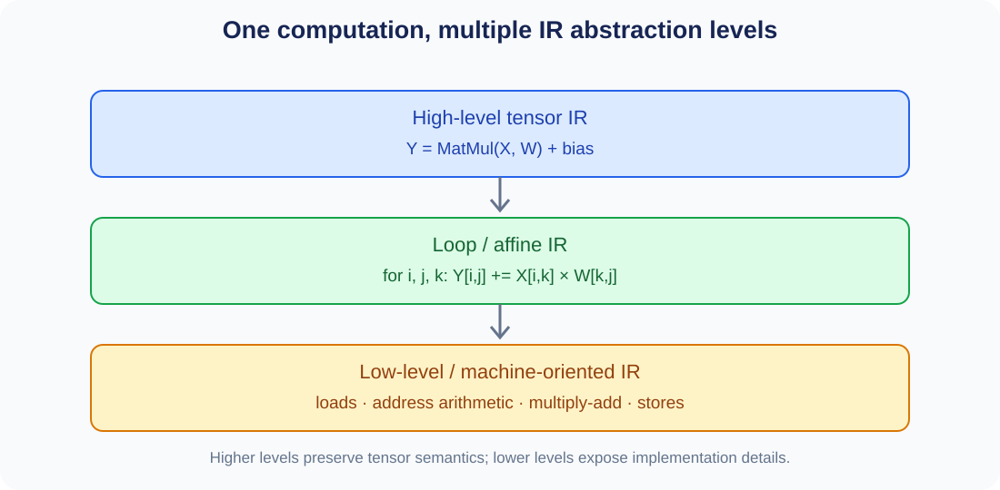

# 中间表示（IR）

**所属分类：** [06 编译器优化](README.md)  
**英文名称：** Intermediate Representation  
**专题编号：** 02

## 01. 一句话定义与核心目的

**一句话定义：** 中间表示（IR）是编译器在源语言与目标机器指令之间使用的结构化程序表示，用于承载运算、数据类型、控制流和依赖关系。

**核心目的：** 将源语言的多样性与目标硬件的复杂性解耦，让优化 Pass 可以在统一表示上工作，并支持同一程序逐层转换到不同硬件。

## 02. 数学原理与核心技术

### 2.1 可视化理解

*图：同一矩阵计算可以在高层表示为 MatMul，在中层表示为循环，在低层表示为地址计算、Load、乘加和 Store。*

### 2.2 数学原理与核心技术

### 2.1 可视化理解

*图：同一计算可以先以高层张量操作表示，再降低为循环和内存操作，最后变成接近机器指令的低层 IR。不同 IR 保留的信息和可优化范围不同。*

### 2.2 数学原理与核心技术

例如：

$$
y=(x+b)\times s
$$

高层 IR 可以把它表示为张量加法和乘法；较低层 IR 则可能展开为循环、索引和标量指令。

常见 IR 形式：
- **AST（Abstract Syntax Tree）：** 保留源代码语法结构，适合前端语义分析。
- **CFG（Control Flow Graph）：** 以基本块和控制流边表示程序执行路径。
- **SSA（Static Single Assignment）：** 每个变量只赋值一次，通过 Phi 节点合并不同控制流路径上的值。
- **LLVM IR：** 面向通用编译优化的低层、类型化 SSA 表示。
- **MLIR Dialect：** 允许在同一框架中定义不同抽象层级的操作集合。
- **Tensor / Graph IR：** 以张量算子和数据依赖描述机器学习计算。

IR 的设计需要权衡抽象能力与优化可见性。高层 IR 保留张量、卷积、Attention 等语义，便于做领域优化；低层 IR 更接近硬件，便于寄存器分配、指令选择和代码生成。

## 03. 代表案例

| 项目 | 与本专题的关系 | 值得关注的内容 | 项目与资料 |
|---|---|---|---|
| LLVM IR | **直接案例：** 经典 SSA 风格低层 IR | Module、Function、Basic Block、Instruction、Phi | [文档](https://llvm.org/docs/LangRef.html) |
| MLIR | **直接案例：** 支持多层级、可扩展 IR 与 Dialect | Operation、Region、Block、Dialect | [GitHub](https://github.com/llvm/llvm-project) · [文档](https://mlir.llvm.org/) |
| OpenXLA HLO | **直接案例：** 以高层张量运算表示机器学习计算图 | HLO instruction、computation、shape | [GitHub](https://github.com/openxla/xla) · [文档](https://openxla.org/xla/hlo_passes) |
| TVM TensorIR | **直接案例：** 表示张量程序、循环和内存访问 | PrimFunc、Block、Buffer、Schedule | [GitHub](https://github.com/apache/tvm) · [文档](https://tvm.apache.org/docs/) |
