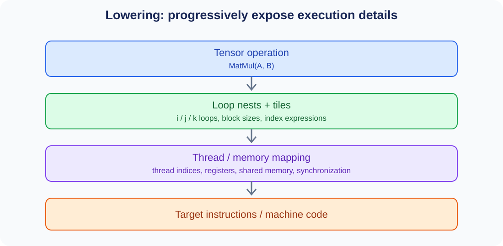

# Lowering（逐层降低）

**所属分类：** [06 编译器优化](README.md)  
**英文名称：** Compiler Lowering  
**专题编号：** 03

## 01. 一句话定义与核心目的

**一句话定义：** Lowering 是把高层、抽象的程序表示逐步转换为更低层、更接近目标硬件执行机制的表示过程。

**核心目的：** 将高级张量算子、循环和并行抽象逐步落实为显式的数据类型、内存访问、线程映射和机器指令，同时在每个层级保留适合该层优化的信息。

## 02. 数学原理与核心技术

### 2.1 可视化理解

*图：Lowering 逐步暴露循环、Tile、线程映射、内存操作和目标指令等实现细节。*

### 2.2 数学原理与核心技术

### 2.1 可视化理解

*图：高层张量算子逐步变成循环/索引、线程与内存操作，再转成目标指令。实际编译器的层级和顺序因框架与后端不同。*

### 2.2 数学原理与核心技术

例如矩阵乘法：

$$
C_{ij}=\sum_k A_{ik}B_{kj}
$$

在高层 IR 中可以是一个 MatMul 操作；Lowering 后逐步展开为 Tile 循环、线程索引、向量加载、乘加指令和存储操作。

**核心技术：**
- **Dialect Conversion：** 将一种 IR Dialect 的操作转换为另一种 Dialect。
- **Loop Lowering：** 将张量计算转换为循环嵌套与迭代空间。
- **Vectorization：** 将标量操作转换为向量或硬件矩阵指令。
- **Memory Lowering：** 明确数据所在存储空间、地址计算和读写操作。
- **Parallel Mapping：** 将循环迭代映射到 Thread、Warp、Block 或设备网格。
- **Instruction Selection：** 将低层操作匹配为目标 ISA 指令。

Lowering 不是简单地“降低抽象程度”。过早 Lowering 可能丢失高层语义，使后续难以识别融合、稀疏或矩阵结构。因此编译器通常会在不同层级之间安排优化 Pass。

## 03. 代表案例

| 项目 | 与本专题的关系 | 值得关注的内容 | 项目与资料 |
|---|---|---|---|
| MLIR | **直接案例：** 通过 Dialect Conversion 和 Pass 完成逐层转换 | Linalg、Affine、SCF、MemRef、LLVM Dialect | [文档](https://mlir.llvm.org/docs/DialectConversion/) |
| Triton | **直接案例：** 将块级张量程序降低为 GPU 专用表示和指令 | Triton IR、TritonGPU、LLVM IR、PTX | [GitHub](https://github.com/triton-lang/triton) |
| TVM | **直接案例：** 从 TensorIR 调度表示降低到目标后端代码 | TensorIR、TIR transformations、codegen | [GitHub](https://github.com/apache/tvm) |
| IREE | **直接案例：** 基于 MLIR 的端到端机器学习编译器，包含多层转换 | Flow、HAL、Linalg、LLVMGPU 等层级 | [GitHub](https://github.com/iree-org/iree) |
