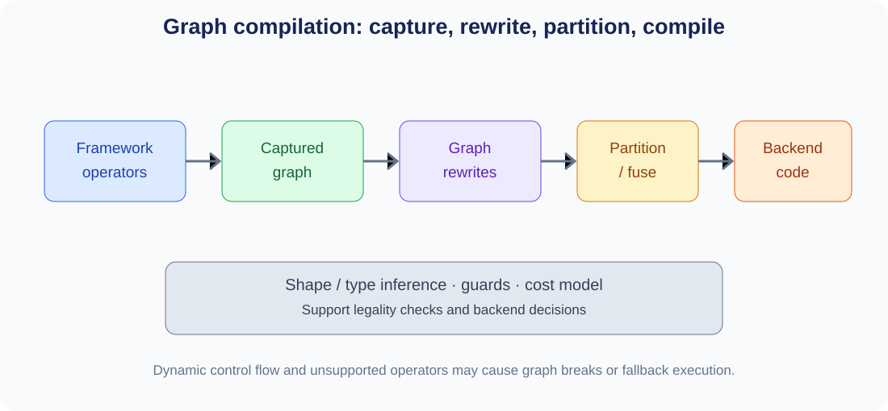

# 图编译

**所属分类：** [06 编译器优化](README.md)  
**英文名称：** Graph Compilation  
**专题编号：** 04

## 01. 一句话定义与核心目的

**一句话定义：** 图编译是将模型或程序的计算图捕获为编译器可分析的图表示，再通过图级优化、分区和代码生成形成可执行程序的过程。

**核心目的：** 在单个算子之外观察更大的计算上下文，识别跨算子融合、常量传播、冗余计算和设备分区机会，并减少解释执行与逐算子调度开销。

## 02. 数学原理与核心技术

### 2.1 可视化理解

*图：模型先被捕获为计算图，再进行图级优化、设备分区和代码生成。动态 Shape、控制流和副作用会限制捕获与变换。*

### 2.2 数学原理与核心技术

### 2.1 可视化理解

*图：模型前向执行先被捕获为计算图，随后进行图级优化、设备分区和代码生成。动态图中的数据依赖、控制流和副作用会影响捕获范围与优化合法性。*

### 2.2 数学原理与核心技术

将模型表示为图：

$$
G=(V,E),
$$

其中 $V$ 表示算子或值，$E$ 表示数据依赖。图编译器寻找一个语义保持的变换：

$$
G\longrightarrow G',
$$

使得 $G'$ 在目标设备上的执行成本更低，同时保持程序的可观察行为。

**核心技术：**
- **Graph Capture：** 通过 tracing、symbolic tracing 或显式模型 IR 捕获计算关系。
- **Graph Simplification：** 常量折叠、CSE、DCE、形状推导和代数简化。
- **Graph Partitioning：** 按设备能力、算子支持和数据传输成本划分子图。
- **Fusion：** 将适合的子图合并成更少的执行单元。
- **Shape Specialization：** 针对已知或受约束的输入形状生成专门代码。
- **Execution Planning：** 决定子图、Kernel 和内存分配的执行顺序。

图编译需要处理动态 Shape、数据依赖、控制流、别名和副作用。图越大并不必然优化越好：捕获成本、编译时间、代码膨胀和动态输入都会影响收益。

## 03. 代表案例

| 项目 | 与本专题的关系 | 值得关注的内容 | 项目与资料 |
|---|---|---|---|
| PyTorch torch.compile | **直接案例：** 捕获并优化 PyTorch 程序，后端常使用 TorchInductor | Dynamo、FX Graph、AOTAutograd、Inductor | [GitHub](https://github.com/pytorch/pytorch) · [文档](https://docs.pytorch.org/docs/stable/torch.compiler.html) |
| OpenXLA XLA | **直接案例：** 将计算图转换为 HLO 并执行图级优化 | StableHLO、HLO、SPMD partitioning | [GitHub](https://github.com/openxla/xla) |
| TensorRT | **直接案例：** 构建优化后的推理执行引擎 | Network definition、optimization profiles、engine build | [GitHub](https://github.com/NVIDIA/TensorRT) |
| IREE | **直接案例：** 图/张量程序编译到多种设备后端 | compiler pipeline、HAL、dispatch formation | [GitHub](https://github.com/iree-org/iree) |

图编译关注跨算子的全局机会；单个融合 Kernel 的线程组织和资源调优，则属于 Kernel 与内存优化专题。
