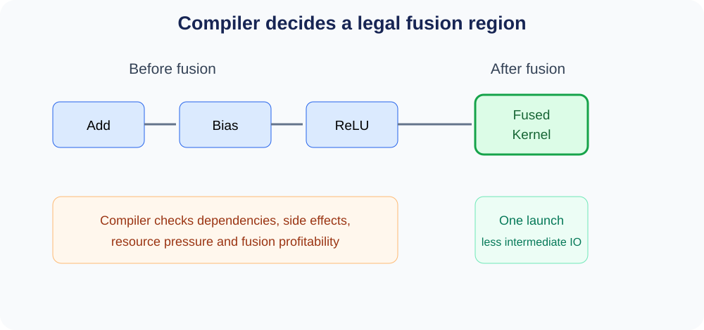

# 编译器算子融合

**所属分类：** [06 编译器优化](README.md)  
**英文名称：** Compiler Operator Fusion  
**专题编号：** 05

## 01. 一句话定义与核心目的

**一句话定义：** 编译器算子融合是在计算图或 IR 中识别满足条件的连续操作，并将其组合成更少的执行单元或 Kernel 的编译期变换。

**核心目的：** 减少 Kernel Launch、中间张量物化和重复内存访问，同时让编译器根据形状、布局和硬件资源自动决定融合范围。它与计算图优化中的算子融合属于同一优化思想，但本专题重点是编译器如何识别、决策和生成融合代码。

## 02. 数学原理与核心技术

### 2.1 可视化理解

*图：编译器将多个相邻算子融合为一个 Kernel，避免中间张量写回；融合范围还需考虑依赖和资源约束。*

### 2.2 数学原理与核心技术

考虑：

$$
y=\operatorname{ReLU}(x+b).
$$

分离执行可能产生中间张量 $t=x+b$；融合后直接计算：

$$
y_i=\max(x_i+b_i,0).
$$

编译器的关键任务是找到合法融合区域，并生成能在目标硬件上有效执行的代码。

**核心技术：**
- **Fusion Pattern：** 识别可融合的 Producer–Consumer、Elementwise、Reduction 等模式。
- **Fusion Legality：** 检查数据依赖、控制流、副作用和数值语义。
- **Fusion Cost Model：** 估算减少的访存与启动开销，以及寄存器压力、并行度下降等潜在代价。
- **Fusion Boundary：** 决定融合子图的输入、输出和内部中间值。
- **Kernel Generation：** 将融合区域降低并生成一个或多个目标 Kernel。
- **Epilogue Fusion：** 将偏置、激活、缩放等后处理并入 GEMM 输出阶段。

融合越大并不总越好。编译器需要平衡访存减少、Kernel 数量、寄存器占用、代码规模和硬件并行度。

## 03. 代表案例

| 项目 | 与本专题的关系 | 值得关注的内容 | 项目与资料 |
|---|---|---|---|
| TorchInductor | **直接案例：** 对 FX 图执行融合分区并生成 Triton/C++ 代码 | Scheduler、Fusion、codegen | [GitHub](https://github.com/pytorch/pytorch) · [TorchInductor 文档](https://docs.pytorch.org/docs/stable/torch.compiler.html) |
| XLA | **直接案例：** 在 HLO 层执行融合并生成后端程序 | HLO Fusion、fusion emitter | [GitHub](https://github.com/openxla/xla) |
| TVM | **直接案例：** 通过计算图与 TensorIR 调度融合计算 | FuseOps、compute_at、TensorIR | [GitHub](https://github.com/apache/tvm) |
| TensorRT | **直接案例：** 推理引擎构建阶段执行层融合和 Kernel 选择 | layer fusion、tactic selection | [GitHub](https://github.com/NVIDIA/TensorRT) |
