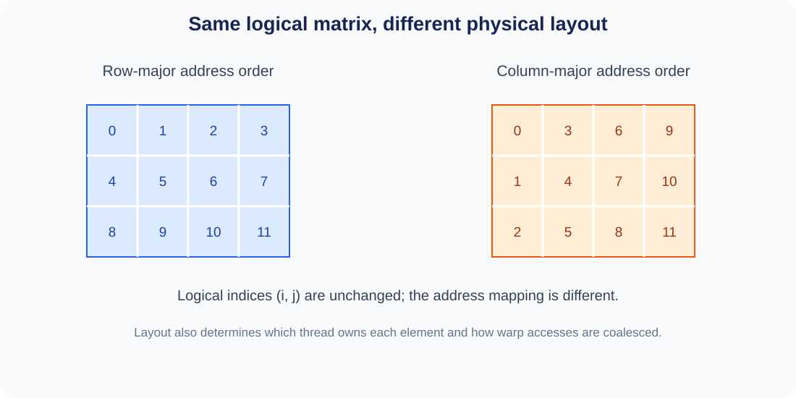

# Layout Transformation（布局变换）

**所属分类：** [06 编译器优化](README.md)  
**英文名称：** Layout Transformation  
**专题编号：** 06

## 01. 一句话定义与核心目的

**一句话定义：** Layout Transformation 是改变张量元素在内存地址、线程、Warp、寄存器或共享内存之间的映射方式，以适应目标计算和硬件访问模式的变换。

**核心目的：** 让数据布局与线程访问、向量化、矩阵指令和存储层级相匹配，减少不合并访存、跨线程交换和不必要的数据重排。逻辑张量形状可以保持不变，但其物理存储或线程分布发生变化。

## 02. 数学原理与核心技术

### 2.1 可视化理解

*图：逻辑矩阵相同，但行主序和列主序的地址映射不同；GPU 还需要决定元素由哪个线程持有。*

### 2.2 数学原理与核心技术

### 2.1 可视化理解

*图：同一逻辑矩阵可按行主序或列主序存储，也可按不同线程布局分配元素。逻辑索引不变，物理地址与线程所有权改变。*

### 2.2 数学原理与核心技术

对于二维张量 $A\in\mathbb R^{M\times N}$，行主序（Row-major）下元素地址可写为：

$$
addr(A_{ij})=base+(iN+j)s,
$$

其中 $s$ 是元素字节数。列主序（Column-major）下：

$$
addr(A_{ij})=base+(jM+i)s.
$$

逻辑元素 $A_{ij}$ 相同，但地址映射不同。GPU 编译器还需要决定每个元素由哪个线程持有，以及是否需要在 Warp 或 Block 内交换数据。

**核心技术：**
- **Memory Layout：** 行主序、列主序、Blocked/Tiled 等内存布局。
- **Thread Layout：** 将逻辑张量元素映射到线程、Warp 和寄存器。
- **Swizzle：** 通过特定索引重排改善 Bank、缓存或访存模式。
- **Transpose / Permutation：** 改变维度顺序或元素排列。
- **Layout Conversion：** 在不同线程或存储布局之间搬运数据，可能需要 Shuffle、Shared Memory 或全局内存重排。
- **Vectorization Alignment：** 让连续元素布局满足向量加载和硬件矩阵指令要求。

布局变换可能引入真实数据搬运，因此不能只看索引表达式是否更简单。需要判断变换是否能减少后续访存、提升指令效率，且搬运成本是否值得。

## 03. 代表案例

| 项目 | 与本专题的关系 | 值得关注的内容 | 项目与资料 |
|---|---|---|---|
| Triton | **直接案例：** 通过 blocked layout 和编译器布局转换映射张量元素到线程 | BlockedLayout、SliceConfig、convert_layout | [GitHub](https://github.com/triton-lang/triton) |
| CUTLASS | **直接案例：** 为 GEMM 定义线程、Warp 和矩阵片段的数据布局 | TensorRef、Layout、TensorOp multiplicand layout | [GitHub](https://github.com/NVIDIA/cutlass) |
| MLIR GPU / NVGPU Dialects | **直接案例：** 表示 GPU 分布式张量布局和硬件相关操作 | GPU mapping、NVGPU、layout conversion | [MLIR 文档](https://mlir.llvm.org/) |
| TVM TensorIR | **关联案例：** 通过数据布局和调度变换改变张量访问方式 | layout transform、schedule、buffer access | [GitHub](https://github.com/apache/tvm) |
