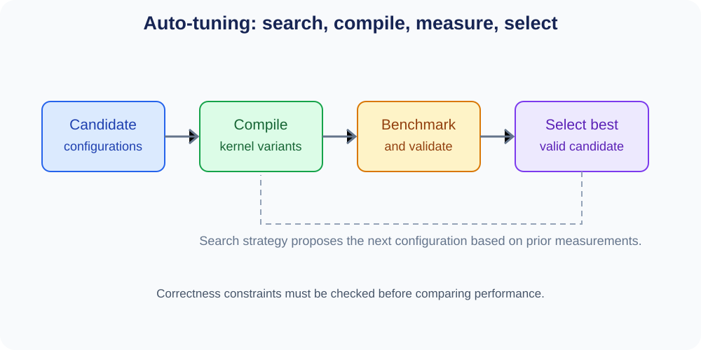

# Auto-Tuning（自动调优）

**所属分类：** [06 编译器优化](README.md)  
**英文名称：** Auto-Tuning  
**专题编号：** 07

## 01. 一句话定义与核心目的

**一句话定义：** Auto-Tuning 是自动搜索 Kernel 或计算程序的配置参数与实现策略，并根据目标硬件上的测量结果选择性能较好的方案。

**核心目的：** 减少人工试错，在不同输入形状、数据类型和硬件上寻找合适的 Tile 大小、Warp 数、流水级数、算法和代码变体。自动调优是搜索与测量过程，不等同于编译器静态优化。

## 02. 数学原理与核心技术

### 2.1 可视化理解

*图：调优器从候选配置中选择参数，编译并运行 Kernel，测量性能后更新搜索方向；最终选择满足正确性要求且性能较好的配置。*

### 2.2 数学原理与核心技术

设配置参数为：

$$
\theta=(B_M,B_N,B_K,n_{warps},n_{stages},\ldots).
$$

自动调优可写成优化问题：

$$
\theta^*=\arg\min_{\theta\in\Theta}T(\theta),
$$

其中 $\Theta$ 是候选配置集合，$T(\theta)$ 是指定输入与硬件上测得的执行时间。实际搜索还必须满足正确性、显存和资源限制等约束。

**核心技术：**
- **Search Space：** 定义可调参数及其合法取值。
- **Grid Search：** 穷举有限候选配置，简单但成本可能很高。
- **Random Search：** 随机采样配置，适合高维搜索空间。
- **Bayesian Optimization：** 根据已测样本建立代理模型，选择有潜力的新配置。
- **Evolutionary Search：** 通过变异、选择等方式探索候选方案。
- **Cost Model：** 用解析模型或学习模型预测配置成本，减少真实测量次数。
- **Correctness Validation：** 对候选配置先验证数值正确性，再比较性能。

调优结果可能过拟合某个输入形状或设备。应明确测试分布、重复次数、预热和计时方式，并考虑编译时间与缓存影响。

## 03. 代表案例

| 项目 | 与本专题的关系 | 值得关注的内容 | 项目与资料 |
|---|---|---|---|
| Triton Autotune | **直接案例：** 通过配置列表和性能测量选择 Kernel 参数 | Config、num_warps、num_stages、key | [GitHub](https://github.com/triton-lang/triton) · [文档](https://triton-lang.org/main/python-api/generated/triton.autotune.html) |
| TVM MetaSchedule | **直接案例：** 通过搜索和成本模型自动优化 TensorIR 程序 | Search Strategy、Cost Model、Measure Candidate | [GitHub](https://github.com/apache/tvm) |
| Ansor | **经典研究案例：** 自动生成并搜索张量程序调度 | hierarchical search、task scheduler、cost model | [论文](https://arxiv.org/abs/2006.06762) |
| OpenTuner | **通用工具：** 面向软件配置参数的自动搜索框架 | search techniques、measurement interface | [GitHub](https://github.com/jansel/opentuner) |
