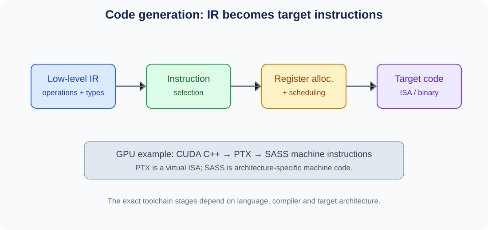

# 代码生成

**所属分类：** [06 编译器优化](README.md)  
**英文名称：** Code Generation  
**专题编号：** 08

## 01. 一句话定义与核心目的

**一句话定义：** 代码生成是编译器把优化后的中间表示转换为目标平台可执行代码的阶段，包括指令选择、寄存器分配、指令调度和目标文件生成。

**核心目的：** 将抽象计算落实为目标 ISA 和硬件能够执行的指令，同时满足调用约定、寄存器约束、内存模型和目标文件格式要求。它决定高层优化最终如何体现在机器指令上。

## 02. 数学原理与核心技术

### 2.1 可视化理解

*图：优化后的 IR 经指令选择、寄存器分配、调度和目标文件生成，成为目标 ISA 可执行的代码。*

### 2.2 数学原理与核心技术

### 2.1 可视化理解

### 2.2 数学原理与核心技术

例如高层运算：

$$
y=a\times b+c
$$

在支持 FMA 的目标平台上，可能被选择为融合乘加指令：

$$
y=\operatorname{fma}(a,b,c).
$$

这可能改变舍入路径，因此是否允许融合还取决于浮点语义和编译选项。

**核心技术：**
- **Instruction Selection：** 将 IR 操作映射到目标 ISA 指令或指令序列。
- **Register Allocation：** 将虚拟寄存器分配到有限的物理寄存器；溢出时可能插入 Spill/Reload。
- **Instruction Scheduling：** 在依赖和资源约束下安排指令顺序，以改善流水线利用。
- **Machine-Level Optimization：** 在机器 IR 层进行窥孔优化、指令合并和冗余消除。
- **Assembly / Object Emission：** 生成汇编、目标文件或设备代码。
- **Linking：** 解析符号和外部依赖，形成可加载的程序或模块。

代码生成并不是简单选择“最少指令”。指令延迟、吞吐、寄存器压力、访存行为和硬件专用单元都会影响最终性能。

## 03. 代表案例

| 项目 | 与本专题的关系 | 值得关注的内容 | 项目与资料 |
|---|---|---|---|
| LLVM CodeGen | **直接案例：** 从 LLVM IR 到 Machine IR、汇编与目标文件 | instruction selection、register allocation、MC layer | [GitHub](https://github.com/llvm/llvm-project) · [LLVM Code Generator](https://llvm.org/docs/CodeGenerator.html) |
| NVIDIA PTX / NVCC | **直接案例：** CUDA C++ 经编译生成 PTX，再由工具链生成 GPU 机器代码 | PTX ISA、ptxas、SASS inspection | [PTX 文档](https://docs.nvidia.com/cuda/parallel-thread-execution/) · [CUDA 文档](https://docs.nvidia.com/cuda/cuda-compiler-driver-nvcc/) |
| Triton | **直接案例：** Triton Kernel 经多层 IR 降低并生成 PTX/目标代码 | LLVM backend、PTX generation | [GitHub](https://github.com/triton-lang/triton) |
| MLIR | **关联案例：** 通过目标 Dialect 转换和 LLVM IR 连接后端代码生成 | LLVM Dialect、translation、target lowering | [MLIR 文档](https://mlir.llvm.org/) |

如果要研究一个 Kernel 为什么生成了某条指令、为什么出现 Spill，最终需要查看编译器输出的 PTX、SASS 或机器级 IR，而不能只看 Python 层代码。
