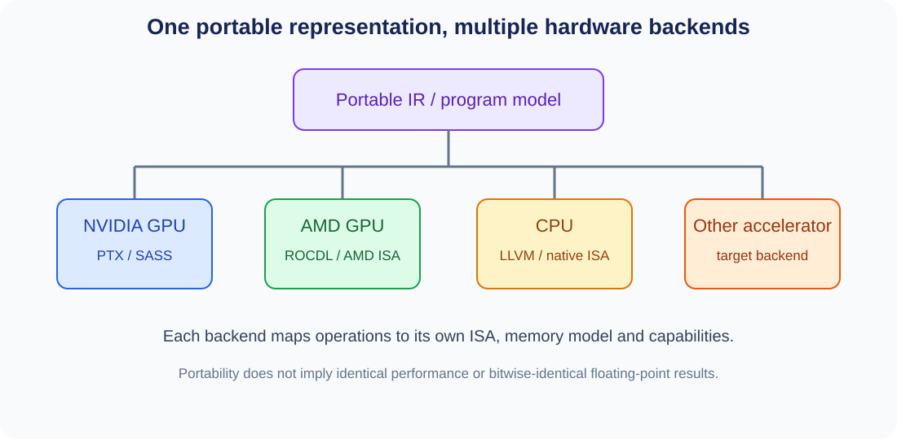

# 跨硬件编译

**所属分类：** [06 编译器优化](README.md)  
**英文名称：** Cross-Hardware Compilation  
**专题编号：** 09

## 01. 一句话定义与核心目的

**一句话定义：** 跨硬件编译是通过统一或分层的程序表示与后端接口，将同一计算逻辑映射到不同厂商、不同架构的 CPU、GPU 或专用加速器上。

**核心目的：** 减少为每种硬件单独重写算法的工作量，同时利用各平台的计算单元、存储层级和指令特征生成高效代码。跨硬件可移植性与各平台最优性能之间通常存在权衡。

## 02. 数学原理与核心技术

### 2.1 可视化理解

*图：统一的计算表示经过不同目标后端，分别映射到 NVIDIA GPU、AMD GPU、CPU 或其他加速器。后端需要处理不同 ISA、内存模型和硬件能力。*

### 2.2 数学原理与核心技术

设同一计算任务为 $F$，目标硬件集合为 $\{H_1,H_2,\ldots,H_n\}$。编译器需要为每个硬件生成实现：

$$
P_i=\operatorname{Compile}(F,H_i).
$$

理想情况下，每个实现都保持任务语义：

$$
\operatorname{Obs}(P_i,x)\approx F(x),
$$

这里使用近似符号是因为不同硬件的浮点格式、舍入和数学库实现可能造成数值差异，具体容差应由应用定义。

**核心技术：**
- **Portable IR：** 使用相对硬件无关的 IR 表达计算语义。
- **Target Backend：** 为不同 ISA 和硬件资源提供代码生成后端。
- **Capability Detection：** 根据设备支持的数据类型、指令和内存能力选择实现路径。
- **Kernel Specialization：** 针对具体架构、形状或数据类型生成专用 Kernel。
- **Runtime Abstraction：** 统一设备发现、内存管理、Kernel Launch 和同步接口。
- **Numerical Validation：** 检查跨设备实现的数值误差和边界行为。

跨硬件编译不意味着所有平台都能获得相同性能。不同设备的 Warp/Wavefront、矩阵指令、共享存储、内存带宽和编译器成熟度不同，通常需要后端专门优化与调优。

## 03. 代表案例

| 项目 | 与本专题的关系 | 值得关注的内容 | 项目与资料 |
|---|---|---|---|
| MLIR | **直接案例：** 通过 Dialect 和 Conversion 支持多硬件编译路径 | target-specific dialect、LLVM/NVGPU 等后端 | [GitHub](https://github.com/llvm/llvm-project) · [文档](https://mlir.llvm.org/) |
| IREE | **直接案例：** 面向多种设备后端的端到端 ML 编译与运行时 | HAL、backend、dispatch、VMVX/Vulkan/LLVMCPU 等 | [GitHub](https://github.com/iree-org/iree) |
| Apache TVM | **直接案例：** 面向多种 CPU、GPU 和加速器生成代码 | target、runtime、TensorIR、BYOC | [GitHub](https://github.com/apache/tvm) |
| Triton | **关联案例：** 提供 GPU Kernel DSL，并逐步扩展到不同 GPU 后端生态 | compiler backend、target-specific lowering | [GitHub](https://github.com/triton-lang/triton) |
| SYCL / oneAPI | **直接案例：** 通过统一 C++ 编程模型支持不同类型的加速设备 | SYCL device、backend、oneMKL | [oneAPI](https://github.com/oneapi-src) · [规范](https://www.khronos.org/sycl/) |
