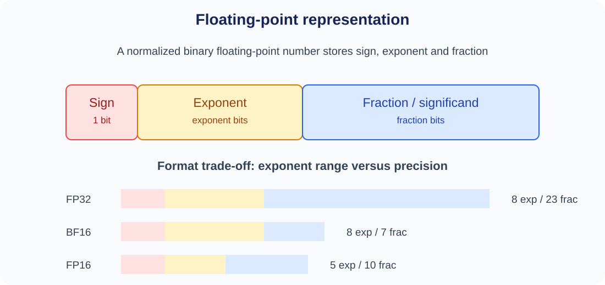

# 浮点数基础

**所属分类：** [07 数值精度优化](README.md)  
**英文名称：** Floating-Point Fundamentals  
**专题编号：** 01

## 01. 一句话定义与核心目的

**一句话定义：** 浮点数是一种用有限位二进制编码近似表示实数的数值格式，通常由符号位、指数位和尾数（有效数）字段组成。

**核心目的：** 在有限存储空间内覆盖很大的数值范围，同时提供可控的相对精度。理解浮点格式是分析舍入误差、混合精度训练、量化和数值稳定性的基础；不同格式在动态范围、有效精度、存储成本和硬件吞吐之间做出不同取舍。

## 02. 数学原理与核心技术

### 2.1 可视化理解

*图：浮点格式将比特分配给符号、指数和尾数。FP32、BF16、FP16 的指数位与尾数位分配不同，因此可表示范围和精度不同。图中字段长度为示意比例，实际位数见下表。*

### 2.2 数学原理与核心技术

对于规格化二进制浮点数，可将其概念性地写为：

$$
x=(-1)^s\times 2^{e-b}\times (1.f)_2
$$

其中 $s$ 为符号位，$e$ 为存储的指数编码，$b$ 为指数偏置，$f$ 为尾数字段；具体特殊编码和非规格化数另有规则。

常见格式的位宽分配：

| 格式 | 总位数 | 指数位 | 尾数位（不含隐含位） | 主要特点 |
|---|---:|---:|---:|---|
| FP32 | 32 | 8 | 23 | 精度较高、动态范围较大 |
| FP16 | 16 | 5 | 10 | 存储和带宽成本较低，但指数范围较窄 |
| BF16 | 16 | 8 | 7 | 指数范围接近 FP32，尾数精度较低 |
| FP64 | 64 | 11 | 52 | 更高精度，常用于数值参考与科学计算 |

**核心技术与概念：**

- **Sign / Exponent / Fraction：** 分别决定符号、数量级和有效数字精度。
- **Exponent Bias：** 指数采用偏置编码，支持正负指数。
- **Normalized / Subnormal：** 规格化数具有隐含最高有效位；非规格化数用于表示接近零的更小数值。
- **Special Values：** 包括正负零、正负无穷和 NaN。
- **Rounding Modes：** 最常见的是 round-to-nearest, ties-to-even；不同舍入模式会影响结果。
- **ULP：** 相邻可表示浮点数之间的间距，用于描述局部表示精度。
- **Unit Roundoff：** 衡量给定格式在特定舍入模型下的基本相对舍入误差尺度。

浮点数不是实数的精确编码。加法、乘法和除法通常会先得到精确结果，再舍入到可表示集合；因此运算顺序可能影响最终结果。还需区分存储格式与计算精度：例如低精度输入可以在更高精度中累积。

## 03. 代表案例

| 项目 | 与本专题的关系 | 值得关注的内容 | 项目与资料 |
|---|---|---|---|
| IEEE 754 | **基础标准：** 定义二进制浮点格式、特殊值和舍入行为 | binary32、binary64、舍入模式、异常值 | [IEEE 754-2019](https://standards.ieee.org/standard/754-2019.html) |
| NVIDIA CUDA Programming Guide | **工程参考：** 说明 GPU 支持的数据类型及浮点行为 | FP16、BF16、TF32、FP32、FP64 与设备能力 | [CUDA Programming Guide](https://docs.nvidia.com/cuda/cuda-c-programming-guide/) |
| NumPy | **实践工具：** 提供多种浮点 dtype，可观察类型转换和表示精度 | `float16`、`float32`、`float64`、`finfo` | [GitHub](https://github.com/numpy/numpy) · [数据类型文档](https://numpy.org/doc/stable/user/basics.types.html) |
| PyTorch | **工程案例：** 张量支持多种浮点 dtype，并允许控制运算精度策略 | dtype、autocast、矩阵乘法精度设置 | [GitHub](https://github.com/pytorch/pytorch) · [Tensor dtype](https://docs.pytorch.org/docs/stable/tensors.html) |
