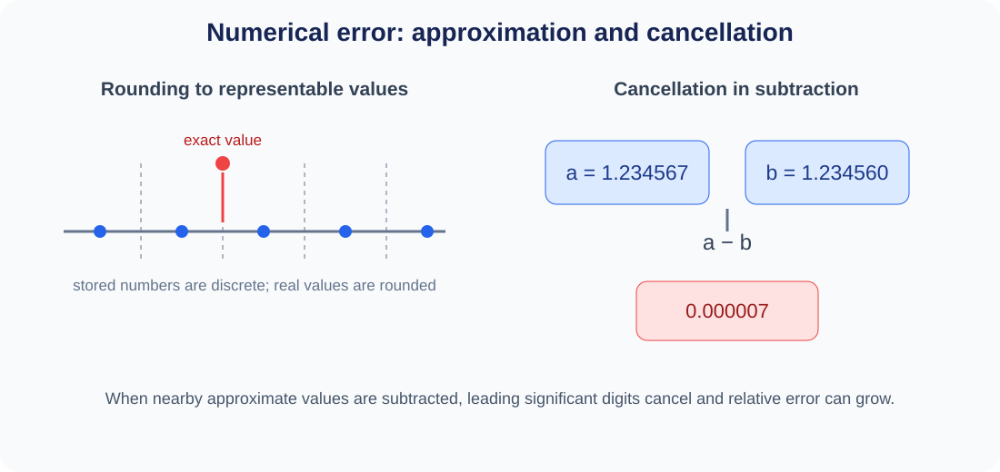

# 数值误差

**所属分类：** [07 数值精度优化](README.md)  
**英文名称：** Numerical Error  
**专题编号：** 02

## 01. 一句话定义与核心目的

**一句话定义：** 数值误差是计算机有限精度运算所得结果与数学精确结果之间的差异，来源包括输入表示、舍入、截断和算法近似等。

**核心目的：** 量化计算结果偏离精确值的程度，分析误差如何在连续运算中传播，并判断某种精度或算法是否满足任务容差。性能优化不能只看运行时间，还必须理解误差从哪里来、会不会被放大。

## 02. 数学原理与核心技术

### 2.1 可视化理解

*图：输入表示误差和每一步运算的舍入误差会共同影响最终结果；在病态问题或不稳定算法中，微小扰动可能被显著放大。*

### 2.2 数学原理与核心技术

常见误差度量包括绝对误差：

$$
E_{abs}=|\hat{x}-x|,
$$

相对误差：

$$
E_{rel}=\frac{|\hat{x}-x|}{|x|},
$$

其中 $x$ 是参考值，$\hat{x}$ 是计算值。若 $x$ 接近零，相对误差可能失去解释力，需要同时报告绝对误差或采用带容差的归一化指标。

在标准浮点模型下，一次基本运算常用近似模型表示：

$$
\operatorname{fl}(a\circ b)=(a\circ b)(1+\delta),
\qquad |\delta|\leq u,
$$

其中 $u$ 是该格式的 unit roundoff，$\circ$ 表示满足模型假设的基本运算。该模型不适用于所有溢出、下溢和特殊值情形。

**主要误差来源：**
- **Representation Error：** 实数输入无法被有限位浮点数精确表示。
- **Rounding Error：** 运算结果舍入到最近可表示数。
- **Truncation Error：** 数值算法用有限步骤或有限阶近似代替精确过程。
- **Cancellation：** 相近数相减导致有效数字丢失。
- **Accumulation：** 多次运算中的舍入误差逐步积累。
- **Conditioning：** 问题本身对输入扰动的敏感程度。

对长度为 $n$ 的求和，若使用标准顺序浮点累加，在适当假设下常见误差界与 $\gamma_n=nu/(1-nu)$ 有关；这说明运算次数和求和顺序都可能影响结果。Pairwise Summation、补偿求和等方法可以改善某些场景的误差。

## 03. 代表案例

| 项目 | 与本专题的关系 | 值得关注的内容 | 项目与资料 |
|---|---|---|---|
| Higham《Accuracy and Stability of Numerical Algorithms》 | **经典理论资料：** 系统讨论浮点误差、条件数和稳定性 | backward error、forward error、condition number | [SIAM 图书](https://epubs.siam.org/doi/book/10.1137/1.9780898718027) |
| NumPy | **直接案例：** 提供浮点精度、类型范围和数值运算 | finfo、isclose、allclose | [GitHub](https://github.com/numpy/numpy) |
| Berkeley TestFloat | **直接工具：** 测试浮点运算实现是否符合 IEEE 754 行为 | rounding、exception flags、format tests | [项目资料](https://www.jhauser.us/arithmetic/TestFloat.html) |
| PyTorch | **关联案例：** 提供不同 dtype 运算及误差比较所需工具 | dtype、autocast、numerical accuracy | [GitHub](https://github.com/pytorch/pytorch) |
