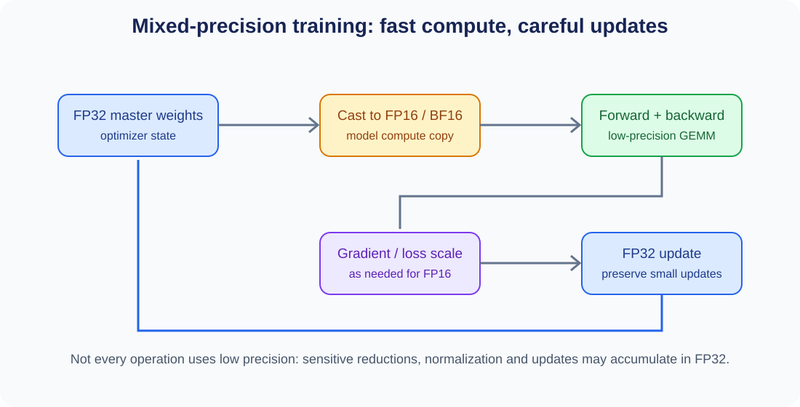

# 混合精度

**所属分类：** [07 数值精度优化](README.md)  
**英文名称：** Mixed Precision Computing  
**专题编号：** 03

## 01. 一句话定义与核心目的

**一句话定义：** 混合精度是在同一计算流程中使用不同数值精度完成存储、乘法、累加和关键更新，以兼顾计算速度、内存占用与数值可靠性。

**核心目的：** 将适合低精度执行的高吞吐计算交给 FP16、BF16 或 FP8 等格式，同时在累加、归一化或优化器更新等敏感环节保留较高精度，降低训练和推理的资源成本。

## 02. 数学原理与核心技术

### 2.1 可视化理解

*图：低精度权重或激活用于高吞吐矩阵乘法，累加器和部分关键状态保留较高精度；实际策略由硬件指令、框架和算法决定。*

### 2.2 数学原理与核心技术

矩阵乘法可采用低精度输入、高精度累加的形式：

$$
C_{ij}=\sum_k \operatorname{accum}_{32}
\left(A_{ik}^{(low)}B_{kj}^{(low)}\right).
$$

其中输入矩阵以低精度表示，乘积累加在更高精度的累加器中完成。具体累加精度取决于指令与硬件路径，不能仅根据输入 dtype 推断。

**核心技术：**
- **FP16 / BF16：** 常见 16-bit 浮点输入格式；BF16 动态范围较大，FP16 有更多尾数位。
- **FP8：** 用于进一步压缩存储和提高矩阵计算吞吐，通常需要缩放因子和格式选择。
- **FP32 Accumulation：** 在支持的路径中使用 FP32 累加，降低长归约的舍入风险。
- **Loss Scaling：** 训练 FP16 时放大 Loss/梯度，减少小梯度下溢，再在更新前缩放回来。
- **Master Weights：** 某些训练策略保留 FP32 主权重，低精度副本用于前向和反向计算。
- **Autocast：** 框架按算子类型自动选择适合的计算精度。
- **Precision Policy：** 对不同算子明确规定输入、累加和输出精度。

混合精度不是所有操作都使用同一种低精度。Softmax、归一化、长序列累加和优化器状态等环节可能需要更谨慎的精度策略。是否采用某种格式，应通过任务指标和数值验证决定。

## 03. 代表案例

| 项目 | 与本专题的关系 | 值得关注的内容 | 项目与资料 |
|---|---|---|---|
| NVIDIA Transformer Engine | **直接案例：** 提供 Transformer 训练中的 FP8 与混合精度工具 | FP8 recipe、scaling、amax history | [GitHub](https://github.com/NVIDIA/TransformerEngine) · [文档](https://docs.nvidia.com/deeplearning/transformer-engine/) |
| PyTorch AMP | **直接案例：** 通过 autocast 与 GradScaler 实现自动混合精度训练 | autocast、GradScaler、dtype policy | [GitHub](https://github.com/pytorch/pytorch) · [AMP 文档](https://docs.pytorch.org/docs/stable/amp.html) |
| Megatron-LM | **直接案例：** 大模型训练中的 FP16、BF16、FP8 等精度策略 | precision flags、loss scaling、Transformer Engine integration | [GitHub](https://github.com/NVIDIA/Megatron-LM) |
| DeepSpeed | **直接案例：** 分布式训练中的混合精度和优化器状态管理 | FP16/BF16 training、loss scaling | [GitHub](https://github.com/deepspeedai/DeepSpeed) |
