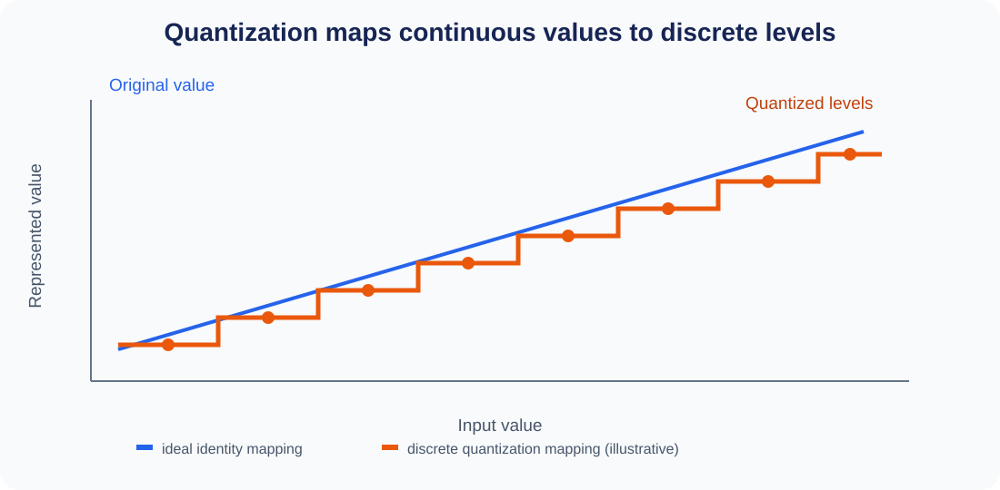

# 量化

**所属分类：** [07 数值精度优化](README.md)  
**英文名称：** Quantization  
**专题编号：** 04

## 01. 一句话定义与核心目的

**一句话定义：** 量化是将高精度数值映射到较低位宽的离散数值集合，并通过缩放、零点或其他映射规则表示原始数据。

**核心目的：** 减少模型权重和激活的存储量、降低内存带宽需求，并在硬件支持时加速矩阵运算和模型推理。量化会引入表示误差，因此需要设计校准、缩放、舍入和误差控制策略。

## 02. 数学原理与核心技术

### 2.1 可视化理解

*图：连续输入值通过量化映射落到有限离散等级。橙色阶梯为示意量化映射，实际量化还需要指定 scale、zero point、取值范围和舍入规则。*

### 2.2 数学原理与核心技术

一种常见的 affine quantization 将实数 $x$ 映射为整数 $q$：

$$
q=\operatorname{clip}
\left(
\operatorname{round}\left(\frac{x}{s}\right)+z,
q_{\min},q_{\max}
\right)
$$

反量化近似为：

$$
\hat{x}=s(q-z)
$$

其中：
- $s$ 是 scale（缩放因子）。
- $z$ 是 zero point（零点）。
- $q_{\min},q_{\max}$ 是整数表示范围。
- $\hat{x}$ 是反量化后的近似值。

**核心技术：**

- **Symmetric / Asymmetric Quantization：** 对称量化通常以零为中心；非对称量化通过 zero point 支持非对称取值范围。
- **Per-Tensor / Per-Channel / Group-wise：** 分别按张量、通道或分组确定缩放参数，粒度越细通常越能适应分布差异，但元数据和实现复杂度也更高。
- **PTQ（Post-Training Quantization）：** 训练完成后量化，常通过校准数据估计范围或参数。
- **QAT（Quantization-Aware Training）：** 训练时模拟量化误差，让模型适应低位宽表示。
- **Weight-only Quantization：** 主要压缩权重，激活仍使用较高精度。
- **Activation Quantization：** 同时量化中间激活，需要处理随输入变化的分布。
- **GPTQ / AWQ：** 面向大语言模型权重量化的代表性方法，利用权重结构或激活统计降低量化误差。

量化位宽降低不保证端到端速度同比提升。若硬件没有对应低位宽指令，或反量化和数据搬运成为瓶颈，收益可能有限。量化误差还可能在深层网络中传播，需用任务指标验证。

## 03. 代表案例

| 项目 | 与本专题的关系 | 值得关注的内容 | 项目与资料 |
|---|---|---|---|
| bitsandbytes | **直接案例：** 提供 8-bit 与 4-bit 量化相关组件，常用于大模型加载和微调 | LLM.int8、NF4、量化线性层 | [GitHub](https://github.com/bitsandbytes-foundation/bitsandbytes) · [文档](https://huggingface.co/docs/bitsandbytes/) |
| GPTQ | **直接案例：** 基于近似二阶信息的权重量化方法 | 逐层权重量化、误差补偿 | [论文](https://arxiv.org/abs/2210.17323) · [参考实现](https://github.com/IST-DASLab/gptq) |
| AWQ | **直接案例：** 利用激活统计保护重要权重通道的低位宽量化方法 | Activation-aware scaling、低比特权重量化 | [论文](https://arxiv.org/abs/2306.00978) · [GitHub](https://github.com/mit-han-lab/llm-awq) |
| NVIDIA TensorRT Model Optimizer | **直接案例：** 提供模型量化与压缩工作流 | PTQ、QAT、校准、低精度部署 | [GitHub](https://github.com/NVIDIA/TensorRT-Model-Optimizer) · [文档](https://nvidia.github.io/TensorRT-Model-Optimizer/) |
| PyTorch AO | **直接案例：** PyTorch 量化与低精度模型优化工具 | Observer、QConfig、量化工作流 | [GitHub](https://github.com/pytorch/ao) · [文档](https://docs.pytorch.org/ao/stable/) |
