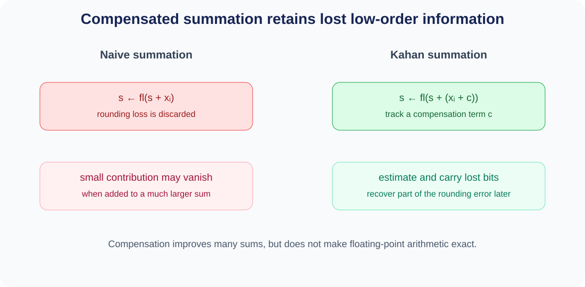

# 误差补偿

**所属分类：** [07 数值精度优化](README.md)  
**英文名称：** Error Compensation  
**专题编号：** 05

## 01. 一句话定义与核心目的

**一句话定义：** 误差补偿是通过额外状态、残差反馈或修正项，记录并抵消低精度近似或有限精度运算中未被当前步骤保留的部分误差。

**核心目的：** 在保持较低存储或通信精度的同时，减少误差在多步计算中的累积，使低精度方案更接近高精度参考结果。补偿方法需要明确误差来源和反馈路径，不能把所有数值偏差都视为可完全消除。

## 02. 数学原理与核心技术

### 2.1 可视化理解

*图：低精度表示产生当前可表示值，未能表示的残差被保存并反馈到后续步骤，使后续量化或累加有机会保留先前丢失的信息。*

### 2.2 数学原理与核心技术

以误差反馈量化为例，当前输入为 $x_t$，保存的误差残差为 $r_t$，量化函数为 $Q(\cdot)$：

$$
q_t=Q(x_t+r_t),
$$

$$
r_{t+1}=x_t+r_t-D(q_t),
$$

其中 $D(q_t)$ 表示将量化结果映射回原数值尺度。补偿残差会把当前步骤无法表示的部分带到后续步骤。

**核心技术与代表思想：**
- **Kahan Compensated Summation：** 额外保存低位补偿量，改善浮点求和中的消去和累积误差。
- **Error Feedback：** 在低精度量化或压缩通信中保留残差，并在后续迭代反馈。
- **Residual Accumulation：** 将本轮未表示的误差累积到后续更新。
- **Iterative Refinement：** 先用较低精度求近似解，再用残差修正解；适用条件依问题和精度路径而定。
- **Compensated Dot Product：** 对乘加或归约过程设计额外补偿，以改善数值精度。

补偿并不意味着误差必然单调下降。残差本身也会受到舍入、溢出和动态范围限制；某些算法还要求误差反馈与优化更新保持特定关系。

## 03. 代表案例

| 项目 | 与本专题的关系 | 值得关注的内容 | 项目与资料 |
|---|---|---|---|
| Kahan Summation | **经典算法：** 用补偿变量保留求和中丢失的低位信息 | compensated summation、roundoff error | [算法介绍](https://en.wikipedia.org/wiki/Kahan_summation_algorithm) |
| Deep Gradient Compression | **经典研究案例：** 使用误差反馈缓解梯度压缩造成的信息损失 | residual accumulation、gradient sparsification | [论文](https://arxiv.org/abs/1712.01887) |
| 1-bit SGD | **经典研究案例：** 通过误差补偿支持低比特梯度通信 | error compensation、compressed communication | [论文](https://arxiv.org/abs/1610.02132) |
| NVIDIA cuSOLVER | **关联案例：** 提供混合精度线性求解和迭代改进相关能力 | iterative refinement、mixed-precision solver | [官方文档](https://docs.nvidia.com/cuda/cusolver/) |
