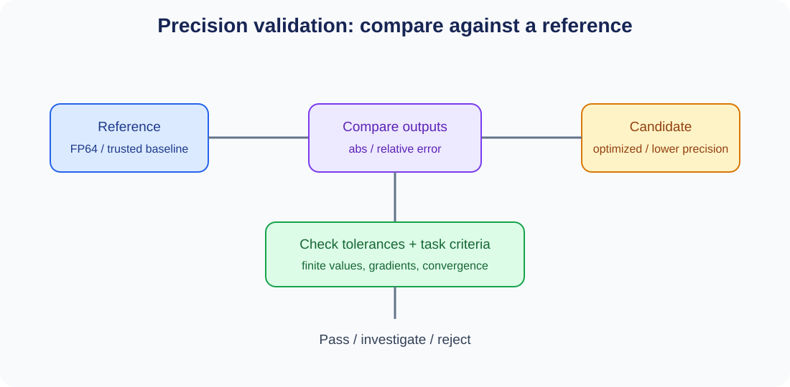

# 精度验证

**所属分类：** [07 数值精度优化](README.md)  
**英文名称：** Precision Validation  
**专题编号：** 07

## 01. 一句话定义与核心目的

**一句话定义：** 精度验证是通过参考结果、误差指标、数值性质和任务级指标，判断某种数据格式、算法变换或硬件实现是否满足正确性与精度要求的过程。

**核心目的：** 确保性能优化没有引入不可接受的数值偏差。对于低精度计算、量化、算子融合和跨硬件适配，不能只看程序是否运行成功，还需要检查输出、梯度、误差分布以及最终任务质量。

## 02. 数学原理与核心技术

### 2.1 可视化理解

*图：将待验证实现与可信参考结果比较，先检查数值误差，再结合容差、梯度和任务指标作出通过、调查或拒绝的判断。*

### 2.2 数学原理与核心技术

给定参考结果 $y$ 和候选实现输出 $\hat y$，常用逐元素误差为：

**绝对误差：**

$$
e_{\mathrm{abs}}=|\hat y-y|
$$

**相对误差：**

$$
e_{\mathrm{rel}}=
\frac{|\hat y-y|}{\max(|y|,\varepsilon)}
$$

其中 $\varepsilon$ 用于避免参考值接近零时相对误差失去意义。张量比较通常结合绝对容差与相对容差：

$$
|\hat y-y|\le
\mathrm{atol}+\mathrm{rtol}|y|
$$

**核心技术：**

- **Reference Baseline：** 使用更高精度实现、可信库函数、解析解或经过验证的基准作为参考。
- **Absolute / Relative Error：** 同时观察绝对和相对误差，避免只用单一指标。
- **Norm-based Error：** 对整个向量或矩阵计算 $L_1$、$L_2$、Frobenius 或最大范数误差。
- **ULP Comparison：** 比较浮点结果相差多少个可表示数间隔，适合分析底层数值差异。
- **Gradient Check：** 用有限差分近似导数，与自动微分结果比较；有限差分步长本身也会带来截断与舍入误差。
- **Property-based Testing：** 检查守恒关系、对称性、正定性、边界条件或其他数学性质。
- **Task-level Validation：** 对训练和推理检查损失、收敛、准确率、困惑度等最终任务指标。
- **Cross-device Validation：** 在不同设备、编译器和精度模式下比较输出，并记录软硬件环境。

验证时应覆盖代表性输入和边界输入，包括零值、极大/极小值、接近相消的输入、非连续布局、不同形状和不同批量。还要区分单次算子误差与长时间迭代、训练收敛或端到端任务误差。

## 03. 代表案例

| 项目 | 与本专题的关系 | 值得关注的内容 | 项目与资料 |
|---|---|---|---|
| PyTorch Testing | **直接案例：** 提供张量比较、容差控制和梯度数值检查 | `torch.testing.assert_close`、`torch.autograd.gradcheck` | [GitHub](https://github.com/pytorch/pytorch) · [assert_close](https://docs.pytorch.org/docs/stable/testing.html#torch.testing.assert_close) · [gradcheck](https://docs.pytorch.org/docs/stable/autograd.html#torch.autograd.gradcheck) |
| NVIDIA Transformer Engine | **直接案例：** 混合精度和 FP8 训练中关注数值行为与模型质量 | 精度 recipe、scaling、训练稳定性测试 | [GitHub](https://github.com/NVIDIA/TransformerEngine) · [文档](https://docs.nvidia.com/deeplearning/transformer-engine/) |
| NVIDIA CUTLASS | **直接案例：** GPU GEMM Kernel 可通过参考实现和误差阈值验证数值正确性 | GEMM test、不同输入/累积精度、容差检查 | [GitHub](https://github.com/NVIDIA/cutlass) |
| MLPerf | **关联案例：** 以规定的质量阈值和任务规则验证训练/推理系统结果 | Accuracy target、模型质量与性能结果的联合评估 | [GitHub](https://github.com/mlcommons) · [MLPerf](https://mlcommons.org/benchmarks/) |

精度验证不能只报告一个最大误差数字。应同时说明参考实现、数据类型、输入分布、误差度量、容差依据和任务级结果。
