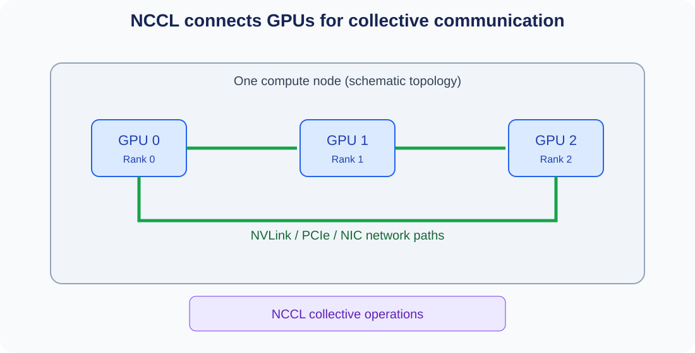

# NCCL

**所属分类：** [08 系统与分布式优化](README.md)  
**英文名称：** NVIDIA Collective Communications Library  
**专题编号：** 02

## 01. 一句话定义与核心目的

**一句话定义：** NCCL 是 NVIDIA 面向多 GPU 和多节点环境的通信库，提供 AllReduce、Broadcast、AllGather、ReduceScatter 等集合通信操作。

**核心目的：** 高效地在多个 GPU 之间搬运和归约数据，是分布式深度学习中梯度同步、张量并行和参数分片通信的基础设施。NCCL 不负责决定模型如何切分，而是执行上层并行策略所需的通信。

## 02. 数学原理与核心技术

### 2.1 可视化理解

*图：多个 GPU Rank 通过 NVLink、PCIe 或网络互联，NCCL 在拓扑基础上执行集合通信。图为概念拓扑，不代表固定连接结构。*

### 2.2 数学原理与核心技术

### 2.1 可视化理解

### 2.2 数学原理与核心技术

NCCL 提供的集合通信以多个 Rank 参与为基础。每个 Rank 通常对应一个 GPU 进程或设备上下文。

常见操作包括：

- **Broadcast：** 一个 Rank 的数据发送给所有 Rank。
- **Reduce：** 将各 Rank 的数据按指定操作归约到一个目标 Rank。
- **AllReduce：** 各 Rank 的数据归约后，每个 Rank 都获得相同结果。
- **AllGather：** 收集各 Rank 的数据并拼接，使所有 Rank 获得完整结果。
- **ReduceScatter：** 先对各 Rank 数据归约，再将结果分片分发到不同 Rank。
- **Send / Recv：** 点对点数据传输。

通信性能常用简化模型分析：

$$
T_{comm}\approx \alpha n_{msg}+\beta V,
$$

其中 $\alpha$ 表示每次消息启动的延迟成本，$n_{msg}$ 为消息阶段数，$\beta$ 表示单位数据传输成本，$V$ 为传输数据量。真实时间还受到拓扑、链路带宽、协议、拥塞和算法选择影响。

**核心技术：**
- **Rank：** 集合通信中的参与者编号。
- **Communicator：** 定义参与通信的 Rank 集合及通信上下文。
- **Topology Awareness：** 感知 GPU、NVLink、PCIe、NIC 和节点拓扑。
- **Ring / Tree Algorithms：** 根据数据规模和拓扑选择不同集合通信算法。
- **NCCL Streams：** 通信操作与 CUDA Stream 关联，便于与计算安排依赖和重叠。
- **Multi-node Transport：** 在多节点场景下结合网络接口和支持的传输技术进行通信。

NCCL 是 NVIDIA 生态组件，不能直接等同于跨厂商通用通信标准。其他硬件平台有各自的通信库和运行时。

## 03. 代表案例

| 项目 | 与本专题的关系 | 值得关注的内容 | 项目与资料 |
|---|---|---|---|
| NCCL | **核心项目：** NVIDIA 多 GPU 集合通信实现 | communicator、collectives、topology、algorithms | [GitHub](https://github.com/NVIDIA/nccl) · [文档](https://docs.nvidia.com/deeplearning/nccl/user-guide/docs/) |
| PyTorch Distributed | **直接案例：** 通过 ProcessGroup NCCL 在分布式训练中调用集合通信 | ProcessGroupNCCL、backend、collectives | [GitHub](https://github.com/pytorch/pytorch) · [文档](https://docs.pytorch.org/docs/stable/distributed.html) |
| Megatron-LM | **关联案例：** 张量并行、流水线并行等使用集合通信完成跨 GPU 数据交换 | TP collectives、pipeline communication | [GitHub](https://github.com/NVIDIA/Megatron-LM) |
| RCCL | **跨硬件关联案例：** AMD ROCm 生态中的 GPU 集合通信库 | RCCL collectives、ROCm communication | [GitHub](https://github.com/ROCm/rccl) |
