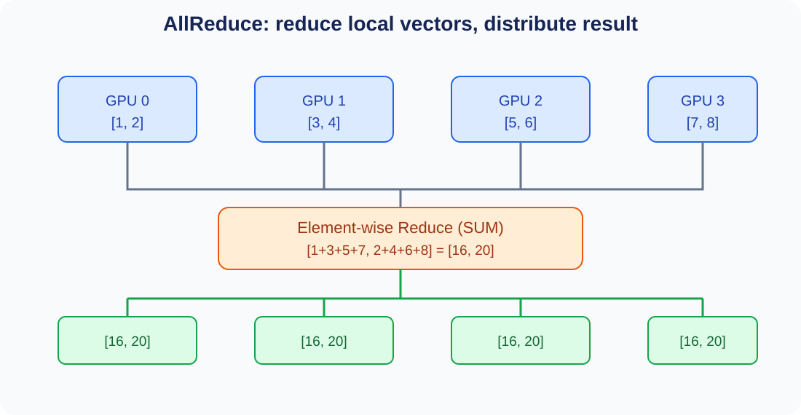

# AllReduce

**所属分类：** [08 系统与分布式优化](README.md)  
**英文名称：** AllReduce  
**专题编号：** 03

## 01. 一句话定义与核心目的

**一句话定义：** AllReduce 是一种集合通信操作：先对所有设备上的对应数据执行归约，再把归约结果分发给所有参与设备。

**核心目的：** 在数据并行训练中汇总各 GPU 的局部梯度，并让所有模型副本获得一致的全局梯度；它也用于分布式统计、归一化和其他需要跨设备归约的计算。

## 02. 数学原理与核心技术

### 2.1 可视化理解

*图：各 GPU 持有本地向量，先按元素求和，再将完整求和结果提供给所有 GPU。实际实现可能采用 Ring、Tree 或分层算法。*

### 2.2 数学原理与核心技术

假设 $p$ 个 GPU 分别持有长度为 $N$ 的向量 $x^{(r)}$。Sum AllReduce 的结果为：

$$
y=\sum_{r=0}^{p-1}x^{(r)}.
$$

执行完成后，每个 Rank 都得到相同的 $y$。若训练需要平均梯度，则再除以参与设备数，或在局部损失定义中采用相应归一化。

**Ring AllReduce 的基本思想：**
1. 将长度为 $N$ 的向量切成 $p$ 个 Chunk。
2. **Reduce-Scatter 阶段：** 各 Rank 沿环传递 Chunk，并对收到的对应数据执行归约；最终每个 Rank 持有一个归约后的 Chunk。
3. **AllGather 阶段：** 再沿环传播已归约 Chunk，使每个 Rank 获得完整结果。

在理想化的 Ring 模型中，每个 Rank 发送和接收的数据量约为：

$$
V_{rank}\approx 2\frac{p-1}{p}N\,b,
$$

其中 $b$ 是每个元素的字节数。该式描述数据量，不包含启动延迟、协议和链路争用。

**核心技术：**
- **Reduce-Scatter：** 归约并分片输出。
- **AllGather：** 收集各 Rank 的结果分片。
- **Ring AllReduce：** 将 AllReduce 拆为 Ring Reduce-Scatter 与 Ring AllGather。
- **Tree AllReduce：** 通过树形归约和广播减少通信阶段深度。
- **Hierarchical AllReduce：** 先在节点内归约，再跨节点通信，最后节点内分发。
- **Bandwidth / Latency Trade-off：** 小消息更受启动延迟影响，大消息更受链路带宽影响。

AllReduce 的效率取决于数据量、GPU 数量、互联拓扑、通信算法和同步方式。设备数增加并不保证训练更快，通信可能抵消并行计算收益。

## 03. 代表案例

| 项目 | 与本专题的关系 | 值得关注的内容 | 项目与资料 |
|---|---|---|---|
| NCCL | **直接实现：** 提供 GPU AllReduce 及多种集合通信算法 | ncclAllReduce、algorithm/protocol selection | [GitHub](https://github.com/NVIDIA/nccl) · [文档](https://docs.nvidia.com/deeplearning/nccl/user-guide/docs/usage/collectives.html) |
| MPI | **基础案例：** 提供通用分布式 Allreduce 接口 | MPI_Allreduce、communicator、reduction operator | [MPI 标准](https://www.mpi-forum.org/docs/) |
| PyTorch Distributed | **直接案例：** 训练中通过 dist.all_reduce 等接口汇总张量 | all_reduce、ReduceOp、ProcessGroup | [文档](https://docs.pytorch.org/docs/stable/distributed.html) |
| Horovod | **直接案例：** 将 AllReduce 用于分布式优化器梯度同步 | DistributedOptimizer、AllReduce | [GitHub](https://github.com/horovod/horovod) |
