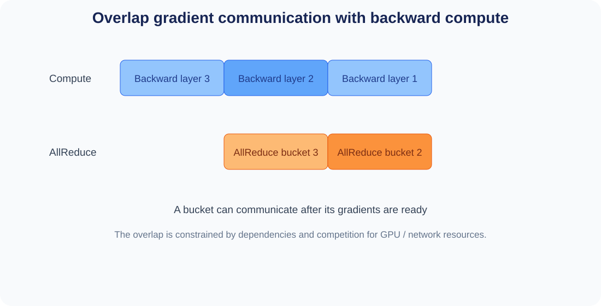

# 通信与计算重叠

**所属分类：** [08 系统与分布式优化](README.md)  
**英文名称：** Communication–Compute Overlap  
**专题编号：** 04

## 01. 一句话定义与核心目的

**一句话定义：** 通信与计算重叠是在满足数据依赖的前提下，让 GPU 计算和设备间通信在时间上并行推进。

**核心目的：** 隐藏部分通信等待时间，减少分布式训练和模型并行中的设备空闲，提高端到端吞吐。本专题从系统角度关注通信库、运行时 Stream、梯度就绪时机和硬件互联如何共同实现重叠。

## 02. 数学原理与核心技术

### 2.1 可视化理解

*图：梯度 Bucket 就绪后启动 AllReduce，同时反向计算继续处理其他层；真实重叠受依赖和资源竞争约束。*

### 2.2 数学原理与核心技术

### 2.1 可视化理解

### 2.2 数学原理与核心技术

若计算耗时为 $T_{comp}$，通信耗时为 $T_{comm}$，完全串行时：

$$
T_{serial}=T_{comp}+T_{comm}.
$$

若通信与计算完全独立且能够充分重叠，理想下界为：

$$
T_{overlap}\geq\max(T_{comp},T_{comm}).
$$

实际执行还包括依赖等待、调度、同步与资源竞争。若通信与计算共享链路、内存带宽或 SM 资源，重叠可能影响双方速度。

**核心技术：**
- **Non-blocking Communication：** 提交通信后允许 CPU 或 GPU 安排其他独立工作。
- **CUDA Streams / Events：** 组织不同工作队列，并用事件表达跨 Stream 依赖。
- **Gradient Bucketing：** 梯度按 Bucket 聚合，某个 Bucket 就绪后即可开始通信。
- **NCCL Collectives：** 通过 AllReduce、AllGather、ReduceScatter 执行数据交换。
- **Double Buffering：** 在一块缓冲区处理数据时，另一块缓冲区传输下一批数据。
- **Dependency Management：** 确保通信读取的数据已准备好，通信结果在消费者使用前已完成。

异步 API 只表示提交方式不必阻塞主机，不等于设备上必然发生有效重叠。需要通过时间线 Profiler 检查通信与 Kernel 是否真正并行，以及是否因资源竞争导致总时间反而增加。

## 03. 代表案例

| 项目 | 与本专题的关系 | 值得关注的内容 | 项目与资料 |
|---|---|---|---|
| PyTorch DistributedDataParallel | **直接案例：** 在反向计算过程中逐 Bucket 启动梯度同步 | Reducer、bucket readiness、communication hooks | [GitHub](https://github.com/pytorch/pytorch) · [DDP 文档](https://docs.pytorch.org/docs/stable/generated/torch.nn.parallel.DistributedDataParallel.html) |
| NCCL | **基础组件：** 提供可关联 CUDA Stream 的 GPU 集合通信 | collectives、stream semantics | [GitHub](https://github.com/NVIDIA/nccl) |
| Megatron-LM | **直接案例：** 在 TP/PP 训练中安排通信和计算执行顺序 | overlap、pipeline schedule、communication groups | [GitHub](https://github.com/NVIDIA/Megatron-LM) |
| DeepSpeed | **直接案例：** 分布式训练中的通信调度与参数分片 | overlap communication、ZeRO communication | [GitHub](https://github.com/deepspeedai/DeepSpeed) |
