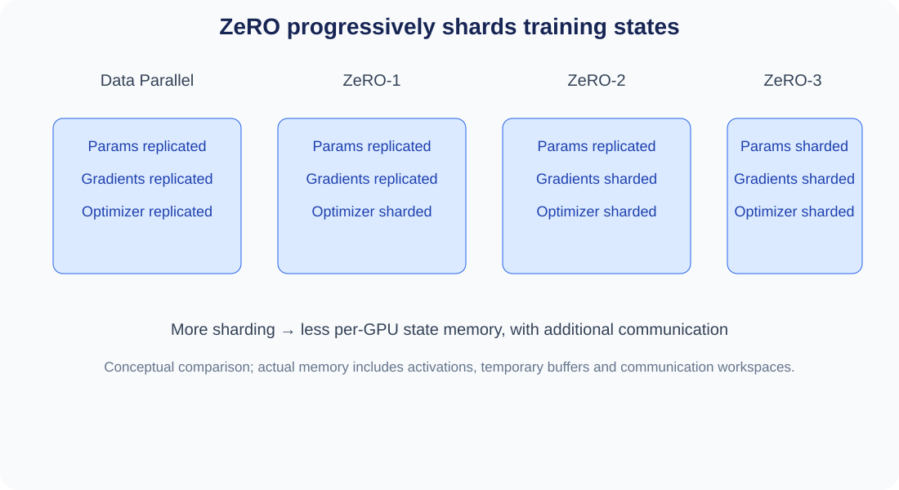

# DeepSpeed ZeRO

**所属分类：** [08 系统与分布式优化](README.md)  
**英文名称：** Zero Redundancy Optimizer  
**专题编号：** 05

## 01. 一句话定义与核心目的

**一句话定义：** ZeRO（Zero Redundancy Optimizer）是通过在数据并行设备之间分片模型训练状态，减少每张 GPU 重复保存参数、梯度和优化器状态所造成的显存冗余。

**核心目的：** 在保持数据并行训练范式的基础上，让模型训练能够容纳更大的参数规模或更大的 Batch。ZeRO 将原本在每张 GPU 上复制的状态分布到多个设备，并在计算需要时通过通信获取相应数据。

## 02. 数学原理与核心技术

### 2.1 可视化理解

*图：传统数据并行在每张 GPU 上复制完整模型状态；ZeRO 按阶段逐步分片优化器状态、梯度和参数，降低单卡冗余存储。*

### 2.2 数学原理与核心技术

传统数据并行中，每张 GPU 通常都保存模型参数、梯度和优化器状态。以 Adam 为例，训练状态至少涉及：
- 参数 $\theta$；
- 梯度 $g$；
- 一阶动量 $m$；
- 二阶动量 $v$。

若参数量为 $P$，各状态使用字节数分别为 $b_\theta,b_g,b_m,b_v$，单卡训练状态内存近似为：

$$
M_{DP}\approx P(b_\theta+b_g+b_m+b_v).
$$

忽略激活、临时缓冲区和通信缓存时，ZeRO 的分片思想可概括为：

| 阶段 | 分片内容 | 主要减少的冗余 |
|---|---|---|
| ZeRO-1 | Optimizer States | 优化器状态 |
| ZeRO-2 | Optimizer States + Gradients | 优化器状态与梯度 |
| ZeRO-3 | Optimizer States + Gradients + Parameters | 进一步分片模型参数 |

在理想均匀分片情况下，相关状态的单卡持有量可随数据并行设备数 $p$ 近似缩小到原来的 $1/p$；但 ZeRO-3 还需在前向/反向过程中按需 Gather 参数，并在适当时机释放或重新分片。

**核心技术：**
- **Optimizer State Partitioning：** 将动量、方差等优化器状态分散到各 Rank。
- **Gradient Partitioning：** 通过 ReduceScatter 等方式保存本 Rank 负责的梯度分片。
- **Parameter Partitioning：** 将参数分片保存，计算时按需 AllGather。
- **Communication Scheduling：** 通过预取、分桶和释放时机管理通信与计算。
- **CPU / NVMe Offload：** 在支持的配置中把部分状态卸载到 CPU 或 NVMe，以容量换取额外传输成本。
- **Memory–Communication Trade-off：** 分片减少显存冗余，但会增加通信、调度和参数重建成本。

ZeRO 不等于免费获得 $p$ 倍训练加速。它首先解决训练状态显存冗余问题；实际吞吐取决于模型、Batch、互联、通信重叠和 Offload 配置。

## 03. 代表案例

| 项目 | 与本专题的关系 | 值得关注的内容 | 项目与资料 |
|---|---|---|---|
| DeepSpeed | **核心项目：** ZeRO 的主要开源实现 | ZeRO stages、partition、offload、communication | [GitHub](https://github.com/deepspeedai/DeepSpeed) · [ZeRO 文档](https://www.deepspeed.ai/tutorials/zero/) |
| ZeRO 论文 | **经典研究：** 系统提出训练状态分片以消除数据并行冗余 | ZeRO-1/2/3、memory analysis | [论文](https://arxiv.org/abs/1910.02054) |
| PyTorch Distributed | **关联案例：** 提供 FullyShardedDataParallel 等分片训练能力 | FSDP、sharding strategy、all-gather/reduce-scatter | [文档](https://docs.pytorch.org/docs/stable/distributed.fsdp.html) |
| Megatron-DeepSpeed | **关联案例：** 将 ZeRO 与 Transformer 并行训练组合 | hybrid parallelism、optimizer state sharding | [Megatron-LM](https://github.com/NVIDIA/Megatron-LM) |
